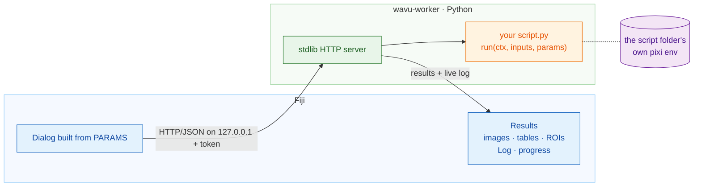

# Wavu

*Wavu* is Fijian for "bridge". It is a bridge from [Fiji](https://fiji.sc) to
Python. You write a short Python script, Fiji shows a dialog for its
parameters, and the script runs in **its own isolated [pixi](https://pixi.sh)
environment**. Logs and progress stream back into Fiji, and the results open
as images, tables or ROIs.



**For** entry-level Python users who want to call Cellpose, scikit-image or
their own code from Fiji. **Small, interactive data only** (one image that
fits in RAM, roughly up to 1-2 GB).

<details>
<summary>More about the scope</summary>

Each script keeps its own dependencies, so a PyTorch script and a
NumPy-2-only script never fight. Images travel as base64 JSON when small, or
as a temporary TIFF otherwise.

**Wavu is not the tool for large data.** For big volumes, many files or
anything that does not fit in memory, convert to OME-Zarr and use a chunked
batch or HPC workflow.

The environments isolate *dependencies*. They are **not a security sandbox**.
A script can do anything your user account can do, so run only scripts you
trust.

</details>

## Install

1. Download `wavu-fiji-<version>.zip` from the
   [latest release](https://github.com/Oxford-Zeiss-Centre-of-Excellence/Wavu/releases/latest).
2. Unzip it **into your Fiji folder** (`Fiji.app`) and restart Fiji.
3. Run **Plugins › Wavu › Setup Python (pixi)** once.

You need nothing else: no Python, no conda, no compiler and no Java build. A
Fiji update site is coming soon.

<details>
<summary>What does "Setup Python (pixi)" do?</summary>

It downloads the official single-file `pixi` for your system from
[prefix-dev/pixi releases](https://github.com/prefix-dev/pixi/releases),
checks its sha256 against the release checksum file, and installs it into
`Fiji.app/wavu/`. If that folder is read-only, it uses `~/.wavu/bin` instead.
Skip this step if `pixi` is already on your PATH.

</details>

## Quick start

1. Get a script folder: download the [template](templates/wavu-script), or,
   in a clone of this repo, run `pixi run new-script my_analysis`.
2. In Fiji, open an image, choose **Plugins › Wavu › Run Python Script** and
   pick the folder.
3. The first run builds the environment (a few minutes, once). Fill in the
   dialog and press OK. Press **Esc** to cancel.

A script is a plain Python file:

```python
PARAMS = {
    "image": {"type": "image"},
    "sigma": {"type": "float", "default": 2.0, "label": "Sigma (pixels)"},
}

def run(ctx, inputs, params):
    from scipy import ndimage
    ctx.log("blurring...")
    return {"blurred": ndimage.gaussian_filter(inputs["image"], params["sigma"])}
```

## Documentation

| I want to… | Read |
|---|---|
| write a script | [Script contract](docs/script-contract.md) |
| go from an idea to a released Fiji menu item | [Cellpose plugin tutorial](docs/tutorial-cellpose-plugin.md) |
| run a worker by hand, in Docker, offline, or debug in VS Code | [Running and debugging](docs/running-and-debugging.md) |
| share my script with other Fiji users | [Sharing](docs/sharing.md) |
| understand the HTTP API | [Protocol](docs/protocol.md) |
| know why it is built this way | [Decisions](docs/decisions.md) |
| run the tests or make a release | [Development](docs/development.md), [CONTRIBUTING](CONTRIBUTING.md) |

**Examples:** [`templates/wavu-script`](templates/wavu-script) (Gaussian
blur, the boilerplate for new scripts) and
[`examples/cellpose_nuclei`](examples/cellpose_nuclei) (Cellpose nuclei
segmentation returning labels and an ImageJ RoiSet, CPU/MPS or CUDA). Using
napari? See
[Napari-Pixi](https://github.com/Oxford-Zeiss-Centre-of-Excellence/Napari-Pixi).

<details>
<summary>Limitations</summary>

- Data must be small. The client sends one image per `image` parameter, plus
  plain values.
- Cancelling is cooperative. A script must check `ctx.cancelled()`, because a
  running Python call cannot be interrupted safely from outside.
- The first run of a script folder downloads its environment. For heavy
  frameworks like PyTorch that can be 1-2 GB.
- Fiji integration is through ImageJ 1.x `ImagePlus`, one image per input.
  Label images come back as 16-bit, or 32-bit float when there are more than
  65535 labels.
- Wavu is new. Expect rough edges and
  [report them](https://github.com/Oxford-Zeiss-Centre-of-Excellence/Wavu/issues).

</details>

## Licence and citation

GPL-3.0-or-later. See [LICENSE](LICENSE). If Wavu helps your research, please
cite it using [CITATION.cff](CITATION.cff). The test image is from BBBC039
(CC0); see [docs/test-data.md](docs/test-data.md).
