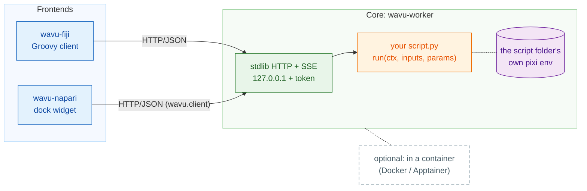

# Wavu

**📖 Step-by-step guide: <https://oxford-zeiss-centre-of-excellence.github.io/Wavu/>**
(short pages, in English, Français, Deutsch, Español, Русский, 日本語, 한국어, 繁體中文 and 简体中文)

*Wavu* is Fijian for "bridge". It is a bridge from your image viewer,
[Fiji](https://fiji.sc) or [napari](https://napari.org), to Python. You
write a short Python script, the viewer shows a dialog for its parameters,
and the script runs in **its own isolated [pixi](https://pixi.sh)
environment**. Logs and progress stream back, and the results open as
images, tables or ROIs. The same script folder works in both viewers.

**Not just a bridge:** your own Groovy script, ImageJ macro or Python notebook
can call a Wavu script as one step of a scripted, end-to-end analysis (loop
over a folder, native preprocessing and measurement, the heavy AI step in its
own environment). A guide section on pipelines, batch processing and large data
is coming soon.



**For** entry-level Python users who want to call Cellpose, scikit-image or
their own code from Fiji or napari. **Small, interactive data only** (one
image that fits in RAM, roughly up to 1-2 GB).

<details>
<summary>More about the scope</summary>

Each script keeps its own dependencies, so a PyTorch script and a
NumPy-2-only script never fight, and neither touches the viewer's own
environment. Images travel as base64 JSON when small, or as a temporary TIFF
otherwise.

**Wavu is made for data that fits in memory** (roughly 1–2 GB per image).
Up to about 50 GB on a local computer, a script can stream an OME-Zarr store
in chunks; it works, but is not recommended inside Fiji or napari. Beyond
that, use a chunked batch or HPC workflow.

The environments isolate *dependencies*. They are **not a security sandbox**.
A script can do anything your user account can do, so run only scripts you
trust.

</details>

## What is in this repository

| Folder | What it is |
|---|---|
| [`src/wavu`](src/wavu) | **The core.** `wavu-worker` (stdlib HTTP + server-sent events), the script contract, `wavu.client` (Python client), `wavu.testing`, the `wavu` CLI (`new-script`, `run`, `package`). |
| [`fiji/`](fiji) | **wavu-fiji.** The Fiji client: Groovy scripts under **Plugins › Wavu**, no jar. |
| [`napari/`](napari) | **wavu-napari.** The napari plugin: **Plugins › Run Python Script (Wavu)**. |
| [`templates/wavu-script`](templates/wavu-script) | The script-folder boilerplate (also at [Wavu-Script-Template](https://github.com/Oxford-Zeiss-Centre-of-Excellence/Wavu-Script-Template)), with tests, VS Code debugging, a release workflow and a Dockerfile. |
| [`examples/`](examples) | Cellpose nuclei segmentation (labels + ImageJ RoiSet, CPU/MPS or CUDA). |
| [`agent/`](agent) | The Wavu skill for AI coding agents (Claude Code plugin, `AGENTS.md`). |
| [`guide/`](guide) | The step-by-step website (MkDocs, nine languages). |

## Install

**Fiji (wavu-fiji)**

1. Download `wavu-fiji-<version>.zip` from the
   [latest release](https://github.com/Oxford-Zeiss-Centre-of-Excellence/Wavu/releases/latest).
2. Unzip it **into your Fiji folder** (`Fiji.app`) and restart Fiji.
3. Run **Plugins › Wavu › Setup Python (pixi)** once.

You need nothing else: no Python, no conda, no compiler and no Java build. A
Fiji update site is coming soon.

**napari (wavu-napari)**

```bash
git clone https://github.com/Oxford-Zeiss-Centre-of-Excellence/Wavu.git
cd Wavu
pixi run -e napari napari      # then Plugins › Run Python Script (Wavu)
```

napari runs in its own light environment; each script still runs in its
folder's environment.

<details>
<summary>What does "Setup Python (pixi)" do?</summary>

It downloads the official single-file `pixi` for your system from
[prefix-dev/pixi releases](https://github.com/prefix-dev/pixi/releases),
checks its sha256 against the release checksum file, and installs it into
`Fiji.app/wavu/`. If that folder is read-only, it uses `~/.wavu/bin` instead.
Skip this step if `pixi` is already on your PATH.

</details>

## Quick start

1. Get a script folder: open the
   [template](https://github.com/Oxford-Zeiss-Centre-of-Excellence/Wavu-Script-Template)
   in VS Code with one click from the
   [guide](https://oxford-zeiss-centre-of-excellence.github.io/Wavu/write/get-the-template/),
   or run `pixi run new-script my_analysis` in a clone of this repo.
2. Write the test first (`test_script.py`), then `script.py`; `pixi run test`.
3. In Fiji: **Plugins › Wavu › Run Python Script** and pick the folder. In
   napari: **Plugins › Run Python Script (Wavu)**, choose the folder,
   **Start worker**, **Run**. The first run builds the environment (a few
   minutes, once).

A script is a plain Python file:

```python
PARAMS = {
    "image": {"type": "image"},
    "sigma": {"type": "float", "default": 2.0, "label": "Sigma (pixels)"},
}

def run(ctx, inputs, params):
    from scipy import ndimage
    ctx.log("blurring...")
    return {"blurred": ndimage.gaussian_filter(inputs["image"], params["sigma"])}
```

## Documentation

The [guide](https://oxford-zeiss-centre-of-excellence.github.io/Wavu/) is the
place to start: the model, writing scripts, wavu-fiji, wavu-napari,
[architecture](https://oxford-zeiss-centre-of-excellence.github.io/Wavu/model/architecture/)
and [AI agents](https://oxford-zeiss-centre-of-excellence.github.io/Wavu/agents/).
Reference material in this repository:

| I want to… | Read |
|---|---|
| know exactly what a script must look like | [Script contract](docs/script-contract.md) |
| go from an idea to a released Fiji menu item | [Cellpose plugin tutorial](docs/tutorial-cellpose-plugin.md) |
| run a worker by hand, in Docker, offline, or debug in VS Code | [Running and debugging](docs/running-and-debugging.md) |
| share my script with other Fiji users | [Sharing](docs/sharing.md) |
| let my AI coding agent write Wavu scripts | [AI agents](https://oxford-zeiss-centre-of-excellence.github.io/Wavu/agents/) (skill: [`agent/skills/wavu/SKILL.md`](agent/skills/wavu/SKILL.md)) |
| understand the HTTP API, or drive a worker from Python (`wavu.client`) | [Protocol](docs/protocol.md) |
| know why it is built this way | [Decisions](docs/decisions.md) |
| run the tests or make a release | [Development](docs/development.md), [CONTRIBUTING](CONTRIBUTING.md) |

<details>
<summary>Limitations</summary>

- Data must be small. The viewer sends one image per `image` parameter, plus
  plain values.
- Cancelling is cooperative. A script must check `ctx.cancelled()`, because a
  running Python call cannot be interrupted safely from outside.
- The first run of a script folder downloads its environment. For heavy
  frameworks like PyTorch that can be 1-2 GB.
- Fiji integration is through ImageJ 1.x `ImagePlus`, one image per input.
  Label images come back as 16-bit, or 32-bit float when there are more than
  65535 labels.
- wavu-napari is installed from a clone of this repository for now (not yet
  from the napari plugin manager).
- Wavu is new. Expect rough edges and
  [report them](https://github.com/Oxford-Zeiss-Centre-of-Excellence/Wavu/issues).

</details>

## Licence and citation

GPL-3.0-or-later. See [LICENSE](LICENSE). If Wavu helps your research, please
cite it using [CITATION.cff](CITATION.cff). The test image is from BBBC039
(CC0); see [docs/test-data.md](docs/test-data.md).
