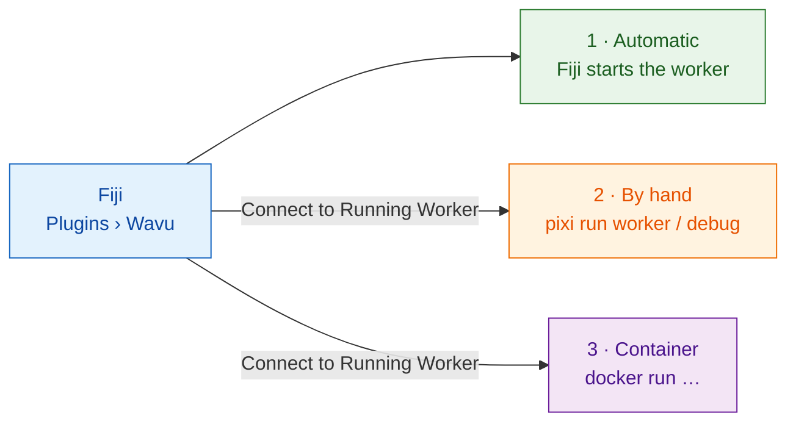

# Running and debugging

## Launch modes

There are three ways for Fiji to reach a worker.



### 1. Automatic (the default)

Fiji runs
`pixi run --manifest-path <folder>/pixi.toml wavu-worker --script-dir <folder>`.
Wavu downloads pixi first if it is missing.

### 2. By hand

Use this while you are developing a script, or to keep one worker alive across
Fiji restarts.

1. In the script folder, run `pixi run worker`, or `pixi run debug` for
   VS Code.
2. In Fiji, choose **Plugins › Wavu › Connect to Running Worker**.

The worker writes its port and token to `~/.wavu/worker.json`.

### 3. Container

Use this on locked-down machines, or to reproduce an exact environment.

```sh
docker run --rm -p 127.0.0.1:8765:8765 -e WAVU_TOKEN=pick-one \
  -v /my/data:/data ghcr.io/oxford-zeiss-centre-of-excellence/wavu-worker
```

Then choose **Connect to Running Worker** and enter:

| field | value |
|---|---|
| handshake file | `/my/data/.wavu/worker.json` |
| host folder | `/my/data` |
| container folder | `/data` |

The image is built from the committed `pixi.lock`. To build an image for
another script folder, see the [Dockerfile](../Dockerfile).

### Offline machines

Each release also includes **offline bundles** (`wavu-offline-*.zip`, made
with pixi-pack). They hold the template environment and the wavu wheel. See
[`packaging/bundle/README-offline.txt`](../packaging/bundle/README-offline.txt).

## Debugging in VS Code

Every script folder has `.vscode/launch.json` with **Attach to Wavu worker**.

1. Either tick *Debug in VS Code* in the Run dialog, or run `pixi run debug`
   and connect from Fiji.
2. Attach from VS Code.
3. Run the script from Fiji. VS Code stops at your breakpoints.
