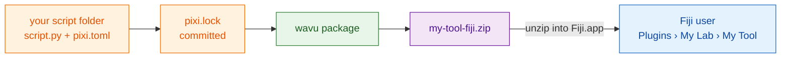

# Sharing your script with other Fiji users

1. Commit `pixi.lock`. Run `pixi install` once in the script folder to create
   it.
2. Run `pixi run wavu package . --name my-tool --menu "My Lab>My Tool"`. This
   writes `dist/fiji/` and `dist/my-tool-fiji.zip`.
3. Users unzip that file into `Fiji.app` (Wavu must already be installed) and
   get **Plugins › My Lab › My Tool**. The first start downloads the packages
   pinned in your lock.

## Automated releases

Folders created with `wavu new-script` include
`.github/workflows/release.yml`. Push a tag such as `v1.0.0` and GitHub tests
the script, packages it and attaches the zip to a GitHub Release. You can
switch on PyPI or your own Fiji update site with repository variables. See the
comments in that file and [script-contract.md](script-contract.md).

For a full walk-through, see the
[Cellpose plugin tutorial](tutorial-cellpose-plugin.md).
