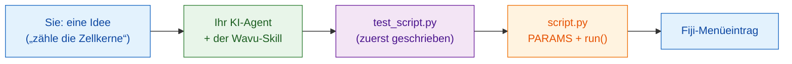

# Bringen Sie Ihrem KI-Agenten den Wavu-Weg bei

KI-Programmierassistenten (Claude Code, Codex, Gemini CLI, Cursor,
Copilot…) können Wavu-Skripte für Sie schreiben. Eine einzige
**Skill-Datei** packt alles, was dieser Leitfaden vermittelt, in
Anweisungen, die Ihr Agent liest. Einmal installiert, arbeitet der Agent auf
Ihrem eigenen Rechner nach Wavu-Art.

## Die Idee in einfachen Worten

Ein neuer Koch in der Küche ist talentiert, kennt aber die Hausregeln nicht.
Die Skill-Datei ist die **Hausordnung**, die innen an der Küchentür klebt:
zuerst abschmecken, die Bestellung auf den Bon schreiben, unsere
Vorratskammer benutzen, so anrichten, wie wir es tun. Der Agent liest sie,
bevor er zu kochen beginnt.



## Was der Skill vermittelt

**Die Schritte, denen er folgt**

0. **Zuerst die Tests** in `test_script.py`: ein ausgedachtes Bild mit
   bekannter Antwort. Erst rot, dann grün.
1. Den Dialog in `PARAMS` beschreiben.
2. Die Arbeit in `run(ctx, inputs, params)` erledigen, mit Log-Meldungen,
   Fortschritt und Abbrechen.
3. Zurückgeben, was Fiji anzeigen soll: Bilder, Labels, Tabellen, ROIs.
4. Pakete in `pixi.toml` eintragen, zuerst aus conda-forge.
5. `pixi run test` ausführen, bis alles besteht, dann in Fiji ausprobieren.
6. Als Fiji-Menüeintrag für Ihr Labor verpacken.

**Und die Regeln**

- :material-check: Nie einen Test abschwächen, nur damit er besteht.
- :material-check: Schwere Imports in `run`, damit sich der Dialog sofort
  öffnet.
- :material-check: Nur kleine, interaktive Daten; kein Java- oder
  Fiji-Plugin-Code.
- :material-check: Ihnen sagen, wie Sie es ausprobieren: **Stop Worker**,
  dann **Run Python Script**.

## Installieren

=== "Claude Code (empfohlen)"

    Fügen Sie eine Zeile in ein Terminal ein. Sie fügt das Wavu-Plugin
    hinzu, das sich mit dem Wavu-Repository aktualisiert:

    ```sh
    claude plugin marketplace add Oxford-Zeiss-Centre-of-Excellence/Wavu && claude plugin install wavu@wavu
    ```

    Oder in einem Claude-Code-Chat:

    ```text
    /plugin marketplace add Oxford-Zeiss-Centre-of-Excellence/Wavu
    /plugin install wavu@wavu
    ```

    Oder als persönliche Skill-Datei, ohne das Plugin:

    === "macOS / Linux"

        ```sh
        mkdir -p ~/.claude/skills/wavu && curl -fsSL https://raw.githubusercontent.com/Oxford-Zeiss-Centre-of-Excellence/Wavu/main/agent/skills/wavu/SKILL.md -o ~/.claude/skills/wavu/SKILL.md
        ```

    === "Windows (PowerShell)"

        ```powershell
        New-Item -ItemType Directory -Force "$HOME\.claude\skills\wavu" | Out-Null; irm https://raw.githubusercontent.com/Oxford-Zeiss-Centre-of-Excellence/Wavu/main/agent/skills/wavu/SKILL.md -OutFile "$HOME\.claude\skills\wavu\SKILL.md"
        ```

=== "Claude Desktop / claude.ai"

    1. Laden Sie den Skill herunter (Schaltfläche unten).
    2. Öffnen Sie in Claude die **Settings** (Einstellungen), dann den
       Bereich für Skills.
    3. Fügen Sie einen Skill hinzu, wählen Sie **upload** (hochladen) und
       dann `wavu-skill.zip`.

    Skills brauchen die Code-Ausführung, die in Claudes Einstellungen
    eingeschaltet sein muss.

    [wavu-skill.zip herunterladen](assets/agent/wavu-skill.zip){ .md-button .md-button--primary }

=== "Codex"

    In Ihrem Skriptordner (der Agent liest die Datei automatisch):

    === "macOS / Linux"

        ```sh
        curl -fsSL https://raw.githubusercontent.com/Oxford-Zeiss-Centre-of-Excellence/Wavu/main/agent/AGENTS.md -o AGENTS.md
        ```

    === "Windows (PowerShell)"

        ```powershell
        irm https://raw.githubusercontent.com/Oxford-Zeiss-Centre-of-Excellence/Wavu/main/agent/AGENTS.md -OutFile AGENTS.md
        ```

    Oder, für alle Projekte, speichern Sie sie als `~/.codex/AGENTS.md`.

=== "OpenCode"

    In Ihrem Skriptordner:

    ```sh
    curl -fsSL https://raw.githubusercontent.com/Oxford-Zeiss-Centre-of-Excellence/Wavu/main/agent/AGENTS.md -o AGENTS.md
    ```

    Oder, für alle Projekte, speichern Sie sie als
    `~/.config/opencode/AGENTS.md`.

=== "Gemini CLI"

    Gemini CLI liest `GEMINI.md`. In Ihrem Skriptordner:

    ```sh
    curl -fsSL https://raw.githubusercontent.com/Oxford-Zeiss-Centre-of-Excellence/Wavu/main/agent/AGENTS.md -o GEMINI.md
    ```

    Oder, für alle Projekte, speichern Sie sie als `~/.gemini/GEMINI.md`.

=== "Andere"

    Die meisten anderen Agenten (Cursor, GitHub Copilot, Windsurf…) lesen
    ebenfalls eine `AGENTS.md` im Projektordner, oder Sie können deren Text
    als eigene Anweisungen einfügen.

    [AGENTS.md](https://raw.githubusercontent.com/Oxford-Zeiss-Centre-of-Excellence/Wavu/main/agent/AGENTS.md){ .md-button }
    [SKILL.md](https://raw.githubusercontent.com/Oxford-Zeiss-Centre-of-Excellence/Wavu/main/agent/skills/wavu/SKILL.md){ .md-button }

## Dann probieren Sie eine Anfrage wie

!!! example ""
    *Erstelle nach dem Wavu-Weg ein Skript, das Zellkerne mit einem
    Otsu-Schwellenwert findet und ein Label-Bild sowie eine Tabelle ihrer
    Flächen zurückgibt. Schreibe zuerst `test_script.py`.*

Öffnen Sie Ihren Agenten in einem Ordner, der aus der
[Vorlage](write/get-the-template.md) erstellt wurde, damit er von einem
funktionierenden Skript ausgeht.

!!! warning "Prüfen Sie seine Arbeit"
    Führen Sie `pixi run test` selbst aus und lesen Sie die Tests, die der
    Agent geschrieben hat: Ein Test, der nie fehlschlagen kann, schützt
    nichts. Siehe [Zuerst testen](write/test-without-fiji.md).

## In einem Satz

Installieren Sie den Wavu-Skill einmal, und Ihr KI-Agent schreibt den Test,
die `PARAMS`, die Funktion `run` und das Paket genau so, wie es dieser
Leitfaden tut.
