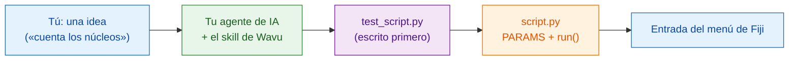

# Enseña a tu agente de IA el estilo Wavu

Los asistentes de programación con IA (Claude Code, Codex, Gemini CLI,
Cursor, Copilot…) pueden escribir scripts de Wavu por ti. Un único **archivo
de skill** reúne todo lo que enseña esta guía en instrucciones que tu agente
lee. Instálalo una vez y el agente trabajará al estilo Wavu en tu propio
ordenador.

## La idea en palabras sencillas

Un cocinero nuevo tiene talento, pero no conoce las normas de la casa. El
archivo de skill es el **reglamento de la casa** pegado por dentro de la
puerta de la cocina: probar primero, apuntar el pedido en la comanda, usar
nuestra despensa, emplatar a nuestra manera. El agente lo lee antes de
empezar a cocinar.



## Qué enseña el skill

**Los pasos que sigue**

0. **Primero los tests** en `test_script.py`: una imagen inventada con una
   respuesta conocida. Primero fallan (rojo), luego pasan (verde).
1. Describir el diálogo en `PARAMS`.
2. Hacer el trabajo en `run(ctx, inputs, params)`, con mensajes del Log,
   progreso y cancelación.
3. Devolver lo que Fiji debe mostrar: imágenes, etiquetas, tablas, ROI.
4. Añadir paquetes a `pixi.toml`, primero desde conda-forge.
5. Ejecutar `pixi run test` hasta que todo pase y luego probarlo en Fiji.
6. Empaquetarlo como entrada del menú de Fiji para tu laboratorio.
7. Opcionalmente, [construir un contenedor](write/container.md).

**Y las reglas**

- :material-check: Nunca debilitar un test para que pase.
- :material-check: Los imports pesados dentro de `run`, para que el diálogo
  se abra al instante.
- :material-check: Solo datos pequeños e interactivos; nada de código Java
  ni de plugins de Fiji.
- :material-check: Decirte cómo probarlo: **Stop Worker** y luego
  **Run Python Script**.

## Instalación

=== "Claude Code (recomendado)"

    Pega una línea en una terminal. Añade el plugin de Wavu, que se
    actualiza junto con el repositorio de Wavu:

    ```sh
    claude plugin marketplace add Oxford-Zeiss-Centre-of-Excellence/Wavu && claude plugin install wavu@wavu
    ```

    O bien, dentro de un chat de Claude Code:

    ```text
    /plugin marketplace add Oxford-Zeiss-Centre-of-Excellence/Wavu
    /plugin install wavu@wavu
    ```

    O como archivo de skill personal, sin el plugin:

    === "macOS / Linux"

        ```sh
        mkdir -p ~/.claude/skills/wavu && curl -fsSL https://raw.githubusercontent.com/Oxford-Zeiss-Centre-of-Excellence/Wavu/main/agent/skills/wavu/SKILL.md -o ~/.claude/skills/wavu/SKILL.md
        ```

    === "Windows (PowerShell)"

        ```powershell
        New-Item -ItemType Directory -Force "$HOME\.claude\skills\wavu" | Out-Null; irm https://raw.githubusercontent.com/Oxford-Zeiss-Centre-of-Excellence/Wavu/main/agent/skills/wavu/SKILL.md -OutFile "$HOME\.claude\skills\wavu\SKILL.md"
        ```

=== "Claude Desktop / claude.ai"

    1. Descarga el skill (botón de abajo).
    2. En Claude, abre **Settings** (Configuración) y luego la sección de
       skills.
    3. Añade un skill, elige **upload** (subir) y selecciona
       `wavu-skill.zip`.

    Los skills necesitan que la ejecución de código esté activada en la
    configuración de Claude.

    [Descargar wavu-skill.zip](assets/agent/wavu-skill.zip){ .md-button .md-button--primary }

=== "Codex"

    En la carpeta de tu script (el agente lo lee automáticamente):

    === "macOS / Linux"

        ```sh
        curl -fsSL https://raw.githubusercontent.com/Oxford-Zeiss-Centre-of-Excellence/Wavu/main/agent/AGENTS.md -o AGENTS.md
        ```

    === "Windows (PowerShell)"

        ```powershell
        irm https://raw.githubusercontent.com/Oxford-Zeiss-Centre-of-Excellence/Wavu/main/agent/AGENTS.md -OutFile AGENTS.md
        ```

    O, para todos tus proyectos, guárdalo como `~/.codex/AGENTS.md`.

=== "OpenCode"

    En la carpeta de tu script:

    ```sh
    curl -fsSL https://raw.githubusercontent.com/Oxford-Zeiss-Centre-of-Excellence/Wavu/main/agent/AGENTS.md -o AGENTS.md
    ```

    O, para todos tus proyectos, guárdalo como
    `~/.config/opencode/AGENTS.md`.

=== "Gemini CLI"

    Gemini CLI lee `GEMINI.md`. En la carpeta de tu script:

    ```sh
    curl -fsSL https://raw.githubusercontent.com/Oxford-Zeiss-Centre-of-Excellence/Wavu/main/agent/AGENTS.md -o GEMINI.md
    ```

    O, para todos tus proyectos, guárdalo como `~/.gemini/GEMINI.md`.

=== "Otros"

    La mayoría de los demás agentes (Cursor, GitHub Copilot, Windsurf…)
    también leen un `AGENTS.md` en la carpeta del proyecto, o te dejan pegar
    su texto como instrucciones personalizadas.

    [AGENTS.md](https://raw.githubusercontent.com/Oxford-Zeiss-Centre-of-Excellence/Wavu/main/agent/AGENTS.md){ .md-button }
    [SKILL.md](https://raw.githubusercontent.com/Oxford-Zeiss-Centre-of-Excellence/Wavu/main/agent/skills/wavu/SKILL.md){ .md-button }

## Luego prueba una petición como

!!! example "Una herramienta nueva"
    *Siguiendo el estilo Wavu, crea un script que encuentre núcleos con un
    umbral de Otsu y devuelva una imagen de etiquetas y una tabla con sus
    áreas. Escribe `test_script.py` primero.*

!!! example "A partir de un plugin de napari"
    *Convierte mi plugin de napari `<name or path>` en un script de Wavu:
    conserva su algoritmo, pon sus dependencias en `pixi.toml` y escribe
    `test_script.py` primero.*

    Las dependencias pesadas del plugin pasan a su propio entorno pixi
    aislado, así que ya no chocan con las de napari ni con las de otros
    plugins, y el mismo script se puede ejecutar también desde Fiji.

!!! example "A partir de un notebook"
    *Convierte este notebook `<file.ipynb>` en un script de Wavu: las celdas
    que hacen el análisis van dentro de `run` y los valores que ajusto pasan
    a ser `PARAMS`. Escribe `test_script.py` primero.*

Abre tu agente en una carpeta creada a partir de la
[plantilla](write/get-the-template.md), para que empiece desde un script que
funciona.

!!! warning "Revisa su trabajo"
    Ejecuta `pixi run test` tú mismo y lee los tests que escribió el agente:
    un test que nunca puede fallar no protege nada. Consulta
    [Primero el test](write/test-without-fiji.md).

## En una frase

Instala el skill de Wavu una vez y tu agente de IA escribirá el test, los
`PARAMS`, la función `run` y el paquete igual que lo hace esta guía.
