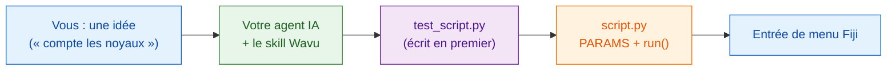

# Apprenez à votre agent IA la méthode Wavu

Les assistants de programmation IA (Claude Code, Codex, Gemini CLI, Cursor,
Copilot…) peuvent écrire des scripts Wavu pour vous. Un seul **fichier de
skill** réunit tout ce que ce guide enseigne sous forme d'instructions que
votre agent lit. Installez-le une fois, et l'agent travaille à la manière
Wavu sur votre propre ordinateur.

## L'idée en mots simples

Un nouveau cuisinier est doué, mais il ne connaît pas les règles de la
maison. Le fichier de skill, c'est le **règlement de la maison** scotché à
l'intérieur de la porte de la cuisine : goûter d'abord, noter la commande sur
le bon, utiliser notre garde-manger, dresser l'assiette à notre façon.
L'agent le lit avant de commencer à cuisiner.



## Ce que le skill enseigne

**Les étapes qu'il suit**

0. **D'abord les tests** dans `test_script.py` : une image inventée dont on
   connaît la réponse. Ils sont d'abord rouges, puis verts.
1. Décrire la boîte de dialogue dans `PARAMS`.
2. Faire le travail dans `run(ctx, inputs, params)`, avec messages de Log,
   progression et annulation.
3. Renvoyer ce que Fiji doit afficher : images, étiquettes, tableaux, ROI.
4. Ajouter les paquets dans `pixi.toml`, conda-forge en premier.
5. Lancer `pixi run test` jusqu'à ce que tout réussisse, puis essayer dans
   Fiji.
6. En faire une entrée de menu Fiji pour votre labo.

**Et les règles**

- :material-check: Ne jamais affaiblir un test pour le faire passer.
- :material-check: Les imports lourds dans `run`, pour que la boîte de
  dialogue s'ouvre instantanément.
- :material-check: Uniquement des données petites et interactives ; pas de
  code Java ni de plugin Fiji.
- :material-check: Vous dire comment l'essayer : **Stop Worker**, puis
  **Run Python Script**.

## Installation

=== "Claude Code (recommandé)"

    Collez une ligne dans un terminal. Elle ajoute le plugin Wavu, qui se met
    à jour avec le dépôt Wavu :

    ```sh
    claude plugin marketplace add Oxford-Zeiss-Centre-of-Excellence/Wavu && claude plugin install wavu@wavu
    ```

    Ou bien, dans une conversation Claude Code :

    ```text
    /plugin marketplace add Oxford-Zeiss-Centre-of-Excellence/Wavu
    /plugin install wavu@wavu
    ```

    Ou comme fichier de skill personnel, sans le plugin :

    === "macOS / Linux"

        ```sh
        mkdir -p ~/.claude/skills/wavu && curl -fsSL https://raw.githubusercontent.com/Oxford-Zeiss-Centre-of-Excellence/Wavu/main/agent/skills/wavu/SKILL.md -o ~/.claude/skills/wavu/SKILL.md
        ```

    === "Windows (PowerShell)"

        ```powershell
        New-Item -ItemType Directory -Force "$HOME\.claude\skills\wavu" | Out-Null; irm https://raw.githubusercontent.com/Oxford-Zeiss-Centre-of-Excellence/Wavu/main/agent/skills/wavu/SKILL.md -OutFile "$HOME\.claude\skills\wavu\SKILL.md"
        ```

=== "Claude Desktop / claude.ai"

    1. Téléchargez le skill (bouton ci-dessous).
    2. Dans Claude, ouvrez **Settings** (Paramètres), puis la section des
       skills.
    3. Ajoutez un skill, choisissez **upload** (téléverser), puis
       sélectionnez `wavu-skill.zip`.

    Les skills nécessitent que l'exécution de code soit activée dans les
    paramètres de Claude.

    [Télécharger wavu-skill.zip](assets/agent/wavu-skill.zip){ .md-button .md-button--primary }

=== "Codex"

    Dans le dossier de votre script (l'agent le lit automatiquement) :

    === "macOS / Linux"

        ```sh
        curl -fsSL https://raw.githubusercontent.com/Oxford-Zeiss-Centre-of-Excellence/Wavu/main/agent/AGENTS.md -o AGENTS.md
        ```

    === "Windows (PowerShell)"

        ```powershell
        irm https://raw.githubusercontent.com/Oxford-Zeiss-Centre-of-Excellence/Wavu/main/agent/AGENTS.md -OutFile AGENTS.md
        ```

    Ou, pour tous vos projets, enregistrez-le sous `~/.codex/AGENTS.md`.

=== "OpenCode"

    Dans le dossier de votre script :

    ```sh
    curl -fsSL https://raw.githubusercontent.com/Oxford-Zeiss-Centre-of-Excellence/Wavu/main/agent/AGENTS.md -o AGENTS.md
    ```

    Ou, pour tous vos projets, enregistrez-le sous
    `~/.config/opencode/AGENTS.md`.

=== "Gemini CLI"

    Gemini CLI lit `GEMINI.md`. Dans le dossier de votre script :

    ```sh
    curl -fsSL https://raw.githubusercontent.com/Oxford-Zeiss-Centre-of-Excellence/Wavu/main/agent/AGENTS.md -o GEMINI.md
    ```

    Ou, pour tous vos projets, enregistrez-le sous `~/.gemini/GEMINI.md`.

=== "Autres"

    La plupart des autres agents (Cursor, GitHub Copilot, Windsurf…) lisent
    aussi un `AGENTS.md` dans le dossier du projet, ou vous laissent coller
    son texte comme instructions personnalisées.

    [AGENTS.md](https://raw.githubusercontent.com/Oxford-Zeiss-Centre-of-Excellence/Wavu/main/agent/AGENTS.md){ .md-button }
    [SKILL.md](https://raw.githubusercontent.com/Oxford-Zeiss-Centre-of-Excellence/Wavu/main/agent/skills/wavu/SKILL.md){ .md-button }

## Ensuite, essayez une demande comme

!!! example ""
    *En suivant la méthode Wavu, crée un script qui trouve les noyaux avec un
    seuil d'Otsu et renvoie une image d'étiquettes et un tableau de leurs
    aires. Écris `test_script.py` en premier.*

Ouvrez votre agent dans un dossier créé à partir du
[modèle](write/get-the-template.md), pour qu'il parte d'un script qui
fonctionne.

!!! warning "Vérifiez son travail"
    Lancez `pixi run test` vous-même et lisez les tests que l'agent a
    écrits : un test qui ne peut jamais échouer ne protège rien. Voir
    [D'abord le test](write/test-without-fiji.md).

## En une phrase

Installez le skill Wavu une fois, et votre agent IA écrit le test, les
`PARAMS`, la fonction `run` et le paquet de la même façon que ce guide.
