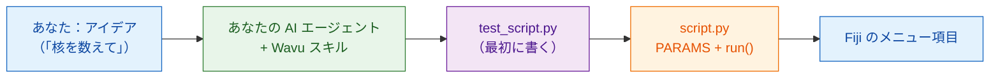

# AI エージェントに Wavu のやり方を教える

AI コーディングアシスタント（Claude Code、Codex、Gemini CLI、Cursor、
Copilot など）は、Wavu スクリプトを代わりに書いてくれます。**スキルファイル**
ひとつに、このガイドで学ぶことがすべて、エージェントが読む指示としてまとめ
られています。一度インストールすれば、エージェントはあなたのコンピューター上で
Wavu のやり方に沿って作業します。

## やさしく言うと

厨房に入った新しい料理人は腕はいいけれど、店のルールを知りません。スキル
ファイルは、厨房のドアの内側に貼られた **店のルールブック** です。まず味見を
する、注文は伝票に書く、うちの食材庫を使う、うちのやり方で盛り付ける。
エージェントは料理を始める前にこれを読みます。



## スキルが教えること

**たどる手順**

0. `test_script.py` で **まずテスト**：答えがわかっている作り物の画像を
   使います。最初は赤（失敗）、それから緑（合格）になります。
1. ダイアログを `PARAMS` に書きます。
2. `run(ctx, inputs, params)` で処理をします。ログのメッセージ、進捗、
   キャンセルにも対応します。
3. Fiji に表示するものを返します：画像、ラベル、表、ROI。
4. パッケージを `pixi.toml` に追加します。conda-forge を優先します。
5. すべて通るまで `pixi run test` を実行し、それから Fiji で試します。
6. 研究室向けに Fiji のメニュー項目としてパッケージにします。
7. 必要なら、[コンテナを作ります](write/container.md)。

**そしてルール**

- :material-check: テストを通すためにテストを甘くしない。
- :material-check: 重い import は `run` の中に。ダイアログがすぐに開くように
  します。
- :material-check: 小さな対話的データだけ。Java や Fiji プラグインの
  コードは書かない。
- :material-check: 試し方を伝える：**Stop Worker**、それから
  **Run Python Script**。

## インストール

=== "Claude Code（おすすめ）"

    ターミナルに 1 行貼り付けます。Wavu プラグインが追加され、Wavu の
    リポジトリと一緒に更新されます。

    ```sh
    claude plugin marketplace add Oxford-Zeiss-Centre-of-Excellence/Wavu && claude plugin install wavu@wavu
    ```

    または、Claude Code のチャットの中で：

    ```text
    /plugin marketplace add Oxford-Zeiss-Centre-of-Excellence/Wavu
    /plugin install wavu@wavu
    ```

    または、プラグインを使わずに個人用のスキルファイルとして：

    === "macOS / Linux"

        ```sh
        mkdir -p ~/.claude/skills/wavu && curl -fsSL https://raw.githubusercontent.com/Oxford-Zeiss-Centre-of-Excellence/Wavu/main/agent/skills/wavu/SKILL.md -o ~/.claude/skills/wavu/SKILL.md
        ```

    === "Windows (PowerShell)"

        ```powershell
        New-Item -ItemType Directory -Force "$HOME\.claude\skills\wavu" | Out-Null; irm https://raw.githubusercontent.com/Oxford-Zeiss-Centre-of-Excellence/Wavu/main/agent/skills/wavu/SKILL.md -OutFile "$HOME\.claude\skills\wavu\SKILL.md"
        ```

=== "Claude Desktop / claude.ai"

    1. スキルをダウンロードします（下のボタン）。
    2. Claude で **Settings**（設定）を開き、スキルのセクションに進みます。
    3. スキルを追加して **upload**（アップロード）を選び、
       `wavu-skill.zip` を指定します。

    スキルを使うには、Claude の設定でコード実行をオンにしておく必要が
    あります。

    [wavu-skill.zip をダウンロード](assets/agent/wavu-skill.zip){ .md-button .md-button--primary }

=== "Codex"

    スクリプトのフォルダーで（エージェントが自動で読み込みます）：

    === "macOS / Linux"

        ```sh
        curl -fsSL https://raw.githubusercontent.com/Oxford-Zeiss-Centre-of-Excellence/Wavu/main/agent/AGENTS.md -o AGENTS.md
        ```

    === "Windows (PowerShell)"

        ```powershell
        irm https://raw.githubusercontent.com/Oxford-Zeiss-Centre-of-Excellence/Wavu/main/agent/AGENTS.md -OutFile AGENTS.md
        ```

    すべてのプロジェクトで使うなら、`~/.codex/AGENTS.md` として保存します。

=== "OpenCode"

    スクリプトのフォルダーで：

    ```sh
    curl -fsSL https://raw.githubusercontent.com/Oxford-Zeiss-Centre-of-Excellence/Wavu/main/agent/AGENTS.md -o AGENTS.md
    ```

    すべてのプロジェクトで使うなら、`~/.config/opencode/AGENTS.md` として
    保存します。

=== "Gemini CLI"

    Gemini CLI は `GEMINI.md` を読みます。スクリプトのフォルダーで：

    ```sh
    curl -fsSL https://raw.githubusercontent.com/Oxford-Zeiss-Centre-of-Excellence/Wavu/main/agent/AGENTS.md -o GEMINI.md
    ```

    すべてのプロジェクトで使うなら、`~/.gemini/GEMINI.md` として保存します。

=== "その他"

    ほかの多くのエージェント（Cursor、GitHub Copilot、Windsurf など）も、
    プロジェクトフォルダーの `AGENTS.md` を読むか、その内容をカスタム指示
    として貼り付けられるようになっています。

    [AGENTS.md](https://raw.githubusercontent.com/Oxford-Zeiss-Centre-of-Excellence/Wavu/main/agent/AGENTS.md){ .md-button }
    [SKILL.md](https://raw.githubusercontent.com/Oxford-Zeiss-Centre-of-Excellence/Wavu/main/agent/skills/wavu/SKILL.md){ .md-button }

## 次に、こんなプロンプトを試してみましょう

!!! example "新しいツール"
    *Wavu のやり方で、大津の二値化で核を見つけ、ラベル画像と核の面積の表を
    返すスクリプトを作って。`test_script.py` を先に書いてね。*

!!! example "napari プラグインから"
    *私の napari プラグイン `<name or path>` を Wavu スクリプトに変換して。
    アルゴリズムはそのままに、依存パッケージは `pixi.toml` に入れて、
    `test_script.py` を先に書いてね。*

    プラグインの重い依存パッケージは、専用の分離された pixi 環境に移ります。
    だから napari やほかのプラグインとぶつからなくなり、同じスクリプトが
    Fiji からも動くようになります。

!!! example "ノートブックから"
    *このノートブック `<file.ipynb>` を Wavu スクリプトにして。解析をする
    セルは `run` に入れて、私が調整する値は `PARAMS` にしてね。
    `test_script.py` を先に書いてね。*

[テンプレート](write/get-the-template.md)から作ったフォルダーでエージェントを
開きましょう。動くスクリプトから始められます。

!!! warning "エージェントの仕事を確認しましょう"
    `pixi run test` を自分で実行し、エージェントが書いたテストを読んで
    ください。絶対に失敗しないテストは何も守ってくれません。
    [まずテストから](write/test-without-fiji.md)を参照してください。

## ひとことで言うと

Wavu スキルを一度インストールすれば、AI エージェントがテスト、`PARAMS`、
`run` 関数、パッケージを、このガイドと同じやり方で書いてくれます。
