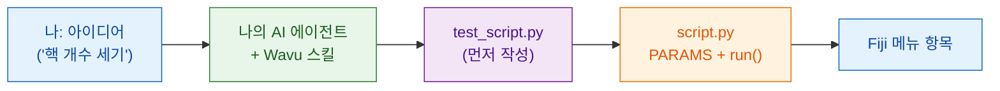

# AI 에이전트에게 Wavu 방식 가르치기

AI 코딩 어시스턴트(Claude Code, Codex, Gemini CLI, Cursor, Copilot…)가
Wavu 스크립트를 대신 써 줄 수 있어요. **스킬 파일** 하나에 이 가이드가
가르치는 모든 것이 에이전트가 읽는 지침으로 담겨 있어요. 한 번만 설치하면
에이전트가 내 컴퓨터에서 Wavu 방식대로 일해요.

## 쉬운 말로 설명하면

주방에 새로 온 요리사는 실력은 좋지만 이 집의 규칙은 몰라요. 스킬 파일은
주방 문 안쪽에 붙여 둔 **우리 집 규칙집**이에요. 먼저 맛보기, 주문은
주문서에 적기, 우리 식료품 창고 쓰기, 우리 방식대로 담기. 에이전트는 요리를
시작하기 전에 이걸 읽어요.



## 스킬이 가르치는 것

**따르는 단계**

0. `test_script.py`에 **테스트 먼저**: 답을 알고 있는 지어낸 이미지를
   써요. 처음엔 빨강, 그다음 초록이 돼요.
1. 대화상자를 `PARAMS`에 적어요.
2. `run(ctx, inputs, params)`에서 작업해요. 로그 메시지, 진행 상황,
   취소도 함께 처리해요.
3. Fiji가 보여 줄 것을 돌려줘요: 이미지, 레이블, 표, ROI.
4. 패키지를 `pixi.toml`에 추가해요. conda-forge가 우선이에요.
5. 모두 통과할 때까지 `pixi run test`를 실행하고, 그다음 Fiji에서 해 봐요.
6. 연구실용 Fiji 메뉴 항목으로 패키징해요.

**그리고 규칙**

- :material-check: 테스트를 통과시키려고 테스트를 약하게 만들지 않아요.
- :material-check: 무거운 import는 `run` 안에 둬요. 그래야 대화상자가 바로
  열려요.
- :material-check: 작고 대화형인 데이터만 다뤄요. Java나 Fiji 플러그인
  코드는 쓰지 않아요.
- :material-check: 해 보는 방법을 알려 줘요: **Stop Worker**, 그다음
  **Run Python Script**.

## 설치

=== "Claude Code (추천)"

    터미널에 한 줄을 붙여 넣으세요. Wavu 플러그인이 추가되고, Wavu
    저장소와 함께 업데이트돼요.

    ```sh
    claude plugin marketplace add Oxford-Zeiss-Centre-of-Excellence/Wavu && claude plugin install wavu@wavu
    ```

    또는 Claude Code 채팅 안에서:

    ```text
    /plugin marketplace add Oxford-Zeiss-Centre-of-Excellence/Wavu
    /plugin install wavu@wavu
    ```

    또는 플러그인 없이 개인 스킬 파일로:

    === "macOS / Linux"

        ```sh
        mkdir -p ~/.claude/skills/wavu && curl -fsSL https://raw.githubusercontent.com/Oxford-Zeiss-Centre-of-Excellence/Wavu/main/agent/skills/wavu/SKILL.md -o ~/.claude/skills/wavu/SKILL.md
        ```

    === "Windows (PowerShell)"

        ```powershell
        New-Item -ItemType Directory -Force "$HOME\.claude\skills\wavu" | Out-Null; irm https://raw.githubusercontent.com/Oxford-Zeiss-Centre-of-Excellence/Wavu/main/agent/skills/wavu/SKILL.md -OutFile "$HOME\.claude\skills\wavu\SKILL.md"
        ```

=== "Claude Desktop / claude.ai"

    1. 스킬을 내려받으세요(아래 버튼).
    2. Claude에서 **Settings**(설정)를 열고 스킬 섹션으로 가세요.
    3. 스킬을 추가하고 **upload**(업로드)를 고른 다음 `wavu-skill.zip`을
       선택하세요.

    스킬을 쓰려면 Claude 설정에서 코드 실행이 켜져 있어야 해요.

    [wavu-skill.zip 내려받기](assets/agent/wavu-skill.zip){ .md-button .md-button--primary }

=== "Codex"

    스크립트 폴더에서(에이전트가 자동으로 읽어요):

    === "macOS / Linux"

        ```sh
        curl -fsSL https://raw.githubusercontent.com/Oxford-Zeiss-Centre-of-Excellence/Wavu/main/agent/AGENTS.md -o AGENTS.md
        ```

    === "Windows (PowerShell)"

        ```powershell
        irm https://raw.githubusercontent.com/Oxford-Zeiss-Centre-of-Excellence/Wavu/main/agent/AGENTS.md -OutFile AGENTS.md
        ```

    모든 프로젝트에 쓰려면 `~/.codex/AGENTS.md`로 저장하세요.

=== "OpenCode"

    스크립트 폴더에서:

    ```sh
    curl -fsSL https://raw.githubusercontent.com/Oxford-Zeiss-Centre-of-Excellence/Wavu/main/agent/AGENTS.md -o AGENTS.md
    ```

    모든 프로젝트에 쓰려면 `~/.config/opencode/AGENTS.md`로 저장하세요.

=== "Gemini CLI"

    Gemini CLI는 `GEMINI.md`를 읽어요. 스크립트 폴더에서:

    ```sh
    curl -fsSL https://raw.githubusercontent.com/Oxford-Zeiss-Centre-of-Excellence/Wavu/main/agent/AGENTS.md -o GEMINI.md
    ```

    모든 프로젝트에 쓰려면 `~/.gemini/GEMINI.md`로 저장하세요.

=== "기타"

    다른 에이전트(Cursor, GitHub Copilot, Windsurf…)도 대부분 프로젝트
    폴더의 `AGENTS.md`를 읽거나, 그 내용을 사용자 지정 지침으로 붙여 넣을
    수 있게 해 줘요.

    [AGENTS.md](https://raw.githubusercontent.com/Oxford-Zeiss-Centre-of-Excellence/Wavu/main/agent/AGENTS.md){ .md-button }
    [SKILL.md](https://raw.githubusercontent.com/Oxford-Zeiss-Centre-of-Excellence/Wavu/main/agent/skills/wavu/SKILL.md){ .md-button }

## 그다음 이런 프롬프트를 해 보세요

!!! example ""
    *Wavu 방식으로, Otsu 임계값으로 핵을 찾고 레이블 이미지와 핵 면적 표를
    돌려주는 스크립트를 만들어 줘. `test_script.py`를 먼저 작성해 줘.*

[템플릿](write/get-the-template.md)으로 만든 폴더에서 에이전트를 여세요.
그러면 동작하는 스크립트에서 시작할 수 있어요.

!!! warning "결과를 확인하세요"
    `pixi run test`를 직접 실행하고 에이전트가 쓴 테스트를 읽어 보세요.
    절대 실패할 수 없는 테스트는 아무것도 지켜 주지 못해요.
    [테스트 먼저](write/test-without-fiji.md)를 참고하세요.

## 한 문장으로

Wavu 스킬을 한 번 설치하면, AI 에이전트가 테스트, `PARAMS`, `run` 함수,
패키지를 이 가이드와 똑같은 방식으로 써 줘요.
