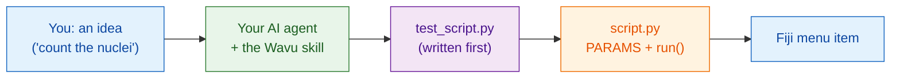

# Teach your AI agent the Wavu way

AI coding assistants (Claude Code, Codex, Gemini CLI, Cursor, Copilot…) can
write Wavu scripts for you. One **skill file** packs everything this guide
teaches into instructions your agent reads. Install it once, and the agent
works the Wavu way on your own computer.

## The idea in plain words

A new cook in the kitchen is talented but doesn't know the house rules. The
skill file is the **house rulebook** taped inside the kitchen door: taste
first, write the order on the ticket, use our pantry, plate it our way. The
agent reads it before it starts cooking.



## What the skill teaches

**The steps it follows**

0. **Tests first** in `test_script.py`: a made-up image with a known answer.
   It runs red, then green.
1. Describe the dialog in `PARAMS`.
2. Do the work in `run(ctx, inputs, params)`, with log messages, progress and
   cancel.
3. Return what Fiji should show: images, labels, tables, ROIs.
4. Add packages to `pixi.toml`, conda-forge first.
5. Run `pixi run test` until everything passes, then try it in Fiji.
6. Package it as a Fiji menu item for your lab.
7. Optionally, [build a container](write/container.md).

**And the rules**

- :material-check: Never weaken a test to make it pass.
- :material-check: Heavy imports inside `run`, so the dialog opens instantly.
- :material-check: Small, interactive data only; no Java or Fiji plugin code.
- :material-check: Tell you how to try it: **Stop Worker**, then
  **Run Python Script**.

## Install

=== "Claude Code (recommended)"

    Paste one line into a terminal. It adds the Wavu plugin, which updates
    with the Wavu repository:

    ```sh
    claude plugin marketplace add Oxford-Zeiss-Centre-of-Excellence/Wavu && claude plugin install wavu@wavu
    ```

    Or, inside a Claude Code chat:

    ```text
    /plugin marketplace add Oxford-Zeiss-Centre-of-Excellence/Wavu
    /plugin install wavu@wavu
    ```

    Or as a personal skill file, without the plugin:

    === "macOS / Linux"

        ```sh
        mkdir -p ~/.claude/skills/wavu && curl -fsSL https://raw.githubusercontent.com/Oxford-Zeiss-Centre-of-Excellence/Wavu/main/agent/skills/wavu/SKILL.md -o ~/.claude/skills/wavu/SKILL.md
        ```

    === "Windows (PowerShell)"

        ```powershell
        New-Item -ItemType Directory -Force "$HOME\.claude\skills\wavu" | Out-Null; irm https://raw.githubusercontent.com/Oxford-Zeiss-Centre-of-Excellence/Wavu/main/agent/skills/wavu/SKILL.md -OutFile "$HOME\.claude\skills\wavu\SKILL.md"
        ```

=== "Claude Desktop / claude.ai"

    1. Download the skill (button below).
    2. In Claude, open **Settings**, then the skills section.
    3. Add a skill and choose **upload**, then pick `wavu-skill.zip`.

    Skills need code execution switched on in Claude's settings.

    [Download wavu-skill.zip](assets/agent/wavu-skill.zip){ .md-button .md-button--primary }

=== "Codex"

    In your script folder (the agent reads it automatically):

    === "macOS / Linux"

        ```sh
        curl -fsSL https://raw.githubusercontent.com/Oxford-Zeiss-Centre-of-Excellence/Wavu/main/agent/AGENTS.md -o AGENTS.md
        ```

    === "Windows (PowerShell)"

        ```powershell
        irm https://raw.githubusercontent.com/Oxford-Zeiss-Centre-of-Excellence/Wavu/main/agent/AGENTS.md -OutFile AGENTS.md
        ```

    Or for every project, save it as `~/.codex/AGENTS.md`.

=== "OpenCode"

    In your script folder:

    ```sh
    curl -fsSL https://raw.githubusercontent.com/Oxford-Zeiss-Centre-of-Excellence/Wavu/main/agent/AGENTS.md -o AGENTS.md
    ```

    Or for every project, save it as `~/.config/opencode/AGENTS.md`.

=== "Gemini CLI"

    Gemini CLI reads `GEMINI.md`. In your script folder:

    ```sh
    curl -fsSL https://raw.githubusercontent.com/Oxford-Zeiss-Centre-of-Excellence/Wavu/main/agent/AGENTS.md -o GEMINI.md
    ```

    Or for every project, save it as `~/.gemini/GEMINI.md`.

=== "Other"

    Most other agents (Cursor, GitHub Copilot, Windsurf…) also read an
    `AGENTS.md` in the project folder, or let you paste its text as custom
    instructions.

    [AGENTS.md](https://raw.githubusercontent.com/Oxford-Zeiss-Centre-of-Excellence/Wavu/main/agent/AGENTS.md){ .md-button }
    [SKILL.md](https://raw.githubusercontent.com/Oxford-Zeiss-Centre-of-Excellence/Wavu/main/agent/skills/wavu/SKILL.md){ .md-button }

## Then try a prompt like

!!! example "A new tool"
    *Using the Wavu way, make a script that finds nuclei with an Otsu
    threshold and returns a label image and a table of their areas. Write
    `test_script.py` first.*

!!! example "From a napari plugin"
    *Convert my napari plugin `<name or path>` into a Wavu script: keep its
    algorithm, put its dependencies in `pixi.toml`, write `test_script.py`
    first.*

    The plugin's heavy dependencies move into their own isolated pixi
    environment, so they no longer clash with napari's or other plugins',
    and the same script then also runs from Fiji.

!!! example "From a notebook"
    *Turn this notebook `<file.ipynb>` into a Wavu script: the cells that do
    the analysis go into `run`, the values I tweak become `PARAMS`. Write
    `test_script.py` first.*

Open your agent in a folder made from the [template](write/get-the-template.md),
so it starts from a working script.

!!! warning "Check its work"
    Run `pixi run test` yourself and read the tests the agent wrote: a test
    that can never fail protects nothing. See [Test first](write/test-without-fiji.md).

## In one sentence

Install the Wavu skill once, and your AI agent writes the test, the
`PARAMS`, the `run` function and the package the same way this guide does.
