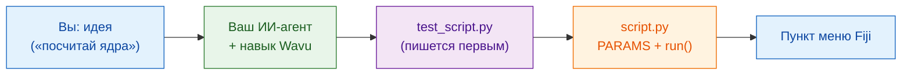

# Научите своего ИИ-агента работать по-Wavu

ИИ-ассистенты для программирования (Claude Code, Codex, Gemini CLI, Cursor,
Copilot…) могут писать скрипты Wavu за вас. Один **файл навыка** (skill)
упаковывает всё, чему учит это руководство, в инструкции, которые читает ваш
агент. Установите его один раз, и агент будет работать по правилам Wavu на
вашем собственном компьютере.

## Идея простыми словами

Новый повар на кухне талантлив, но не знает правил заведения. Файл навыка —
это **свод правил кухни**, приклеенный изнутри к кухонной двери: сначала
пробовать, записывать заказ в чек, брать продукты из нашей кладовой,
подавать блюдо по-нашему. Агент читает его, прежде чем начать готовить.



## Чему учит навык

**Шаги, которым он следует**

0. **Сначала тесты** в `test_script.py`: придуманное изображение с заранее
   известным ответом. Сначала красный, потом зелёный.
1. Описать диалог в `PARAMS`.
2. Сделать работу в `run(ctx, inputs, params)`, с сообщениями Log,
   прогрессом и отменой.
3. Вернуть то, что должен показать Fiji: изображения, метки, таблицы, ROI.
4. Добавить пакеты в `pixi.toml`, в первую очередь из conda-forge.
5. Запускать `pixi run test`, пока всё не пройдёт, потом попробовать в Fiji.
6. Упаковать как пункт меню Fiji для вашей лаборатории.
7. По желанию [собрать контейнер](write/container.md).

**И правила**

- :material-check: Никогда не ослаблять тест, чтобы он прошёл.
- :material-check: Тяжёлые импорты — внутри `run`, чтобы диалог открывался
  мгновенно.
- :material-check: Только небольшие интерактивные данные; никакого кода на
  Java и плагинов Fiji.
- :material-check: Сказать вам, как попробовать: **Stop Worker**, затем
  **Run Python Script**.

## Установка

=== "Claude Code (рекомендуется)"

    Вставьте одну строку в терминал. Она добавит плагин Wavu, который
    обновляется вместе с репозиторием Wavu:

    ```sh
    claude plugin marketplace add Oxford-Zeiss-Centre-of-Excellence/Wavu && claude plugin install wavu@wavu
    ```

    Или прямо в чате Claude Code:

    ```text
    /plugin marketplace add Oxford-Zeiss-Centre-of-Excellence/Wavu
    /plugin install wavu@wavu
    ```

    Или как личный файл навыка, без плагина:

    === "macOS / Linux"

        ```sh
        mkdir -p ~/.claude/skills/wavu && curl -fsSL https://raw.githubusercontent.com/Oxford-Zeiss-Centre-of-Excellence/Wavu/main/agent/skills/wavu/SKILL.md -o ~/.claude/skills/wavu/SKILL.md
        ```

    === "Windows (PowerShell)"

        ```powershell
        New-Item -ItemType Directory -Force "$HOME\.claude\skills\wavu" | Out-Null; irm https://raw.githubusercontent.com/Oxford-Zeiss-Centre-of-Excellence/Wavu/main/agent/skills/wavu/SKILL.md -OutFile "$HOME\.claude\skills\wavu\SKILL.md"
        ```

=== "Claude Desktop / claude.ai"

    1. Скачайте навык (кнопка ниже).
    2. В Claude откройте **Settings** (Настройки), затем раздел навыков
       (skills).
    3. Добавьте навык, выберите **upload** (загрузить) и укажите
       `wavu-skill.zip`.

    Для навыков в настройках Claude должно быть включено выполнение кода.

    [Скачать wavu-skill.zip](assets/agent/wavu-skill.zip){ .md-button .md-button--primary }

=== "Codex"

    В папке вашего скрипта (агент прочитает файл автоматически):

    === "macOS / Linux"

        ```sh
        curl -fsSL https://raw.githubusercontent.com/Oxford-Zeiss-Centre-of-Excellence/Wavu/main/agent/AGENTS.md -o AGENTS.md
        ```

    === "Windows (PowerShell)"

        ```powershell
        irm https://raw.githubusercontent.com/Oxford-Zeiss-Centre-of-Excellence/Wavu/main/agent/AGENTS.md -OutFile AGENTS.md
        ```

    Или, чтобы он действовал во всех проектах, сохраните его как
    `~/.codex/AGENTS.md`.

=== "OpenCode"

    В папке вашего скрипта:

    ```sh
    curl -fsSL https://raw.githubusercontent.com/Oxford-Zeiss-Centre-of-Excellence/Wavu/main/agent/AGENTS.md -o AGENTS.md
    ```

    Или, чтобы он действовал во всех проектах, сохраните его как
    `~/.config/opencode/AGENTS.md`.

=== "Gemini CLI"

    Gemini CLI читает `GEMINI.md`. В папке вашего скрипта:

    ```sh
    curl -fsSL https://raw.githubusercontent.com/Oxford-Zeiss-Centre-of-Excellence/Wavu/main/agent/AGENTS.md -o GEMINI.md
    ```

    Или, чтобы он действовал во всех проектах, сохраните его как
    `~/.gemini/GEMINI.md`.

=== "Другие"

    Большинство других агентов (Cursor, GitHub Copilot, Windsurf…) тоже
    читают `AGENTS.md` в папке проекта или позволяют вставить его текст как
    пользовательские инструкции.

    [AGENTS.md](https://raw.githubusercontent.com/Oxford-Zeiss-Centre-of-Excellence/Wavu/main/agent/AGENTS.md){ .md-button }
    [SKILL.md](https://raw.githubusercontent.com/Oxford-Zeiss-Centre-of-Excellence/Wavu/main/agent/skills/wavu/SKILL.md){ .md-button }

## Затем попробуйте запрос вроде этого

!!! example "Новый инструмент"
    *Следуя подходу Wavu, сделай скрипт, который находит ядра с помощью
    порога Оцу и возвращает изображение меток и таблицу их площадей.
    Сначала напиши `test_script.py`.*

!!! example "Из плагина napari"
    *Преврати мой плагин napari `<name or path>` в скрипт Wavu: сохрани его
    алгоритм, перенеси его зависимости в `pixi.toml`, сначала напиши
    `test_script.py`.*

    Тяжёлые зависимости плагина переезжают в собственное изолированное
    pixi-окружение, поэтому больше не конфликтуют с зависимостями napari и
    других плагинов, а тот же скрипт затем запускается и из Fiji.

!!! example "Из ноутбука"
    *Преврати этот ноутбук `<file.ipynb>` в скрипт Wavu: ячейки, которые
    делают анализ, переходят в `run`, а значения, которые я подбираю,
    становятся `PARAMS`. Сначала напиши `test_script.py`.*

Откройте агента в папке, созданной из [шаблона](write/get-the-template.md),
чтобы он начинал с работающего скрипта.

!!! warning "Проверяйте его работу"
    Запустите `pixi run test` сами и прочитайте тесты, которые написал
    агент: тест, который никогда не может упасть, ничего не защищает.
    См. [Сначала тест](write/test-without-fiji.md).

## Одним предложением

Установите навык Wavu один раз, и ваш ИИ-агент будет писать тест, `PARAMS`,
функцию `run` и пакет так же, как это делается в этом руководстве.
