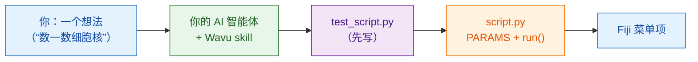

# 教你的 AI 智能体用 Wavu 的方式工作

AI 编程助手（Claude Code、Codex、Gemini CLI、Cursor、Copilot…）可以替你写
Wavu 脚本。一个 **skill 文件**把这份指南教的所有内容，整理成你的智能体会读的
指令。安装一次，智能体就会在你自己的电脑上按 Wavu 的方式工作。

## 用大白话说

新来的厨师很有天赋，但不懂店里的规矩。skill 文件就是贴在厨房门内侧的
**店规手册**：先尝味道、把点的菜写在单子上、用我们的厨具、按我们的方式
装盘。智能体在开始做菜之前会先读它。



## skill 教了什么

**它遵循的步骤**

0. 在 `test_script.py` 里**先写测试**：用一张已知答案、自己造的图像。
   先是红色，再变绿色。
1. 在 `PARAMS` 里描述对话框。
2. 在 `run(ctx, inputs, params)` 里干活，带上日志消息、进度和取消功能。
3. 返回 Fiji 要显示的东西：图像、标签、表格、ROI。
4. 把软件包加进 `pixi.toml`，优先用 conda-forge。
5. 运行 `pixi run test` 直到全部通过，再到 Fiji 里试试。
6. 打包成实验室用的 Fiji 菜单项。
7. 可选：[构建一个容器](write/container.md)。

**还有这些规则**

- :material-check: 绝不为了让测试通过而放宽测试。
- :material-check: 重量级的 import 放在 `run` 里面，让对话框立刻打开。
- :material-check: 只处理小规模、交互式的数据；不写 Java 或 Fiji 插件代码。
- :material-check: 告诉你怎么试：先点 **Stop Worker**，再点
  **Run Python Script**。

## 安装

=== "Claude Code（推荐）"

    在终端里粘贴一行。它会添加 Wavu 插件，并随 Wavu 仓库一起更新：

    ```sh
    claude plugin marketplace add Oxford-Zeiss-Centre-of-Excellence/Wavu && claude plugin install wavu@wavu
    ```

    或者，在 Claude Code 的对话里：

    ```text
    /plugin marketplace add Oxford-Zeiss-Centre-of-Excellence/Wavu
    /plugin install wavu@wavu
    ```

    或者不用插件，作为个人 skill 文件：

    === "Windows (PowerShell)"

        ```powershell
        New-Item -ItemType Directory -Force "$HOME\.claude\skills\wavu" | Out-Null; irm https://raw.githubusercontent.com/Oxford-Zeiss-Centre-of-Excellence/Wavu/main/agent/skills/wavu/SKILL.md -OutFile "$HOME\.claude\skills\wavu\SKILL.md"
        ```

    === "macOS / Linux"

        ```sh
        mkdir -p ~/.claude/skills/wavu && curl -fsSL https://raw.githubusercontent.com/Oxford-Zeiss-Centre-of-Excellence/Wavu/main/agent/skills/wavu/SKILL.md -o ~/.claude/skills/wavu/SKILL.md
        ```

=== "Claude Desktop / claude.ai"

    1. 下载 skill（下方按钮）。
    2. 在 Claude 里打开 **Settings**（设置），再进入 skills 部分。
    3. 添加一个 skill，选择 **upload**（上传），然后选中 `wavu-skill.zip`。

    使用 skill 需要在 Claude 的设置里开启代码执行。

    [下载 wavu-skill.zip](assets/agent/wavu-skill.zip){ .md-button .md-button--primary }

=== "Codex"

    在你的脚本文件夹里（智能体会自动读取）：

    === "Windows (PowerShell)"

        ```powershell
        irm https://raw.githubusercontent.com/Oxford-Zeiss-Centre-of-Excellence/Wavu/main/agent/AGENTS.md -OutFile AGENTS.md
        ```

    === "macOS / Linux"

        ```sh
        curl -fsSL https://raw.githubusercontent.com/Oxford-Zeiss-Centre-of-Excellence/Wavu/main/agent/AGENTS.md -o AGENTS.md
        ```

    如果想用于所有项目，就保存为 `~/.codex/AGENTS.md`。

=== "OpenCode"

    在你的脚本文件夹里：

    ```sh
    curl -fsSL https://raw.githubusercontent.com/Oxford-Zeiss-Centre-of-Excellence/Wavu/main/agent/AGENTS.md -o AGENTS.md
    ```

    如果想用于所有项目，就保存为 `~/.config/opencode/AGENTS.md`。

=== "Gemini CLI"

    Gemini CLI 读取的是 `GEMINI.md`。在你的脚本文件夹里：

    ```sh
    curl -fsSL https://raw.githubusercontent.com/Oxford-Zeiss-Centre-of-Excellence/Wavu/main/agent/AGENTS.md -o GEMINI.md
    ```

    如果想用于所有项目，就保存为 `~/.gemini/GEMINI.md`。

=== "其他"

    大多数其他智能体（Cursor、GitHub Copilot、Windsurf…）也会读取项目文件夹里的
    `AGENTS.md`，或者允许你把它的内容粘贴为自定义指令。

    [AGENTS.md](https://raw.githubusercontent.com/Oxford-Zeiss-Centre-of-Excellence/Wavu/main/agent/AGENTS.md){ .md-button }
    [SKILL.md](https://raw.githubusercontent.com/Oxford-Zeiss-Centre-of-Excellence/Wavu/main/agent/skills/wavu/SKILL.md){ .md-button }

## 然后试试这样的提示词

!!! example "一个新工具"
    *按照 Wavu 的方式，写一个用 Otsu 阈值找出细胞核的脚本，返回一张标签图像
    和一个列出它们面积的表格。先写 `test_script.py`。*

!!! example "从 napari 插件转换"
    *把我的 napari 插件 `<名称或路径>` 转换成 Wavu 脚本：保留它的算法，
    把它的依赖放进 `pixi.toml`，先写 `test_script.py`。*

    插件那些庞大的依赖会搬进它自己独立的 pixi 环境，不再和 napari 或
    其他插件的依赖冲突；而且同一个脚本也能从 Fiji 运行。

!!! example "从笔记本转换"
    *把这个笔记本 `<file.ipynb>` 转换成 Wavu 脚本：做分析的单元格放进 `run`，
    我要调整的数值变成 `PARAMS`。先写 `test_script.py`。*

在用[模板](write/get-the-template.md)创建的文件夹里打开你的智能体，这样它就会
从一个能正常运行的脚本开始。

!!! warning "检查它的成果"
    自己运行 `pixi run test`，并读一读智能体写的测试：一个永远不会失败的测试，
    什么也保护不了。请看[先写测试](write/test-without-fiji.md)。

## 一句话总结

安装一次 Wavu skill，你的 AI 智能体就会用和这份指南一样的方式，写出测试、
`PARAMS`、`run` 函数和软件包。
