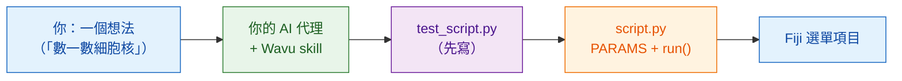

# 教你的 AI 代理用 Wavu 的方式工作

AI 程式設計助理（Claude Code、Codex、Gemini CLI、Cursor、Copilot…）可以
幫你寫 Wavu 腳本。一個 **skill 檔案**把這份指南教的所有內容，整理成你的
代理會讀的指示。安裝一次，代理就會在你自己的電腦上照 Wavu 的方式工作。

## 用白話說

新來的廚師很有天分，但不懂店裡的規矩。skill 檔案就是貼在廚房門內側的
**店規手冊**：先試味道、把點餐寫在單子上、用我們的食材櫃、照我們的方式
擺盤。代理在開始下廚之前會先讀它。



## skill 教了什麼

**它遵循的步驟**

0. 在 `test_script.py` 裡**先寫測試**：用一張已知答案、自己造出來的
   影像。先是紅燈，再變綠燈。
1. 在 `PARAMS` 裡描述對話框。
2. 在 `run(ctx, inputs, params)` 裡做事，附上 Log 訊息、進度和取消功能。
3. 回傳 Fiji 要顯示的東西：影像、標籤、表格、ROI。
4. 把套件加進 `pixi.toml`，優先用 conda-forge。
5. 執行 `pixi run test` 直到全部通過，再到 Fiji 裡試試。
6. 打包成實驗室用的 Fiji 選單項目。

**還有這些規則**

- :material-check: 絕不為了讓測試通過而放寬測試。
- :material-check: 重量級的 import 放在 `run` 裡面，讓對話框立刻打開。
- :material-check: 只處理小型、互動式的資料；不寫 Java 或 Fiji 外掛程式碼。
- :material-check: 告訴你怎麼試：先按 **Stop Worker**，再按
  **Run Python Script**。

## 安裝

=== "Claude Code（推薦）"

    在終端機貼上一行。它會加入 Wavu 外掛，並跟著 Wavu 儲存庫一起更新：

    ```sh
    claude plugin marketplace add Oxford-Zeiss-Centre-of-Excellence/Wavu && claude plugin install wavu@wavu
    ```

    或者，在 Claude Code 的對話裡：

    ```text
    /plugin marketplace add Oxford-Zeiss-Centre-of-Excellence/Wavu
    /plugin install wavu@wavu
    ```

    或者不用外掛，當成個人的 skill 檔案：

    === "macOS / Linux"

        ```sh
        mkdir -p ~/.claude/skills/wavu && curl -fsSL https://raw.githubusercontent.com/Oxford-Zeiss-Centre-of-Excellence/Wavu/main/agent/skills/wavu/SKILL.md -o ~/.claude/skills/wavu/SKILL.md
        ```

    === "Windows (PowerShell)"

        ```powershell
        New-Item -ItemType Directory -Force "$HOME\.claude\skills\wavu" | Out-Null; irm https://raw.githubusercontent.com/Oxford-Zeiss-Centre-of-Excellence/Wavu/main/agent/skills/wavu/SKILL.md -OutFile "$HOME\.claude\skills\wavu\SKILL.md"
        ```

=== "Claude Desktop / claude.ai"

    1. 下載 skill（下方按鈕）。
    2. 在 Claude 裡打開 **Settings**（設定），再進入 skills 區塊。
    3. 新增一個 skill，選 **upload**（上傳），然後選擇 `wavu-skill.zip`。

    使用 skill 需要在 Claude 的設定裡開啟程式碼執行。

    [下載 wavu-skill.zip](assets/agent/wavu-skill.zip){ .md-button .md-button--primary }

=== "Codex"

    在你的腳本資料夾裡（代理會自動讀取）：

    === "macOS / Linux"

        ```sh
        curl -fsSL https://raw.githubusercontent.com/Oxford-Zeiss-Centre-of-Excellence/Wavu/main/agent/AGENTS.md -o AGENTS.md
        ```

    === "Windows (PowerShell)"

        ```powershell
        irm https://raw.githubusercontent.com/Oxford-Zeiss-Centre-of-Excellence/Wavu/main/agent/AGENTS.md -OutFile AGENTS.md
        ```

    若要用在所有專案，就存成 `~/.codex/AGENTS.md`。

=== "OpenCode"

    在你的腳本資料夾裡：

    ```sh
    curl -fsSL https://raw.githubusercontent.com/Oxford-Zeiss-Centre-of-Excellence/Wavu/main/agent/AGENTS.md -o AGENTS.md
    ```

    若要用在所有專案，就存成 `~/.config/opencode/AGENTS.md`。

=== "Gemini CLI"

    Gemini CLI 讀的是 `GEMINI.md`。在你的腳本資料夾裡：

    ```sh
    curl -fsSL https://raw.githubusercontent.com/Oxford-Zeiss-Centre-of-Excellence/Wavu/main/agent/AGENTS.md -o GEMINI.md
    ```

    若要用在所有專案，就存成 `~/.gemini/GEMINI.md`。

=== "其他"

    大多數其他代理（Cursor、GitHub Copilot、Windsurf…）也會讀專案資料夾裡的
    `AGENTS.md`，或讓你把它的內容貼上當作自訂指示。

    [AGENTS.md](https://raw.githubusercontent.com/Oxford-Zeiss-Centre-of-Excellence/Wavu/main/agent/AGENTS.md){ .md-button }
    [SKILL.md](https://raw.githubusercontent.com/Oxford-Zeiss-Centre-of-Excellence/Wavu/main/agent/skills/wavu/SKILL.md){ .md-button }

## 接著試試這樣的提示

!!! example ""
    *照 Wavu 的方式，寫一個用 Otsu 閾值找出細胞核的腳本，回傳一張標籤影像
    和一個列出它們面積的表格。先寫 `test_script.py`。*

在用[範本](write/get-the-template.md)建立的資料夾裡打開你的代理，這樣它就會
從一個能正常運作的腳本開始。

!!! warning "檢查它的成果"
    自己執行 `pixi run test`，並讀一讀代理寫的測試：一個永遠不會失敗的測試，
    什麼也保護不了。請看[先寫測試](write/test-without-fiji.md)。

## 一句話總結

安裝一次 Wavu skill，你的 AI 代理就會用跟這份指南一樣的方式，寫出測試、
`PARAMS`、`run` 函式和套件。
