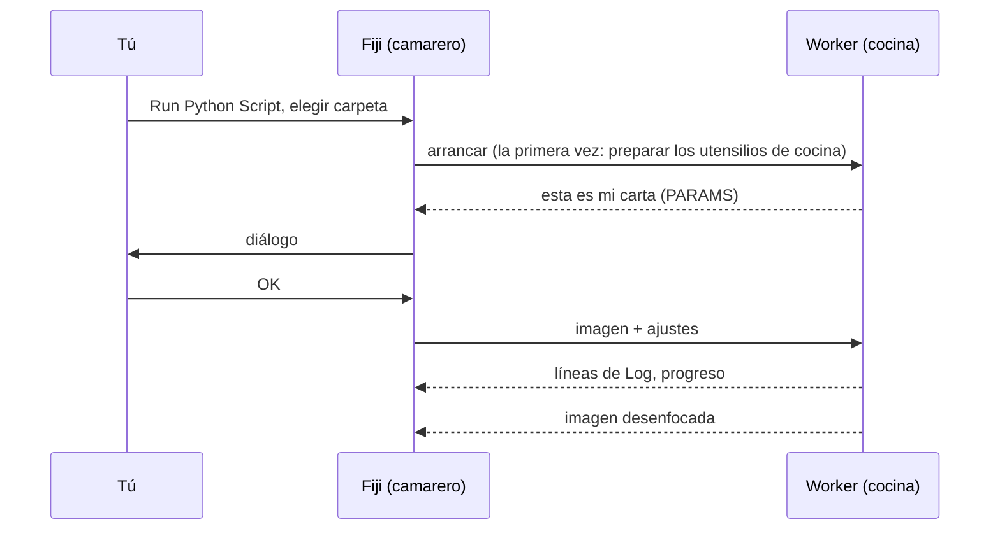

# Tu primera ejecución

## La idea en palabras sencillas

Llega el primer pedido. Usaremos el **script de la plantilla**, una receta
diminuta que desenfoca una imagen (un desenfoque gaussiano), sobre la imagen
de ejemplo *Blobs* que trae Fiji. El desenfoque es aburrido a propósito: así
ves el recorrido completo, del diálogo a la cocina y de vuelta, sin sorpresas.



## Paso 1: consigue la carpeta de la plantilla

Descarga la plantilla como zip y descomprímela en un sitio donde la vuelvas a
encontrar, por ejemplo en *Documentos*, o, si usas VS Code, deja que clone
la plantilla por ti:

[Descargar ZIP](https://github.com/Oxford-Zeiss-Centre-of-Excellence/Wavu-Script-Template/archive/refs/heads/main.zip){ .md-button }
[Abrir la plantilla en VS Code](vscode://vscode.git/clone?url=https%3A%2F%2Fgithub.com%2FOxford-Zeiss-Centre-of-Excellence%2FWavu-Script-Template.git){ .md-button }

Obtienes una carpeta llamada `Wavu-Script-Template-main`. Dentro están
`script.py` (la receta) y `pixi.toml` (la lista de sus utensilios de cocina).
Eso es todo lo que es una *carpeta de script*.

!!! tip "¿Una carpeta de más?"
    *Extraer todo* de Windows a veces crea una carpeta dentro de otra con el
    mismo nombre. La correcta es la que contiene directamente `pixi.toml`.

!!! note "Por ahora hace falta Git"
    La plantilla descarga la parte de Python de Wavu desde GitHub, y para eso
    necesitas [Git](https://git-scm.com) instalado en tu ordenador. Instálalo
    una vez con las opciones por defecto; nunca tendrás que *usarlo*.

## Paso 2: abre la imagen de ejemplo Blobs

En Fiji: **File › Open Samples › Blobs (25K)**.

## Paso 3: ejecuta el script

1. Elige **Plugins › Wavu › Run Python Script**.
2. Se abre un selector de carpetas con el título
   *Wavu: choose a script folder (contains pixi.toml)*. Selecciona la
   carpeta `Wavu-Script-Template-main` y confirma.

!!! info "El primer arranque tarda unos minutos, una sola vez"
    La ventana Log dice
    *First start of '…': downloading its Python packages. This happens once
    and can take several minutes…*, y la barra de estado cuenta los
    segundos. Es pixi preparando los utensilios de cocina. Deja que termine; la próxima vez
    el script arranca en segundos.

3. Aparece el diálogo **Wavu: script**. Su primera línea es la descripción
   del script, *Gaussian blur -- the Wavu example script.*, seguida de los
   campos **Image**, **Sigma (pixels)**, **Edges** y
   **Keep the input's pixel type**, más una casilla **Debug in VS Code**
   (déjala desmarcada).

4. Deja los valores por defecto, comprueba que **Image** muestra
   `blobs.gif` y pulsa **OK**.

## Paso 4: mira el resultado

Se abre una imagen nueva llamada **blobs-blurred**: los mismos blobs, más
suaves. El Log muestra lo que ha pasado:

```text
[Wavu] Running script [sigma:2.0, mode:reflect, keep_dtype:true]
Blurring a (254, 256) uint8 image with sigma=2.0
[Wavu] script finished
```

Prueba otra vez con **Sigma (pixels)** en `8`. Esta vez arranca al instante,
porque la cocina sigue abierta y los utensilios de cocina están listos.

## ¿Qué acaba de pasar?

- Fiji encontró `pixi.toml` en la carpeta, así que supo que era una carpeta
  de script.
- pixi construyó el entorno propio de esa carpeta (dentro de una carpeta
  oculta `.pixi`).
- Un worker arrancó en ese entorno y le dijo a Fiji qué debía contener el
  diálogo.
- Fiji envió la imagen y tus ajustes, y abrió la imagen que volvió.

El worker sigue en marcha hasta que cierras Fiji o eliges
**Plugins › Wavu › Stop Worker**.

¿Usas napari? Mira [Tu primera ejecución en napari](../napari/first-run.md).

## En una frase

Elige una carpeta de script en **Run Python Script**, espera una vez a que se
prepare su entorno, rellena el diálogo y el resultado se abre en Fiji.

[Siguiente: escribe tu propio script :material-arrow-right:](../write/get-the-template.md){ .md-button }
