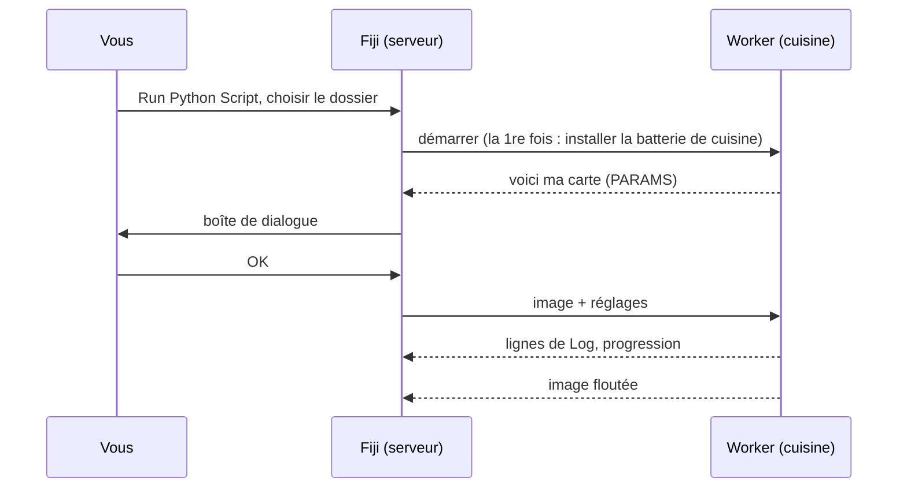

# Votre première exécution

## L'idée en mots simples

C'est l'heure de la première commande. Nous allons utiliser le **script
modèle**, une toute petite recette qui floute une image (un flou gaussien),
sur l'exemple *Blobs* intégré à Fiji. Le flou lui-même est volontairement
banal : il vous permet de voir tout le trajet, de la boîte de dialogue à la
cuisine et retour, sans surprise.



## Étape 1 : récupérer le dossier modèle

Téléchargez le modèle sous forme de zip et décompressez-le à un endroit où
vous le retrouverez, par exemple dans *Documents*, ou, si vous utilisez
VS Code, laissez-le cloner le modèle pour vous :

[Télécharger le ZIP](https://github.com/Oxford-Zeiss-Centre-of-Excellence/Wavu-Script-Template/archive/refs/heads/main.zip){ .md-button }
[Ouvrir le modèle dans VS Code](vscode://vscode.git/clone?url=https%3A%2F%2Fgithub.com%2FOxford-Zeiss-Centre-of-Excellence%2FWavu-Script-Template.git){ .md-button }

Vous obtenez un dossier nommé `Wavu-Script-Template-main`. Il contient
`script.py` (la recette) et `pixi.toml` (la liste de sa batterie de
cuisine). Un *dossier de script*, ce n'est rien de plus.

!!! tip "Un dossier de trop ?"
    *Extraire tout* de Windows crée parfois un dossier dans un dossier du
    même nom. Le bon est celui qui contient directement `pixi.toml`.

!!! note "Git nécessaire pour l'instant"
    Le modèle télécharge la partie Python de Wavu depuis GitHub, ce qui
    demande que [Git](https://git-scm.com) soit installé sur votre ordinateur.
    Installez-le une fois avec les options par défaut ; vous n'aurez jamais à
    vous *en servir*.

## Étape 2 : ouvrir l'exemple Blobs

Dans Fiji : **File › Open Samples › Blobs (25K)**.

## Étape 3 : lancer le script

1. Choisissez **Plugins › Wavu › Run Python Script**.
2. Un sélecteur de dossier s'ouvre, intitulé
   *Wavu: choose a script folder (contains pixi.toml)*. Sélectionnez le
   dossier `Wavu-Script-Template-main` et confirmez.

!!! info "Le premier démarrage prend quelques minutes, une seule fois"
    La fenêtre Log affiche
    *First start of '…': downloading its Python packages. This happens once
    and can take several minutes…*, et la barre d'état compte les secondes.
    C'est pixi qui installe la batterie de cuisine. Laissez-le terminer ; la fois
    suivante, le script démarre en quelques secondes.

3. La boîte de dialogue **Wavu: script** apparaît. Sa première ligne est la
   description du script, *Gaussian blur -- the Wavu example script.*,
   suivie des champs **Image**, **Sigma (pixels)**, **Edges** et
   **Keep the input's pixel type**, plus une case **Debug in VS Code**
   (laissez-la décochée).

4. Gardez les valeurs par défaut, vérifiez que **Image** affiche
   `blobs.gif`, et cliquez sur **OK**.

## Étape 4 : regarder le résultat

Une nouvelle image nommée **blobs-blurred** s'ouvre : les mêmes taches, en
plus doux. Le Log montre ce qui s'est passé :

```text
[Wavu] Running script [sigma:2.0, mode:reflect, keep_dtype:true]
Blurring a (254, 256) uint8 image with sigma=2.0
[Wavu] script finished
```

Recommencez avec **Sigma (pixels)** réglé sur `8`. Cette fois, ça démarre
tout de suite, parce que la cuisine tourne encore et que la batterie de
cuisine est prête.

## Que s'est-il passé ?

- Fiji a trouvé `pixi.toml` dans le dossier : il a donc su que c'est un
  dossier de script.
- pixi a construit l'environnement propre à ce dossier (dans un dossier
  caché `.pixi`).
- Un worker a démarré dans cet environnement et a dit à Fiji ce que la boîte
  de dialogue devait contenir.
- Fiji a envoyé l'image et vos réglages, puis a ouvert l'image renvoyée.

Le worker continue de tourner jusqu'à ce que vous quittiez Fiji ou que vous
choisissiez **Plugins › Wavu › Stop Worker**.

Vous utilisez napari ? Voir [Votre première exécution dans napari](../napari/first-run.md).

## En une phrase

Choisissez un dossier de script dans **Run Python Script**, attendez une
seule fois son environnement, remplissez la boîte de dialogue, et le
résultat s'ouvre dans Fiji.

[Suite : écrire votre propre script :material-arrow-right:](../write/get-the-template.md){ .md-button }
