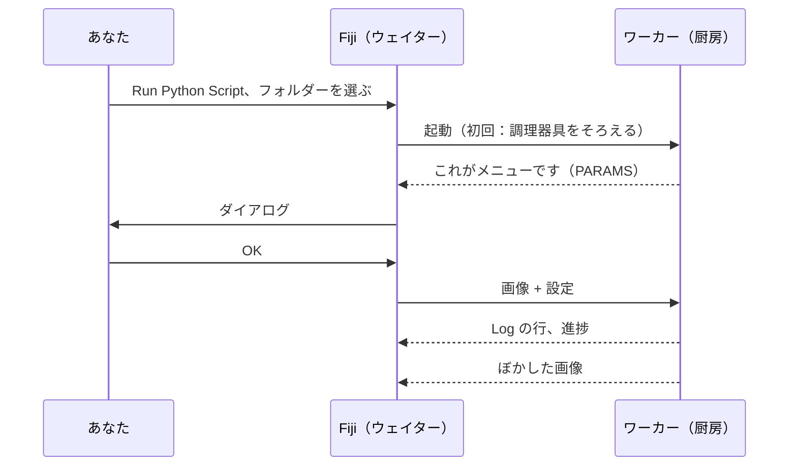

# 最初の実行

## やさしく言うと

最初の注文の時間です。**テンプレートスクリプト** を使います。これは画像を
ぼかす（ガウスぼかし）小さなレシピで、Fiji に付属しているサンプル画像
*Blobs* に使います。ぼかし自体はわざと地味にしてあります。そのおかげで、
ダイアログから厨房へ行って戻ってくるまでの流れ全体を、驚きなしに
見ることができます。



## ステップ 1：テンプレートフォルダーを手に入れる

テンプレートを zip でダウンロードし、あとで見つけられる場所、たとえば
*ドキュメント* に解凍します。

[ZIP をダウンロード](https://github.com/Oxford-Zeiss-Centre-of-Excellence/Wavu-Script-Template/archive/refs/heads/main.zip){ .md-button }

`Wavu-Script-Template-main` というフォルダーができます。中には
`script.py`（レシピ）と `pixi.toml`（調理器具のリスト）があります。
*スクリプトフォルダー* とは、これだけのものです。

!!! tip "フォルダーが 1 段深すぎる？"
    Windows の *Extract All*（すべて展開）は、同じ名前のフォルダーの中に
    もう 1 つフォルダーを作ることがあります。正しいのは、`pixi.toml` を
    直接含んでいるフォルダーです。

!!! note "今のところ Git が必要です"
    テンプレートは Wavu 自身の Python 部分を GitHub からダウンロード
    するため、コンピューターに [Git](https://git-scm.com) が必要です。
    既定の設定で一度インストールしておけば、自分で *使う* 必要はありません。

## ステップ 2：Blobs サンプルを開く

Fiji で **File › Open Samples › Blobs (25K)** を選びます。

## ステップ 3：スクリプトを実行する

1. **Plugins › Wavu › Run Python Script** を選びます。
2. *Wavu: choose a script folder (contains pixi.toml)* という題名の
   フォルダー選択画面が開きます。`Wavu-Script-Template-main` フォルダーを
   選んで確定します。

!!! info "最初の起動は一度だけ数分かかります"
    Log ウィンドウに
    *First start of '…': downloading its Python packages. This happens once
    and can take several minutes…* と表示され、ステータスバーが秒数を
    数えます。これは pixi が調理器具をそろえているところです。終わるまで
    待ってください。次からは数秒で起動します。

3. **Wavu: script** ダイアログが表示されます。1 行目はスクリプトの説明
   *Gaussian blur -- the Wavu example script.* で、その下に **Image**、
   **Sigma (pixels)**、**Edges**、**Keep the input's pixel type** の欄と、
   **Debug in VS Code** チェックボックスがあります（オフのままにします）。

4. 既定値のまま、**Image** が `blobs.gif` になっていることを確かめて、
   **OK** を押します。

## ステップ 4：結果を見る

**blobs-blurred** という新しい画像が開きます。同じブロブが、やわらかく
なっています。Log には何が起きたかが表示されます。

```text
[Wavu] Running script [sigma:2.0, mode:reflect, keep_dtype:true]
Blurring a (254, 256) uint8 image with sigma=2.0
[Wavu] script finished
```

**Sigma (pixels)** を `8` にして、もう一度試してみてください。今度はすぐに
始まります。厨房がまだ開いていて、調理器具もそろっているからです。

## 今、何が起きたの？

- Fiji はフォルダーの中に `pixi.toml` を見つけたので、これがスクリプト
  フォルダーだと分かりました。
- pixi がそのフォルダー専用の環境を作りました（隠しフォルダー `.pixi` の中）。
- その環境でワーカーが起動し、ダイアログに何を載せるかを Fiji に伝えました。
- Fiji は画像と設定を送り、戻ってきた画像を開きました。

ワーカーは、Fiji を終了するか **Plugins › Wavu › Stop Worker** を選ぶまで
動き続けます。

napari を使っていますか？ [napari での最初の実行](../napari/first-run.md) を見てください。

## ひとことで言うと

**Run Python Script** でスクリプトフォルダーを選び、環境ができるのを一度
待ち、ダイアログに入力すれば、結果が Fiji で開きます。

[次へ：自分のスクリプトを書く :material-arrow-right:](../write/get-the-template.md){ .md-button }
