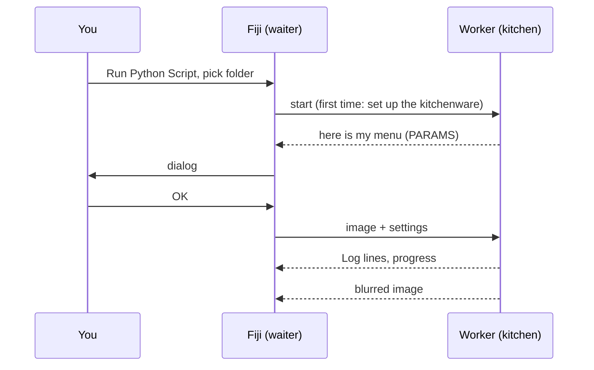

# Your first run

## The idea in plain words

Time for the first order. We will use the **template script**, a tiny recipe
that blurs an image (a Gaussian blur), on Fiji's built-in *Blobs* sample.
The blur itself is boring on purpose: it lets you see the whole trip, from
dialog to kitchen and back, without any surprises.



## Step 1: get the template folder

Download the template as a zip and unzip it somewhere you can find it again,
for example in *Documents*:

[Download ZIP](https://github.com/Oxford-Zeiss-Centre-of-Excellence/Wavu-Script-Template/archive/refs/heads/main.zip){ .md-button }

You get a folder called `Wavu-Script-Template-main`. Inside are
`script.py` (the recipe) and `pixi.toml` (the list of its kitchenware).
That is all a *script folder* is.

!!! tip "One folder too deep?"
    Windows' *Extract All* sometimes creates a folder inside a folder of the
    same name. The right one is the folder that directly contains
    `pixi.toml`.

!!! note "Git needed for now"
    The template downloads Wavu's own Python part from GitHub, which needs
    [Git](https://git-scm.com) installed on your computer. Install it once
    with the default options; you never have to *use* it.

## Step 2: open the Blobs sample

In Fiji: **File › Open Samples › Blobs (25K)**.

## Step 3: run the script

1. Choose **Plugins › Wavu › Run Python Script**.
2. A folder chooser opens, titled
   *Wavu: choose a script folder (contains pixi.toml)*. Select the
   `Wavu-Script-Template-main` folder and confirm.

!!! info "The first start takes a few minutes, once"
    The Log window says
    *First start of '…': downloading its Python packages. This happens once
    and can take several minutes…*, and the status bar counts the seconds.
    This is pixi setting up the kitchenware. Let it finish; next time the script
    starts in seconds.

3. The dialog **Wavu: script** appears. Its first line is the script's
   description, *Gaussian blur -- the Wavu example script.*, followed by the
   fields **Image**, **Sigma (pixels)**, **Edges** and
   **Keep the input's pixel type**, plus a **Debug in VS Code** checkbox
   (leave it off).

4. Leave the defaults, check that **Image** shows `blobs.gif`, and press
   **OK**.

## Step 4: look at the result

A new image called **blobs-blurred** opens: the same blobs, softer. The Log
shows what happened:

```text
[Wavu] Running script [sigma:2.0, mode:reflect, keep_dtype:true]
Blurring a (254, 256) uint8 image with sigma=2.0
[Wavu] script finished
```

Try again with **Sigma (pixels)** set to `8`. This time it starts at once,
because the kitchen is still running and the kitchenware is ready.

## What just happened?

- Fiji found `pixi.toml` in the folder, so it knew this is a script folder.
- pixi built that folder's own environment (inside a hidden `.pixi` folder).
- A worker started in that environment and told Fiji what the dialog
  should contain.
- Fiji sent the image and your settings, and opened the image that came
  back.

The worker keeps running until you quit Fiji or choose
**Plugins › Wavu › Stop Worker**.

Using napari? See [Your first run in napari](../napari/first-run.md).

## In one sentence

Pick a script folder in **Run Python Script**, wait once for its environment,
fill in the dialog, and the result opens in Fiji.

[Next: write your own script :material-arrow-right:](../write/get-the-template.md){ .md-button }
