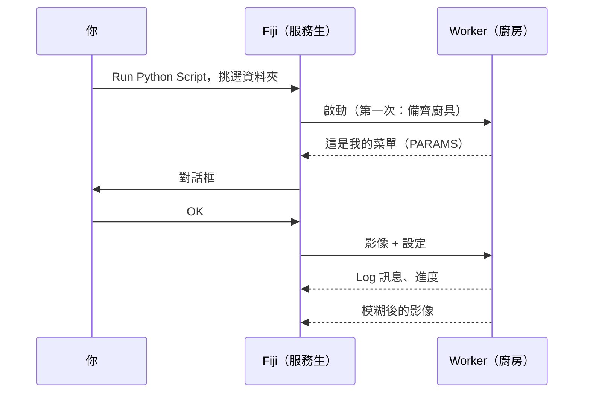

# 第一次執行

## 用白話說

該點第一道菜了。我們會用**範本腳本**：一道把影像模糊化（高斯模糊）的小
食譜，套用在 Fiji 內建的 *Blobs* 範例影像上。模糊本身故意做得很無聊：這樣
你就能看清整趟旅程，從對話框到廚房再回來，不會有任何意外。



## 步驟 1：取得範本資料夾

把範本下載成 zip 檔，解壓縮到你之後找得到的地方，例如*文件*資料夾：

[下載 ZIP](https://github.com/Oxford-Zeiss-Centre-of-Excellence/Wavu-Script-Template/archive/refs/heads/main.zip){ .md-button }

你會得到一個叫 `Wavu-Script-Template-main` 的資料夾。裡面有
`script.py`（食譜）和 `pixi.toml`（它的廚具清單）。所謂的
*腳本資料夾*，就只是這樣而已。

!!! tip "多了一層資料夾？"
    Windows 的 *Extract All*（全部解壓縮）有時會在資料夾裡再建一個同名的
    資料夾。正確的是直接包含 `pixi.toml` 的那一層。

!!! note "目前需要 Git"
    範本會從 GitHub 下載 Wavu 自己的 Python 部分，所以電腦上需要安裝
    [Git](https://git-scm.com)。用預設選項安裝一次即可；你完全不需要*使用*它。

## 步驟 2：開啟 Blobs 範例

在 Fiji 中：**File › Open Samples › Blobs (25K)**。

## 步驟 3：執行腳本

1. 選擇 **Plugins › Wavu › Run Python Script**。
2. 會開啟一個資料夾選擇視窗，標題是
   *Wavu: choose a script folder (contains pixi.toml)*。選擇
   `Wavu-Script-Template-main` 資料夾並確認。

!!! info "第一次啟動要等幾分鐘，只有一次"
    Log 視窗會顯示
    *First start of '…': downloading its Python packages. This happens once
    and can take several minutes…*，狀態列也會計算秒數。這是 pixi 在補齊
    廚具。讓它跑完；下次這個腳本幾秒內就能啟動。

3. 出現 **Wavu: script** 對話框。第一行是腳本的說明
   *Gaussian blur -- the Wavu example script.*，接著是
   **Image**、**Sigma (pixels)**、**Edges** 和
   **Keep the input's pixel type** 這幾個欄位，還有一個
   **Debug in VS Code** 核取方塊（保持不勾選）。

4. 保留預設值，確認 **Image** 顯示的是 `blobs.gif`，然後按 **OK**。

## 步驟 4：看看結果

一張名為 **blobs-blurred** 的新影像會開啟：一樣的斑點，只是比較柔和。
Log 會顯示發生了什麼事：

```text
[Wavu] Running script [sigma:2.0, mode:reflect, keep_dtype:true]
Blurring a (254, 256) uint8 image with sigma=2.0
[Wavu] script finished
```

把 **Sigma (pixels)** 改成 `8` 再試一次。這次會立刻開始，因為廚房還開著，
廚具也都備齊了。

## 剛才發生了什麼？

- Fiji 在資料夾裡找到 `pixi.toml`，因此知道這是一個腳本資料夾。
- pixi 為這個資料夾建立了專屬的環境（放在隱藏的 `.pixi` 資料夾裡）。
- 一個 worker（廚房）在這個環境中啟動，並告訴 Fiji 對話框該有哪些內容。
- Fiji 送出影像和你的設定，再開啟傳回來的影像。

worker 會一直執行，直到你結束 Fiji，或選擇
**Plugins › Wavu › Stop Worker**。

在用 napari？請看 [在 napari 中第一次執行](../napari/first-run.md)。

## 一句話總結

在 **Run Python Script** 中挑一個腳本資料夾，等它的環境建好一次，填好
對話框，結果就會在 Fiji 中開啟。

[下一步：撰寫你自己的腳本 :material-arrow-right:](../write/get-the-template.md){ .md-button }
