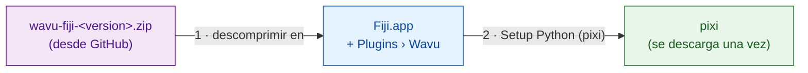

# Instalar Wavu en Fiji

## La idea en palabras sencillas

Instalar Wavu es como contratar al camarero. Copias unos pocos archivos
pequeños en Fiji, y eso añade un menú **Plugins › Wavu**. Después le pides a
Wavu que traiga **pixi**, la herramienta que llena la despensa de cada script
(descarga Python y los paquetes que necesita un script). *No* tienes que
instalar Python, conda ni nada más por tu cuenta.



!!! note "Pronto habrá un sitio de actualización de Fiji"
    Pronto podrás instalar Wavu marcando una casilla en **Help › Update…**.
    Hasta entonces, usa el zip de abajo. Son dos minutos.

## Paso 1: descarga el zip

Ve a la
[última versión de Wavu](https://github.com/Oxford-Zeiss-Centre-of-Excellence/Wavu/releases/latest)
y descarga **`wavu-fiji-<version>.zip`** (en *Assets*).

## Paso 2: descomprímelo en tu carpeta de Fiji { #step-2-unzip-it-into-your-fiji-folder }

El zip contiene una carpeta `scripts`. Tiene que quedar **dentro** de tu
carpeta de Fiji (`Fiji.app`), junto a las carpetas `scripts` y `plugins` de
Fiji, de modo que los archivos acaben en `Fiji.app/scripts/Plugins/Wavu/`.

=== "Windows"

    1. Clic derecho en el zip › **Extract All…** (Extraer todo)
    2. Haz clic en **Browse…** (Examinar) y elige tu carpeta `Fiji.app`.
    3. Haz clic en **Extract** (Extraer). Si Windows pregunta por carpetas
       que ya existen, deja que las combine.

=== "macOS"

    `Fiji.app` es una carpeta especial de tipo "paquete", y arrastrar carpetas
    sobre ella en el Finder puede *reemplazar* la carpeta `scripts` de Fiji en
    lugar de combinarla. Lo más seguro es un solo comando en la Terminal
    (Applications › Utilities › Terminal). Cambia la ruta si Fiji no está en
    Applications:

    ```sh
    unzip -o ~/Downloads/wavu-fiji-*.zip -d /Applications/Fiji.app
    ```

    Deberías ver algunas líneas como
    `inflating: /Applications/Fiji.app/scripts/Plugins/Wavu/Run_Python_Script.groovy`.

=== "Linux"

    Usa *Extraer en…* en tu gestor de archivos y elige `Fiji.app`, o bien:

    ```sh
    unzip -o ~/Downloads/wavu-fiji-*.zip -d ~/Fiji.app
    ```

    Deberías ver líneas como
    `inflating: …/Fiji.app/scripts/Plugins/Wavu/Run_Python_Script.groovy`.

## Paso 3: reinicia Fiji y busca el menú

Cierra Fiji y vuelve a abrirlo. Abre el menú **Plugins**. Cerca del final
deberías ver ahora **Wavu** con cuatro entradas:

- **Connect to Running Worker** (conectar con un worker en marcha)
- **Run Python Script** (ejecutar script de Python)
- **Setup Python (pixi)** (preparar Python)
- **Stop Worker** (detener el worker)

## Paso 4: Setup Python (pixi), una sola vez

Elige **Plugins › Wavu › Setup Python (pixi)**. Wavu descarga el programa
oficial pixi (unos 20 MB), comprueba que la descarga es auténtica y lo guarda
dentro de `Fiji.app/wavu/` (o en `~/.wavu/bin` si la carpeta de Fiji es de
solo lectura). La ventana Log muestra `Downloading pixi…` y `Checksum OK`.

Cuando termina, una pequeña ventana dice **Ready:** seguido de la versión de
pixi.

!!! tip "¿Ya tienes pixi?"
    Si pixi ya está instalado en tu ordenador, Wavu dice
    *"pixi is already available"* y pregunta si quieres descargarlo de todos
    modos. Haz clic en **Cancel**; Wavu usará el que ya tienes.

Incluso puedes saltarte este paso: la primera vez que un script necesite
pixi, Wavu se ofrecerá a descargarlo por ti.

¿Usas napari? Mira [Instalar wavu-napari](../napari/install.md).

## En una frase

Descomprime un archivo en `Fiji.app`, reinicia Fiji y haz clic una vez en
**Plugins › Wavu › Setup Python (pixi)**: esa es toda la instalación.

[Siguiente: tu primera ejecución :material-arrow-right:](first-run.md){ .md-button }
