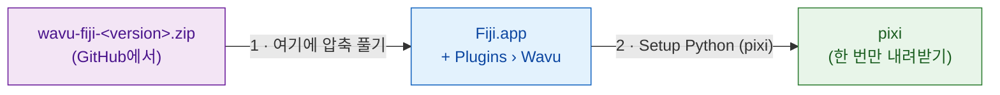

# Fiji에 Wavu 설치하기

## 쉬운 말로 설명하면

Wavu 설치는 웨이터를 고용하는 것과 같아요. 작은 파일 몇 개를 Fiji에
복사하면 **Plugins › Wavu** 메뉴가 생겨요. 그다음 Wavu에게 **pixi**를
가져오라고 해요. pixi는 스크립트마다 창고를 채우는 도구예요(Python과
스크립트에 필요한 패키지를 내려받아요). Python, conda 같은 것을 직접 설치할
필요는 *없어요*.



!!! note "Fiji 업데이트 사이트가 곧 나와요"
    곧 **Help › Update…**에서 체크 하나로 Wavu를 설치할 수 있게 돼요. 그
    전까지는 아래 zip을 쓰세요. 2분이면 돼요.

## 1단계: zip 내려받기

[최신 Wavu 릴리스](https://github.com/Oxford-Zeiss-Centre-of-Excellence/Wavu/releases/latest)에
가서 **`wavu-fiji-<version>.zip`**을 내려받으세요(*Assets* 아래에 있어요).

## 2단계: Fiji 폴더에 압축 풀기 { #step-2-unzip-it-into-your-fiji-folder }

zip 안에는 `scripts` 폴더가 있어요. 이 폴더가 Fiji 폴더(`Fiji.app`) **안에**,
Fiji 자체의 `scripts`, `plugins` 폴더 옆에 들어가야 해요. 그래야 파일이
`Fiji.app/scripts/Plugins/Wavu/`에 놓여요.

=== "Windows"

    1. zip을 오른쪽 클릭 › **Extract All…**(압축 풀기)
    2. **Browse…**(찾아보기)를 눌러 `Fiji.app` 폴더를 골라요.
    3. **Extract**(압축 풀기)를 눌러요. 이미 있는 폴더에 대해 물으면
       합치도록 허용하세요.

=== "macOS"

    `Fiji.app`은 특별한 "패키지" 폴더라서, Finder에서 폴더를 끌어다 놓으면
    Fiji의 `scripts` 폴더가 합쳐지지 않고 *대체*될 수 있어요. 가장 안전한
    방법은 터미널 명령 한 줄이에요(Applications › Utilities › Terminal).
    Fiji가 Applications에 없다면 경로를 바꾸세요.

    ```sh
    unzip -o ~/Downloads/wavu-fiji-*.zip -d /Applications/Fiji.app
    ```

    `inflating: /Applications/Fiji.app/scripts/Plugins/Wavu/Run_Python_Script.groovy`
    같은 줄이 몇 개 보이면 돼요.

=== "Linux"

    파일 관리자의 *Extract to…*(압축 풀 위치)로 `Fiji.app`을 고르거나,
    다음을 실행하세요.

    ```sh
    unzip -o ~/Downloads/wavu-fiji-*.zip -d ~/Fiji.app
    ```

    `inflating: …/Fiji.app/scripts/Plugins/Wavu/Run_Python_Script.groovy`
    같은 줄이 보이면 돼요.

## 3단계: Fiji를 다시 시작하고 메뉴 찾기

Fiji를 종료했다가 다시 시작하세요. **Plugins** 메뉴를 열면 아래쪽에
항목 네 개가 있는 **Wavu**가 보여요.

- **Connect to Running Worker**(실행 중인 워커에 연결)
- **Run Python Script**(Python 스크립트 실행)
- **Setup Python (pixi)**(Python 설정)
- **Stop Worker**(워커 중지)

## 4단계: Setup Python (pixi), 한 번만

**Plugins › Wavu › Setup Python (pixi)**를 고르세요. Wavu가 공식 pixi
프로그램(약 20 MB)을 내려받고, 진짜 파일인지 확인한 다음
`Fiji.app/wavu/`에 보관해요(Fiji 폴더가 읽기 전용이면 `~/.wavu/bin`).
Log 창에 `Downloading pixi…`와 `Checksum OK`가 표시돼요.

끝나면 작은 창에 **Ready:**와 pixi 버전이 나와요.

!!! tip "pixi가 이미 있나요?"
    컴퓨터에 pixi가 이미 설치되어 있으면 Wavu가
    *"pixi is already available"*이라고 알려 주고, 그래도 내려받을지 물어요.
    **Cancel**을 누르세요. Wavu가 이미 있는 것을 써요.

이 단계는 건너뛰어도 돼요. 스크립트가 처음 pixi를 필요로 할 때 Wavu가
내려받겠냐고 물어봐요.

napari를 쓰나요? [wavu-napari 설치하기](../napari/install.md)를 보세요.

## 한 문장으로

파일 하나를 `Fiji.app`에 압축 풀고, Fiji를 다시 시작하고,
**Plugins › Wavu › Setup Python (pixi)**를 한 번 누르면 설치 끝이에요.

[다음: 첫 실행 :material-arrow-right:](first-run.md){ .md-button }
