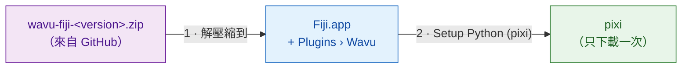

# 在 Fiji 中安裝 Wavu

## 用白話說

安裝 Wavu 就像僱用服務生。你把幾個小檔案複製到 Fiji 裡，Fiji 就會多出
**Plugins › Wavu** 選單。接著請 Wavu 去取得 **pixi**，也就是負責補齊每個
腳本廚具的工具（它會下載 Python 和腳本需要的套件）。你*不用*自己安裝
Python、conda 或其他任何東西。



!!! note "Fiji 更新站點即將推出"
    很快你就能在 **Help › Update…** 裡勾選一個方塊來安裝 Wavu。在那之前，
    請使用下面的 zip 檔，只要兩分鐘。

## 步驟 1：下載 zip 檔

前往
[最新的 Wavu 發布版本](https://github.com/Oxford-Zeiss-Centre-of-Excellence/Wavu/releases/latest)，
下載 **`wavu-fiji-<version>.zip`**（在 *Assets* 底下）。

## 步驟 2：解壓縮到你的 Fiji 資料夾 { #step-2-unzip-it-into-your-fiji-folder }

zip 檔裡有一個 `scripts` 資料夾。它必須放在你的 Fiji 資料夾（`Fiji.app`）
**裡面**，和 Fiji 自己的 `scripts`、`plugins` 資料夾並排，這樣檔案才會落在
`Fiji.app/scripts/Plugins/Wavu/`。

=== "Windows"

    1. 在 zip 檔上按右鍵 › **Extract All…**（全部解壓縮）
    2. 按 **Browse…**（瀏覽），選擇你的 `Fiji.app` 資料夾。
    3. 按 **Extract**（解壓縮）。如果 Windows 詢問是否處理既有的資料夾，
       請允許合併。

=== "macOS"

    `Fiji.app` 是一種特殊的「套件」資料夾，在 Finder 裡把資料夾拖進去，
    可能會*取代* Fiji 的 `scripts` 資料夾，而不是合併。最安全的做法是在
    終端機（Applications › Utilities › Terminal）裡執行一行指令。如果 Fiji
    不在「應用程式」裡，請修改路徑：

    ```sh
    unzip -o ~/Downloads/wavu-fiji-*.zip -d /Applications/Fiji.app
    ```

    你應該會看到幾行像
    `inflating: /Applications/Fiji.app/scripts/Plugins/Wavu/Run_Python_Script.groovy`
    的輸出。

=== "Linux"

    用檔案管理員的「解壓縮到…」並選擇 `Fiji.app`，或者：

    ```sh
    unzip -o ~/Downloads/wavu-fiji-*.zip -d ~/Fiji.app
    ```

    你應該會看到像
    `inflating: …/Fiji.app/scripts/Plugins/Wavu/Run_Python_Script.groovy`
    的輸出。

## 步驟 3：重新啟動 Fiji，找到選單

結束 Fiji 再重新開啟。打開 **Plugins** 選單，在靠近底部的地方應該會看到
**Wavu**，底下有四個項目：

- **Connect to Running Worker**（連線到執行中的 worker）
- **Run Python Script**（執行 Python 腳本）
- **Setup Python (pixi)**（設定 Python）
- **Stop Worker**（停止 worker）

## 步驟 4：執行一次 Setup Python (pixi)

選擇 **Plugins › Wavu › Setup Python (pixi)**。Wavu 會下載官方的 pixi 程式
（約 20 MB），確認下載的檔案是正版，再把它存放在 `Fiji.app/wavu/` 裡
（如果 Fiji 的資料夾是唯讀的，則放在 `~/.wavu/bin`）。Log 視窗會顯示
`Downloading pixi…` 和 `Checksum OK`。

完成後，一個小視窗會顯示 **Ready:**，後面接著 pixi 的版本。

!!! tip "已經有 pixi 了？"
    如果你的電腦上已經裝了 pixi，Wavu 會說
    *"pixi is already available"*，並詢問是否仍要下載。按 **Cancel**，
    Wavu 就會使用你現有的那一個。

你甚至可以跳過這一步：第一次有腳本需要 pixi 時，Wavu 會主動幫你下載。

在用 napari？請看 [安裝 wavu-napari](../napari/install.md)。

## 一句話總結

把一個檔案解壓縮到 `Fiji.app`、重新啟動 Fiji，再按一次
**Plugins › Wavu › Setup Python (pixi)**：安裝就這樣完成了。

[下一步：第一次執行 :material-arrow-right:](first-run.md){ .md-button }
