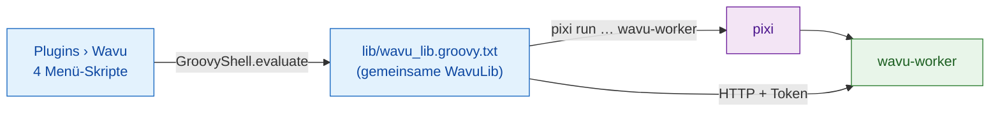

# Interna von wavu-fiji (für Fortgeschrittene)

!!! abstract "Für Neugierige und für Maintainer"
    Sie brauchen diese Seite nicht, um Wavu in Fiji zu benutzen. Sie erklärt,
    wie der Fiji-Kellner gebaut ist. Die Seite des Workers steht unter
    [Architektur](../model/architecture.md).

## Die Idee in einfachen Worten

Ein Kellner braucht keine eigene Küche, nur einen Notizblock und gute
Manieren. Der Fiji-Kellner ist genau das: **eine Handvoll
Groovy-Skripte als reiner Text**, kein kompiliertes Java, kein jar. Fiji
macht aus jeder `.groovy`-Datei unter `scripts/Plugins/` einen Menüeintrag,
das Hineinlegen der Dateien ist also schon die ganze Installation.

## Die Dateien { #the-files }

Alles liegt in `Fiji.app/scripts/Plugins/Wavu/`:

| Datei | Menüeintrag |
|---|---|
| `Run_Python_Script.groovy` | **Run Python Script** |
| `Run_Script_(Macro).groovy` | **Run Script (Macro)**: aufzeichenbar, ohne Dialoge, für Makros und Batch-Workflows |
| `Setup_Python_(pixi).groovy` | **Setup Python (pixi)** |
| `Connect_to_Running_Worker.groovy` | **Connect to Running Worker** |
| `Stop_Worker.groovy` | **Stop Worker** |
| `lib/wavu_lib.groovy.txt` | keiner: die gemeinsame Bibliothek |

**Warum kein jar?** Ein jar braucht einen Java-Build, der gepflegt werden
muss, und zusätzliche Java-Bibliotheken im einen gemeinsamen Klassenpfad von
Fiji können mit anderen Plugins kollidieren. Einfaches HTTP über
`HttpURLConnection` braucht nichts außer dem JDK (Entscheidungen D1 und D6
im
[Entscheidungsprotokoll](https://github.com/Oxford-Zeiss-Centre-of-Excellence/Wavu/blob/main/docs/decisions.md),
auf Englisch).

**Warum `.groovy.txt`?** Keine Skriptsprache beansprucht `.txt`, deshalb
macht Fiji aus der Bibliothek keinen Menüeintrag. Jedes Menü-Skript lädt sie
in vier Zeilen mit `new GroovyShell(this.class.classLoader).evaluate(file)`
und erhält ein `WavuLib`-Objekt. Die Umgebungsvariable `WAVU_LIB` zeigt auf
eine andere Kopie, die die Tests verwenden. Laufende Worker werden in
`System.getProperties()` unter `wavu.workers` gespeichert, weil das zwischen
Menübefehlen erhalten bleibt. Der Code vermeidet APIs ab Java 9, läuft also
auch auf älteren Fiji-Builds mit Java 8.

## pixi finden und installieren { #finding-and-installing-pixi }

Wavu sucht pixi in dieser Reihenfolge und nimmt das erste, das es findet:

1. die IJ-Einstellung `wavu.pixi`;
2. `<Fiji>/wavu/pixi` (`pixi.exe` unter Windows);
3. `~/.wavu/bin/`;
4. jeden Ordner in `PATH`;
5. `~/.pixi/bin/` (wo der Installer pixi.sh es ablegt).

**Setup Python (pixi)**, oder der erste Durchlauf ohne pixi, lädt es
herunter:

- Das Release-Tag kommt aus der Weiterleitung `releases/latest` von GitHub,
  außer die Einstellung `wavu.pixi.version` legt eines fest;
- es lädt `sha256.sum` und das Archiv für Ihr System aus demselben Release
  herunter, prüft die SHA-256-Prüfsumme und bricht bei jeder Abweichung ab;
- es entpackt das Programm nach `<Fiji>/wavu/`, oder nach `~/.wavu/bin/`,
  wenn der Fiji-Ordner schreibgeschützt ist, und speichert den Pfad in
  `wavu.pixi`.

## Vom Ordner zum Dialog { #from-folder-to-dialog }

**Run Python Script** listet zuerst auf, was es schon kennt: *running:*
Worker und *installed:* Skripte, plus *&lt;choose a script folder...&gt;*.
Ein neuer Ordner muss `pixi.toml` enthalten. Läuft für ihn noch kein Worker,
startet Wavu einen mit
`pixi run --manifest-path … wavu-worker --script-dir …`; hat der Ordner noch
kein `.pixi`, warnt das Log, dass beim ersten Start Pakete heruntergeladen
werden. Die Statusleiste zählt die Sekunden, und **Esc** gibt auf.

Dann folgt `GET /scripts`. Enthält der Ordner mehrere Skripte, fragt ein
kleiner Dialog, welches. Die `PARAMS` des Skripts werden zu einem
`GenericDialog`, mit der ersten Zeile des Docstrings des Skripts oben:

| `PARAMS`-Typ | Dialogfeld | Gesendet als |
|---|---|---|
| `float` | Zahlenfeld, 3 Nachkommastellen | Zahl |
| `int` | Zahlenfeld, 0 Nachkommastellen | gerundete ganze Zahl |
| `bool` | Kontrollkästchen | true/false |
| `choice` | Auswahlliste der `choices` | der gewählte Text |
| `image` | Auswahlliste der Titel offener Bilder (das aktuelle zuerst) | das Bild, als Eingabe |
| `str` | Textfeld | Text |

Hat Fiji den Worker selbst gestartet, kommt als letztes Kästchen
**Debug in VS Code (restart worker with debugpy on port 5678)** hinzu.

## Wie Bilder hinausgehen { #how-images-go-out }

Jedes `image`-Feld wird zu einer Eingabe:

- **Form und Achsen:** Die Dimensionen von ImageJ werden zur
  NumPy-Reihenfolge `T Z C Y X` (T, Z und C nur, wenn länger als 1);
  RGB-Bilder bekommen am Ende ein `S` (3 Samples).
- **Kalibrierung:** Ist die Einheit µm oder micron, wird die Pixelbreite zu
  `meta.pixel_um` (nm wird durch 1000 geteilt). Der Titel geht ebenfalls
  mit.
- **Transport:** Bis zu 4 MiB Pixel reisen inline (8, 16 oder 32 Bit, oder
  RGB als verschachtelte Bytes); größere Bilder und 8-Bit-Farbbilder (zuerst
  in RGB umgewandelt) werden als TIFF in einem temporären Ordner gespeichert
  und als Pfad geschickt.

## Wie Ergebnisse zurückkommen { #how-results-come-back }

| Ausgabeart | Was Fiji tut |
|---|---|
| `image` | öffnet ein neues Bild namens `<input title>-<output name>`; ein 3-D-Inline-Bild, dessen `axes` mit `C` beginnen, wird ein Composite, `T` ergibt Frames, sonst Schichten (Slices). Enthält der Name `label` (und ist es kein RGB), wird die LUT **glasbey on dark** angewendet. |
| `table` | öffnet die CSV-Datei als **Results**-Tabelle |
| `rois` | lädt die ZIP-Datei in den **ROI Manager** und zeigt alle auf der Eingabe an |
| `file`, `value` | eine Zeile im Log |

Kalibrierung: `pixel_um` im `meta` der Ausgabe setzt Mikrometer; sonst
übernimmt eine Ausgabe mit gleicher Breite und Höhe wie die Eingabe deren
Kalibrierung. `channel_names` werden zu Schicht-Beschriftungen (Slice
Labels).

Während der Auftrag läuft, gehen `log`-Ereignisse ins Log und `progress` in
den Fortschrittsbalken und die Statusleiste. **Esc** sendet
`POST /jobs/<id>/cancel`, was das Skript bittet, anzuhalten
([kooperativ](../write/logs-progress-cancel.md)). Ein Fehler öffnet ein
kurzes Meldungsfenster; der vollständige Traceback steht im Log.

Fiji vergleicht außerdem seine eigene Version mit der des Workers
(major.minor) und schreibt eine *Note* ins Log, wenn sie sich unterscheiden.

## Installierte Skripte und Menü-Stubs { #installed-scripts-and-menu-stubs }

`wavu package` (siehe [Mit dem eigenen Labor teilen](with-your-lab.md))
baut einen Verzeichnisbaum, der sich in `Fiji.app` entpacken lässt:

- `wavu/scripts/<name>/` enthält `script.py`, `pixi.toml`, `pixi.lock` und
  `README.md`;
- `scripts/Plugins/<Menu>/<Title>.groovy` ist ein winziger Stub, der die
  Bibliothek lädt und `runScriptFolder` für diesen Ordner aufruft, es gibt
  also keine Ordnerauswahl.

Für Ordner unter `<Fiji>/wavu/scripts/`, die eine `pixi.lock` haben, wird
der Worker mit `pixi run --frozen` gestartet, sodass die Nutzer genau die
mitgelieferten Versionen bekommen.

## Anhängen und Stoppen { #attach-and-stop }

**Connect to Running Worker** liest eine Handshake-Datei (Standard
`~/.wavu/worker.json`), einen optionalen **Host** (ein anderer Rechner)
und, für Container, einen Ordner auf dem Host und
denselben Ordner im Container; Pfade werden in beide Richtungen übersetzt.
**Stop Worker** sendet `/shutdown` an jeden Worker, den dieses Fiji
gestartet oder mit dem es sich verbunden hat, und schließt die Pipe derer,
die es gestartet hat.

## Dasselbe Skript in napari { #same-script-in-napari }

Der napari-Kellner erledigt dieselbe Arbeit mit Python-Widgets und Layern:
siehe [Interna von wavu-napari](../napari/internals.md).

## In einem Satz

wavu-fiji besteht aus vier Groovy-Menü-Skripten plus einer gemeinsamen
Bibliotheksdatei, die pixi finden, pro Ordner einen Worker starten, `PARAMS`
in einen `GenericDialog` verwandeln und die Ausgaben wieder in Bilder,
Tabellen und ROIs zurückverwandeln.
