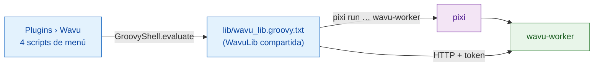

# Funcionamiento interno de wavu-fiji (avanzado)

!!! abstract "Para curiosos y para quienes lo mantienen"
    No necesitas esta página para usar Wavu en Fiji. Explica cómo está hecho
    el camarero de Fiji. La parte del worker está en
    [Arquitectura](../model/architecture.md).

## La idea en palabras sencillas

Un camarero no necesita cocina propia, solo una libreta y buenos modales. El
camarero de Fiji es exactamente eso: **un puñado de scripts Groovy en texto
plano**, sin Java compilado, sin jar. Fiji convierte cada archivo `.groovy`
que hay bajo `scripts/Plugins/` en una entrada de menú, así que copiar los
archivos es toda la instalación.

## Los archivos

Todo está en `Fiji.app/scripts/Plugins/Wavu/`:

| Archivo | Entrada de menú |
|---|---|
| `Run_Python_Script.groovy` | **Run Python Script** |
| `Setup_Python_(pixi).groovy` | **Setup Python (pixi)** |
| `Connect_to_Running_Worker.groovy` | **Connect to Running Worker** |
| `Stop_Worker.groovy` | **Stop Worker** |
| `lib/wavu_lib.groovy.txt` | ninguna: la biblioteca compartida |

**¿Por qué no un jar?** Un jar necesita una compilación de Java que hay que
mantener, y las bibliotecas Java adicionales en el único classpath compartido
de Fiji pueden chocar con otros plugins. HTTP simple mediante
`HttpURLConnection` no necesita nada más que el JDK (decisiones D1 y D6 del
[registro de decisiones](https://github.com/Oxford-Zeiss-Centre-of-Excellence/Wavu/blob/main/docs/decisions.md),
en inglés).

**¿Por qué `.groovy.txt`?** Ningún lenguaje de scripts reclama `.txt`, así que
Fiji no convierte la biblioteca en una entrada de menú. Cada script de menú la
carga en cuatro líneas con
`new GroovyShell(this.class.classLoader).evaluate(file)` y obtiene un objeto
`WavuLib`. La variable de entorno `WAVU_LIB` apunta a otra copia, que usan las
pruebas. Los workers en marcha se guardan en `System.getProperties()` bajo
`wavu.workers`, porque eso sobrevive entre comandos de menú. El código evita
las API de Java 9+, así que también funciona en las versiones antiguas de Fiji
con Java 8.

## Encontrar e instalar pixi

Wavu busca pixi en este orden y usa el primero que encuentra:

1. la preferencia de IJ `wavu.pixi`;
2. `<Fiji>/wavu/pixi` (`pixi.exe` en Windows);
3. `~/.wavu/bin/`;
4. cada carpeta del `PATH`;
5. `~/.pixi/bin/` (donde lo pone el instalador pixi.sh).

**Setup Python (pixi)**, o la primera ejecución sin pixi, lo descarga:

- la etiqueta de versión sale de la redirección `releases/latest` de GitHub,
  salvo que la preferencia `wavu.pixi.version` fije una;
- descarga `sha256.sum` y el archivo comprimido para tu sistema desde la misma
  versión, comprueba el SHA-256 y se detiene ante cualquier discrepancia;
- descomprime el binario en `<Fiji>/wavu/`, o en `~/.wavu/bin/` si la carpeta
  de Fiji es de solo lectura, y guarda la ruta en `wavu.pixi`.

## De la carpeta al diálogo

**Run Python Script** primero lista lo que ya conoce: workers *running:* (en
marcha) y scripts *installed:* (instalados), más
*&lt;choose a script folder...&gt;* (elegir una carpeta de script). Una
carpeta nueva debe contener `pixi.toml`. Si no hay ningún worker vivo para
ella, Wavu arranca uno con
`pixi run --manifest-path … wavu-worker --script-dir …`; si la carpeta aún no
tiene `.pixi`, el Log avisa de que el primer arranque descarga paquetes. La
barra de estado cuenta los segundos, y **Esc** abandona.

Después, `GET /scripts`. Si la carpeta tiene varios scripts, un pequeño
diálogo pregunta cuál. Los `PARAMS` del script se convierten en un
`GenericDialog`, con la primera línea del docstring del script arriba:

| Tipo en `PARAMS` | Campo del diálogo | Se envía como |
|---|---|---|
| `float` | campo numérico, 3 decimales | número |
| `int` | campo numérico, 0 decimales | número entero redondeado |
| `bool` | casilla | true/false |
| `choice` | desplegable con `choices` | el texto elegido |
| `image` | desplegable con los títulos de las imágenes abiertas (la actual primero) | la imagen, como entrada |
| `str` | campo de texto | texto |

Si Fiji arrancó el worker él mismo, se añade una última casilla
**Debug in VS Code (restart worker with debugpy on port 5678)**.

## Cómo salen las imágenes

Cada campo `image` se convierte en una entrada:

- **Forma y ejes:** las dimensiones de ImageJ pasan al orden de NumPy
  `T Z C Y X` (T, Z y C solo cuando miden más de 1); las imágenes RGB llevan
  una `S` final (3 muestras).
- **Calibración:** si la unidad es µm o micron, el ancho del píxel pasa a ser
  `meta.pixel_um` (los nm se dividen entre 1000). El título va también.
- **Transporte:** hasta 4 MiB de píxeles viajan en línea (8, 16 o 32 bits, o
  RGB como bytes intercalados); las imágenes más grandes, y las imágenes en
  color de 8 bits (convertidas antes a RGB), se guardan como TIFF en una
  carpeta temporal y se envían como ruta.

## Cómo vuelven los resultados

| Kind de salida | Qué hace Fiji |
|---|---|
| `image` | abre una imagen nueva llamada `<input title>-<output name>`; una imagen 3-D en línea cuyos `axes` empiezan por `C` se convierte en un composite, `T` da fotogramas (frames) y, si no, cortes (slices). Si el nombre contiene `label` (y no es RGB), se aplica la LUT **glasbey on dark**. |
| `table` | abre el CSV como **Results table** |
| `rois` | carga el zip en el **ROI Manager** y las muestra todas sobre la entrada |
| `file`, `value` | una línea en el Log |

Calibración: `pixel_um` en el `meta` de la salida fija los micrómetros; si
no, una salida con el mismo ancho y alto que la entrada copia la calibración
de la entrada. `channel_names` se convierten en etiquetas de los cortes.

Mientras el trabajo está en marcha, los eventos `log` van al Log y `progress`
a la barra de progreso y a la barra de estado. **Esc** envía
`POST /jobs/<id>/cancel`, que pide al script que se detenga
([de forma cooperativa](../write/logs-progress-cancel.md)). Un error abre un
pequeño mensaje; el traceback completo está en el Log.

Fiji compara además su propia versión con la del worker (major.minor) y
escribe una *Note* en el Log si son distintas.

## Scripts instalados y stubs de menú

`wavu package` (mira [Compartir con tu laboratorio](with-your-lab.md)) crea
un árbol que se descomprime en `Fiji.app`:

- `wavu/scripts/<name>/` contiene `script.py`, `pixi.toml`, `pixi.lock` y
  `README.md`;
- `scripts/Plugins/<Menu>/<Title>.groovy` es un stub (archivo mínimo) que
  carga la biblioteca y llama a `runScriptFolder` sobre esa carpeta, así que
  no aparece ningún selector de carpeta.

Para las carpetas bajo `<Fiji>/wavu/scripts/` que tienen un `pixi.lock`, el
worker se arranca con `pixi run --frozen`, así que los usuarios obtienen
exactamente las versiones distribuidas.

## Conectar y detener

**Connect to Running Worker** lee un archivo de saludo (por defecto
`~/.wavu/worker.json`), un **Host** opcional (otro equipo) y, para
contenedores, una carpeta del equipo anfitrión y esa misma carpeta dentro del
contenedor; las rutas se traducen en ambos sentidos. **Stop Worker** envía `/shutdown` a cada worker que este Fiji
arrancó o al que se conectó, y cierra la tubería de los que arrancó.

## El mismo script en napari

El camarero de napari hace el mismo trabajo con widgets y capas de Python:
mira [Funcionamiento interno de wavu-napari](../napari/internals.md).

## En una frase

wavu-fiji son cuatro scripts Groovy de menú más un archivo de biblioteca
compartida que encuentran pixi, arrancan un worker por carpeta, convierten
`PARAMS` en un `GenericDialog` y vuelven a convertir las salidas en imágenes,
tablas y ROI.
