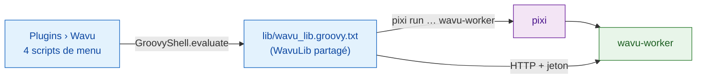

# Fonctionnement interne de wavu-fiji (avancé)

!!! abstract "Pour les curieux et pour les mainteneurs"
    Vous n'avez pas besoin de cette page pour utiliser Wavu dans Fiji. Elle
    explique comment le serveur Fiji est construit. Le côté worker est décrit
    dans [Architecture](../model/architecture.md).

## L'idée en mots simples { #the-idea-in-plain-words }

Un serveur n'a pas besoin de sa propre cuisine, juste d'un carnet et de
bonnes manières. Le serveur Fiji, c'est exactement cela : **une poignée de
scripts Groovy en texte brut**, pas de Java compilé, pas de jar. Fiji
transforme chaque fichier `.groovy` sous `scripts/Plugins/` en entrée de
menu : déposer les fichiers suffit donc à l'installation.

## Les fichiers { #the-files }

Tout se trouve dans `Fiji.app/scripts/Plugins/Wavu/` :

| Fichier | Entrée de menu |
|---|---|
| `Run_Python_Script.groovy` | **Run Python Script** |
| `Run_Script_(Macro).groovy` | **Run Script (Macro)** : enregistrable, sans boîte de dialogue, pour les macros et les workflows par lots |
| `Setup_Python_(pixi).groovy` | **Setup Python (pixi)** |
| `Connect_to_Running_Worker.groovy` | **Connect to Running Worker** |
| `Stop_Worker.groovy` | **Stop Worker** |
| `lib/wavu_lib.groovy.txt` | aucune : la bibliothèque partagée |

**Pourquoi pas de jar ?** Un jar demande une compilation Java à maintenir,
et des bibliothèques Java en plus dans le classpath unique et partagé de
Fiji peuvent entrer en conflit avec d'autres plugins. Du HTTP simple via
`HttpURLConnection` ne demande rien d'autre que le JDK (décisions D1 et D6
du [journal des décisions](https://github.com/Oxford-Zeiss-Centre-of-Excellence/Wavu/blob/main/docs/decisions.md),
en anglais).

**Pourquoi `.groovy.txt` ?** Aucun langage de script ne revendique `.txt`,
donc Fiji ne transforme pas la bibliothèque en entrée de menu. Chaque script
de menu la charge en quatre lignes avec
`new GroovyShell(this.class.classLoader).evaluate(file)` et obtient un objet
`WavuLib`. La variable d'environnement `WAVU_LIB` pointe vers une autre
copie, ce qu'utilisent les tests. Les workers en cours d'exécution sont
conservés dans `System.getProperties()` sous `wavu.workers`, car cela
survit d'une commande de menu à l'autre. Le code évite les API de Java 9+,
il tourne donc aussi sur les anciennes versions de Fiji en Java 8.

## Trouver et installer pixi { #finding-and-installing-pixi }

Wavu cherche pixi dans cet ordre, et utilise le premier qu'il trouve :

1. la préférence IJ `wavu.pixi` ;
2. `<Fiji>/wavu/pixi` (`pixi.exe` sous Windows) ;
3. `~/.wavu/bin/` ;
4. chaque dossier du `PATH` ;
5. `~/.pixi/bin/` (là où l'installeur pixi.sh le met).

**Setup Python (pixi)**, ou la première exécution sans pixi, le télécharge :

- l'étiquette de version vient de la redirection `releases/latest` de
  GitHub, sauf si la préférence `wavu.pixi.version` en impose une ;
- il télécharge `sha256.sum` et l'archive pour votre système depuis la même
  version, vérifie le SHA-256, et s'arrête à la moindre différence ;
- il décompresse le binaire dans `<Fiji>/wavu/`, ou dans `~/.wavu/bin/` si
  le dossier de Fiji est en lecture seule, et enregistre le chemin dans
  `wavu.pixi`.

## Du dossier à la boîte de dialogue { #from-folder-to-dialog }

**Run Python Script** liste d'abord ce qu'il connaît déjà : les workers
*running:* (en cours) et les scripts *installed:* (installés), plus
*&lt;choose a script folder...&gt;* (choisir un dossier de script). Un
nouveau dossier doit contenir `pixi.toml`. Si aucun worker n'est actif pour
lui, Wavu en démarre un avec
`pixi run --manifest-path … wavu-worker --script-dir …` ; si le dossier n'a
pas encore de `.pixi`, le Log prévient que le premier démarrage télécharge
des paquets. La barre d'état compte les secondes, et **Échap** abandonne.

Puis vient `GET /scripts`. Si le dossier contient plusieurs scripts, une
petite boîte de dialogue demande lequel. Les `PARAMS` du script deviennent
un `GenericDialog`, avec en tête la première ligne de la docstring du
script :

| Type `PARAMS` | Champ de la boîte de dialogue | Envoyé comme |
|---|---|---|
| `float` | champ numérique, 3 décimales | nombre |
| `int` | champ numérique, 0 décimale | nombre entier arrondi |
| `bool` | case à cocher | true/false |
| `choice` | liste déroulante des `choices` | le texte choisi |
| `image` | liste déroulante des titres des images ouvertes (l'image active en premier) | l'image, comme entrée |
| `str` | champ de texte | texte |

Si Fiji a démarré le worker lui-même, une dernière case
**Debug in VS Code (restart worker with debugpy on port 5678)** (déboguer
dans VS Code) est ajoutée.

## Comment les images partent { #how-images-go-out }

Chaque champ `image` devient une entrée :

- **Forme et axes :** les dimensions d'ImageJ deviennent l'ordre NumPy
  `T Z C Y X` (T, Z et C seulement s'ils sont plus longs que 1) ; les images
  RGB reçoivent un `S` final (3 échantillons).
- **Calibration :** si l'unité est µm ou micron, la largeur du pixel
  devient `meta.pixel_um` (les nm sont divisés par 1000). Le titre est
  envoyé aussi.
- **Transport :** jusqu'à 4 Mio de pixels voyagent inline (8, 16 ou
  32 bits, ou RGB en octets entrelacés) ; les images plus grandes, et les
  images couleur 8 bits (converties d'abord en RGB), sont enregistrées en
  TIFF dans un dossier temporaire et envoyées comme chemin.

## Comment les résultats reviennent { #how-results-come-back }

| Type de sortie | Ce que fait Fiji |
|---|---|
| `image` | ouvre une nouvelle image nommée `<input title>-<output name>` ; une image inline 3-D dont les `axes` commencent par `C` devient un composite, `T` donne des images temporelles (frames), sinon des coupes (slices). Si le nom contient `label` (et que l'image n'est pas RGB), la LUT **glasbey on dark** est appliquée. |
| `table` | ouvre le CSV comme **Results table** (tableau de résultats) |
| `rois` | charge le zip dans le **ROI Manager** et les affiche toutes sur l'entrée |
| `file`, `value` | une ligne dans le Log |

Calibration : `pixel_um` dans le `meta` de la sortie fixe les microns ;
sinon, une sortie de même largeur et hauteur que l'entrée copie la
calibration de l'entrée. `channel_names` deviennent les étiquettes des
coupes (slice labels).

Pendant la tâche, les événements `log` vont dans le Log, `progress` dans la
barre de progression et la barre d'état. **Échap** envoie
`POST /jobs/<id>/cancel`, qui demande au script de s'arrêter
([de façon coopérative](../write/logs-progress-cancel.md)). Une erreur
ouvre une courte boîte de message ; la trace d'appels complète est dans le
Log.

Fiji compare aussi sa propre version avec celle du worker (majeure.mineure)
et écrit une *Note* dans le Log si elles diffèrent.

## Scripts installés et raccourcis de menu { #installed-scripts-and-menu-stubs }

`wavu package` (voir [Partager avec votre labo](with-your-lab.md)) construit
une arborescence qui se décompresse dans `Fiji.app` :

- `wavu/scripts/<name>/` contient `script.py`, `pixi.toml`, `pixi.lock` et
  `README.md` ;
- `scripts/Plugins/<Menu>/<Title>.groovy` est un tout petit script de
  raccourci (*stub*) qui charge la bibliothèque et appelle `runScriptFolder`
  sur ce dossier : il n'y a donc pas de sélecteur de dossier.

Pour les dossiers sous `<Fiji>/wavu/scripts/` qui ont un `pixi.lock`, le
worker est démarré avec `pixi run --frozen` : les utilisateurs obtiennent
exactement les versions livrées.

## Rattacher et arrêter { #attach-and-stop }

**Connect to Running Worker** lit un fichier de poignée de main (par défaut
`~/.wavu/worker.json`), un champ **Host** (hôte, une autre machine)
facultatif et, pour les conteneurs, un dossier de l'hôte et le même dossier
dans le conteneur ; les chemins sont traduits dans les deux
sens. **Stop Worker** envoie `/shutdown` à chaque worker que ce Fiji a
démarré ou auquel il s'est connecté, et ferme le tube de ceux qu'il a
démarrés.

## Le même script dans napari { #same-script-in-napari }

Le serveur napari fait le même travail avec des widgets Python et des
calques : voir
[Fonctionnement interne de wavu-napari](../napari/internals.md).

## En une phrase { #in-one-sentence }

wavu-fiji, ce sont quatre scripts de menu Groovy plus un fichier de
bibliothèque partagé, qui trouvent pixi, démarrent un worker par dossier,
transforment `PARAMS` en `GenericDialog`, et retransforment les sorties en
images, tableaux et ROI.
