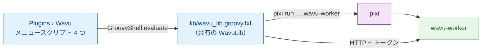

# wavu-fiji の内部（上級）

!!! abstract "興味のある方と、メンテナンスする方へ"
    Fiji で Wavu を使うのに、このページは必要ありません。ここでは Fiji の
    ウェイターがどう作られているかを説明します。ワーカー側については
    [アーキテクチャ](../model/architecture.md) を見てください。

## やさしく言うと

ウェイターに自分の厨房はいりません。メモ帳と礼儀正しさがあれば十分です。
Fiji のウェイターはまさにそれで、**数個のプレーンテキストの Groovy
スクリプト** だけでできています。コンパイルした Java も jar もありません。
Fiji は `scripts/Plugins/` の下にあるすべての `.groovy` ファイルをメニュー
項目にするので、ファイルを置くことがインストールのすべてです。

## ファイル

すべて `Fiji.app/scripts/Plugins/Wavu/` にあります。

| ファイル | メニュー項目 |
|---|---|
| `Run_Python_Script.groovy` | **Run Python Script** |
| `Setup_Python_(pixi).groovy` | **Setup Python (pixi)** |
| `Connect_to_Running_Worker.groovy` | **Connect to Running Worker** |
| `Stop_Worker.groovy` | **Stop Worker** |
| `lib/wavu_lib.groovy.txt` | なし：共有ライブラリ |

**なぜ jar を使わないの？** jar を保守するには Java のビルドが必要です。
また、Fiji の 1 つしかない共有クラスパスに Java ライブラリを追加すると、
ほかのプラグインとぶつかることがあります。`HttpURLConnection` を使った
素の HTTP なら、JDK 以外に何もいりません
（[決定の記録](https://github.com/Oxford-Zeiss-Centre-of-Excellence/Wavu/blob/main/docs/decisions.md)
（英語）の D1 と D6）。

**なぜ `.groovy.txt` なの？** `.txt` を扱うスクリプト言語はないので、Fiji は
このライブラリをメニュー項目にしません。各メニュースクリプトは
`new GroovyShell(this.class.classLoader).evaluate(file)` で、4 行でこれを
読み込み、`WavuLib` オブジェクトを 1 つ受け取ります。環境変数 `WAVU_LIB`
は別のコピーを指すためのもので、テストで使います。実行中のワーカーは
`System.getProperties()` の `wavu.workers` に保存されます。これはメニュー
コマンドをまたいで残るからです。コードは Java 9 以降の API を使わないので、
Java 8 で動く古い Fiji でも動きます。

## pixi を見つける、インストールする

Wavu は次の順番で pixi を探し、最初に見つかったものを使います。

1. IJ の設定 `wavu.pixi`
2. `<Fiji>/wavu/pixi`（Windows では `pixi.exe`）
3. `~/.wavu/bin/`
4. `PATH` 上のすべてのフォルダー
5. `~/.pixi/bin/`（pixi.sh インストーラーが置く場所）

**Setup Python (pixi)** を選んだとき、または pixi なしで最初に実行した
ときに、pixi をダウンロードします。

- リリースのタグは GitHub の `releases/latest` のリダイレクトから得ます。
  ただし設定 `wavu.pixi.version` でバージョンを固定している場合はそれを
  使います。
- 同じリリースから `sha256.sum` と、あなたのシステム用のアーカイブを
  ダウンロードし、SHA-256 を確認して、一致しなければ止まります。
- 実行ファイルを `<Fiji>/wavu/`（Fiji のフォルダーが読み取り専用なら
  `~/.wavu/bin/`）に展開し、そのパスを `wavu.pixi` に保存します。

## フォルダーからダイアログまで

**Run Python Script** はまず、すでに知っているものを一覧にします。
*running:*（実行中）のワーカーと *installed:*（インストール済み）の
スクリプト、そして *&lt;choose a script folder...&gt;*（スクリプトフォルダー
を選ぶ）です。新しいフォルダーには `pixi.toml` が必要です。そのフォルダーの
ワーカーが動いていなければ、Wavu は
`pixi run --manifest-path … wavu-worker --script-dir …` で起動します。
フォルダーにまだ `.pixi` がなければ、最初の起動でパッケージをダウンロード
することを Log が警告します。ステータスバーが秒数を数え、**Esc** で中止
できます。

次に `GET /scripts` を呼びます。フォルダーにスクリプトが複数あれば、小さな
ダイアログでどれを使うか尋ねます。スクリプトの `PARAMS` は `GenericDialog`
になり、一番上にスクリプトの docstring の 1 行目が表示されます。

| `PARAMS` の型 | ダイアログのフィールド | 送られる形 |
|---|---|---|
| `float` | 数値フィールド、小数 3 桁 | 数値 |
| `int` | 数値フィールド、小数 0 桁 | 丸めた整数 |
| `bool` | チェックボックス | true/false |
| `choice` | `choices` のドロップダウン | 選ばれたテキスト |
| `image` | 開いている画像のタイトルのドロップダウン（現在の画像が先頭） | 画像を入力として |
| `str` | テキストフィールド | テキスト |

Fiji 自身がワーカーを起動した場合は、最後にチェックボックス
**Debug in VS Code (restart worker with debugpy on port 5678)** が追加されます。

## 画像の送り方

`image` フィールドはそれぞれ入力になります。

- **形と軸：** ImageJ の次元は NumPy の順序 `T Z C Y X` になります（T、Z、
  C は長さが 1 より大きいときだけ）。RGB 画像には末尾に `S`（3 サンプル）
  が付きます。
- **キャリブレーション：** 単位が µm または micron なら、ピクセル幅が
  `meta.pixel_um` になります（nm なら 1000 で割ります）。タイトルも一緒に
  送られます。
- **転送：** 4 MiB までのピクセルはインラインで運ばれます（8、16、32 ビット、
  または RGB をインターリーブしたバイト列）。それより大きい画像と、8 ビットの
  カラー画像（先に RGB に変換）は、一時フォルダーに TIFF として保存し、
  パスとして送ります。

## 結果の戻り方

| 出力の kind | Fiji がすること |
|---|---|
| `image` | `<input title>-<output name>` という名前の新しい画像を開きます。インラインの 3 次元画像で、`axes` が `C` で始まるものはコンポジットに、`T` ならフレームに、それ以外はスライスになります。名前に `label` を含む場合（RGB でなければ）、**glasbey on dark** の LUT が適用されます。 |
| `table` | CSV を **Results table** として開きます |
| `rois` | zip を **ROI Manager** に読み込み、入力画像の上にすべて表示します |
| `file`、`value` | Log に 1 行 |

キャリブレーション：出力の `meta` に `pixel_um` があればミクロン単位を
設定します。なければ、入力と幅・高さが同じ出力は入力のキャリブレーションを
コピーします。`channel_names` はスライスのラベルになります。

ジョブの実行中、`log` イベントは Log に、`progress` はプログレスバーと
ステータスバーに送られます。**Esc** を押すと `POST /jobs/<id>/cancel` が
送られ、スクリプトに止まるよう頼みます
（[協力して](../write/logs-progress-cancel.md)）。エラーが起きると短い
メッセージボックスが開き、トレースバックの全文は Log に出ます。

Fiji は自分のバージョンとワーカーのバージョン（major.minor）も比べ、
違っていれば Log に *Note* を書きます。

## インストール済みスクリプトとメニュースタブ

`wavu package`（[研究室で共有する](with-your-lab.md) を参照）は、
`Fiji.app` に解凍できるツリーを作ります。

- `wavu/scripts/<name>/` には `script.py`、`pixi.toml`、`pixi.lock`、
  `README.md` が入ります。
- `scripts/Plugins/<Menu>/<Title>.groovy` は小さなスタブで、ライブラリを
  読み込んでそのフォルダーに対して `runScriptFolder` を呼びます。だから
  フォルダーを選ぶ画面は出ません。

`<Fiji>/wavu/scripts/` の下にあって `pixi.lock` を持つフォルダーでは、
ワーカーは `pixi run --frozen` で起動されます。だからユーザーは、配布された
とおりのバージョンをそのまま使えます。

## アタッチと停止

**Connect to Running Worker** はハンドシェイクファイル（既定は
`~/.wavu/worker.json`）と、任意の **Host**（別のマシン）を読みます。
コンテナの場合は、ホスト側のフォルダーとコンテナ内の同じフォルダーも読み、
パスを双方向に変換します。
**Stop Worker** は、この Fiji が起動した、または接続したすべてのワーカーに
`/shutdown` を送り、自分が起動したワーカーのパイプを閉じます。

## 同じスクリプトを napari で

napari のウェイターは、Python のウィジェットとレイヤーで同じ仕事をします。
[wavu-napari の内部](../napari/internals.md) を見てください。

## ひとことで言うと

wavu-fiji は、4 つの Groovy メニュースクリプトと 1 つの共有ライブラリ
ファイルでできています。pixi を見つけ、フォルダーごとにワーカーを起動し、
`PARAMS` を `GenericDialog` に変え、出力を画像、表、ROI に戻します。
