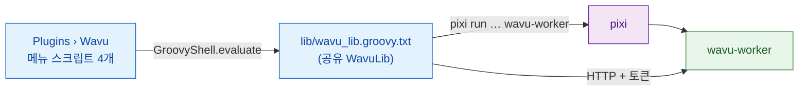

# wavu-fiji 내부 구조 (고급)

!!! abstract "궁금한 분과 유지보수하는 분을 위해"
    Fiji에서 Wavu를 쓰는 데 이 페이지는 필요 없어요. 여기서는 Fiji 웨이터가
    어떻게 만들어졌는지 설명해요. 워커 쪽은 [아키텍처](../model/architecture.md)에
    있어요.

## 쉬운 말로 설명하면

웨이터에게 자기 주방은 필요 없어요. 메모장과 좋은 매너면 충분해요. Fiji
웨이터가 딱 그래요. **평범한 텍스트로 된 Groovy 스크립트 몇 개**뿐이고,
컴파일한 Java도, jar도 없어요. Fiji는 `scripts/Plugins/` 아래의 모든
`.groovy` 파일을 메뉴 항목으로 만들기 때문에, 파일을 넣는 것만으로 설치가
끝나요.

## 파일

모두 `Fiji.app/scripts/Plugins/Wavu/`에 있어요.

| 파일 | 메뉴 항목 |
|---|---|
| `Run_Python_Script.groovy` | **Run Python Script** |
| `Setup_Python_(pixi).groovy` | **Setup Python (pixi)** |
| `Connect_to_Running_Worker.groovy` | **Connect to Running Worker** |
| `Stop_Worker.groovy` | **Stop Worker** |
| `lib/wavu_lib.groovy.txt` | 없음: 공유 라이브러리 |

**왜 jar를 안 쓰나요?** jar를 유지하려면 Java 빌드가 필요하고, Fiji의 하나뿐인
공유 클래스패스에 Java 라이브러리를 더 넣으면 다른 플러그인과 충돌할 수
있어요. `HttpURLConnection`을 쓰는 평범한 HTTP는 JDK 말고는 아무것도 필요
없어요([결정 기록](https://github.com/Oxford-Zeiss-Centre-of-Excellence/Wavu/blob/main/docs/decisions.md)(영어)의
D1과 D6).

**왜 `.groovy.txt`인가요?** `.txt`를 맡는 스크립트 언어가 없어서, Fiji가 이
라이브러리를 메뉴 항목으로 만들지 않아요. 각 메뉴 스크립트는
`new GroovyShell(this.class.classLoader).evaluate(file)`로 네 줄 만에 이걸
불러와서 `WavuLib` 객체 하나를 받아요. 환경 변수 `WAVU_LIB`는 다른 사본을
가리키는 데 쓰고, 테스트가 이걸 써요. 실행 중인 워커는
`System.getProperties()`의 `wavu.workers` 아래에 저장돼요. 메뉴 명령 사이에도
남아 있기 때문이에요. 코드는 Java 9 이상의 API를 피하므로, Java 8로 도는
오래된 Fiji에서도 작동해요.

## pixi 찾기와 설치하기

Wavu는 이 순서로 pixi를 찾고, 처음 찾은 것을 써요.

1. IJ 환경설정 `wavu.pixi`
2. `<Fiji>/wavu/pixi`(Windows에서는 `pixi.exe`)
3. `~/.wavu/bin/`
4. `PATH`에 있는 모든 폴더
5. `~/.pixi/bin/`(pixi.sh 설치 프로그램이 넣는 곳)

**Setup Python (pixi)**를 고르거나, pixi 없이 처음 실행하면 pixi를
내려받아요.

- 릴리스 태그는 GitHub의 `releases/latest` 리디렉션에서 가져와요. 단,
  환경설정 `wavu.pixi.version`으로 버전을 고정했다면 그걸 써요.
- 같은 릴리스에서 `sha256.sum`과 여러분 시스템용 압축 파일을 내려받고,
  SHA-256을 확인해서 하나라도 맞지 않으면 멈춰요.
- 실행 파일을 `<Fiji>/wavu/`(Fiji 폴더가 읽기 전용이면 `~/.wavu/bin/`)에
  풀고, 그 경로를 `wavu.pixi`에 저장해요.

## 폴더에서 대화상자까지

**Run Python Script**는 먼저 이미 알고 있는 것을 보여 줘요. *running:*(실행
중) 워커와 *installed:*(설치됨) 스크립트, 그리고
*&lt;choose a script folder...&gt;*(스크립트 폴더 고르기)예요. 새 폴더에는
`pixi.toml`이 있어야 해요. 그 폴더의 워커가 살아 있지 않으면 Wavu가
`pixi run --manifest-path … wavu-worker --script-dir …`로 워커를 시작해요.
폴더에 아직 `.pixi`가 없으면, 첫 시작에서 패키지를 내려받는다고 Log가
경고해요. 상태 표시줄이 초를 세고, **Esc**를 누르면 그만둬요.

그다음 `GET /scripts`를 불러요. 폴더에 스크립트가 여러 개면 작은 대화상자가
어느 것을 쓸지 물어요. 스크립트의 `PARAMS`는 `GenericDialog`가 되고, 맨 위에
스크립트 docstring의 첫 줄이 나와요.

| `PARAMS` 타입 | 대화상자 필드 | 보내는 형태 |
|---|---|---|
| `float` | 숫자 필드, 소수점 3자리 | 숫자 |
| `int` | 숫자 필드, 소수점 0자리 | 반올림한 정수 |
| `bool` | 체크박스 | true/false |
| `choice` | `choices`의 드롭다운 | 고른 텍스트 |
| `image` | 열린 이미지 제목의 드롭다운(현재 이미지가 맨 위) | 이미지를 입력으로 |
| `str` | 텍스트 필드 | 텍스트 |

Fiji가 직접 워커를 시작했다면, 마지막에
**Debug in VS Code (restart worker with debugpy on port 5678)** 체크박스가
추가돼요.

## 이미지를 보내는 방법

`image` 필드는 각각 입력이 돼요.

- **모양과 축:** ImageJ의 차원은 NumPy 순서 `T Z C Y X`가 돼요(T, Z, C는
  길이가 1보다 클 때만). RGB 이미지는 끝에 `S`(샘플 3개)가 붙어요.
- **보정(calibration):** 단위가 µm이나 micron이면 픽셀 너비가
  `meta.pixel_um`이 돼요(nm이면 1000으로 나눠요). 제목도 함께 가요.
- **전송:** 4 MiB까지의 픽셀은 인라인으로 가요(8, 16, 32비트, 또는 RGB를
  인터리브한 바이트). 그보다 큰 이미지와 8비트 컬러 이미지(먼저 RGB로
  변환)는 임시 폴더에 TIFF로 저장해서 경로로 보내요.

## 결과가 돌아오는 방법

| 출력 kind | Fiji가 하는 일 |
|---|---|
| `image` | `<input title>-<output name>`이라는 이름의 새 이미지를 열어요. 인라인 3차원 이미지에서 `axes`가 `C`로 시작하면 컴포지트가 되고, `T`면 프레임, 그 밖에는 슬라이스가 돼요. 이름에 `label`이 들어 있으면(RGB가 아니라면) **glasbey on dark** LUT를 적용해요. |
| `table` | CSV를 **Results table**로 열어요 |
| `rois` | zip을 **ROI Manager**에 불러와서 입력 이미지 위에 모두 보여 줘요 |
| `file`, `value` | Log에 한 줄 |

보정: 출력의 `meta`에 `pixel_um`이 있으면 마이크로미터로 설정해요. 없으면
입력과 너비·높이가 같은 출력은 입력의 보정을 복사해요. `channel_names`는
슬라이스 라벨이 돼요.

작업이 도는 동안 `log` 이벤트는 Log로, `progress`는 진행 표시줄과 상태
표시줄로 가요. **Esc**를 누르면 `POST /jobs/<id>/cancel`을 보내서 스크립트에
멈춰 달라고 요청해요([협조 방식](../write/logs-progress-cancel.md)). 오류가
나면 짧은 메시지 상자가 열리고, 전체 트레이스백은 Log에 있어요.

Fiji는 자기 버전과 워커 버전(major.minor)도 비교해서, 다르면 Log에 *Note*를
남겨요.

## 설치된 스크립트와 메뉴 스텁

`wavu package`([연구실과 공유하기](with-your-lab.md) 참고)는 `Fiji.app`에
압축을 풀 수 있는 트리를 만들어요.

- `wavu/scripts/<name>/`에는 `script.py`, `pixi.toml`, `pixi.lock`,
  `README.md`가 들어가요.
- `scripts/Plugins/<Menu>/<Title>.groovy`는 작은 스텁(stub)으로, 라이브러리를
  불러와서 그 폴더에 대해 `runScriptFolder`를 불러요. 그래서 폴더 고르는
  창이 나오지 않아요.

`<Fiji>/wavu/scripts/` 아래에 있고 `pixi.lock`이 있는 폴더는 워커를
`pixi run --frozen`으로 시작해요. 그래서 사용자는 배포된 버전을 정확히 그대로
받아요.

## 연결과 중지

**Connect to Running Worker**는 핸드셰이크 파일(기본값
`~/.wavu/worker.json`), 선택 사항인 **Host**(다른 컴퓨터), 그리고
컨테이너라면 호스트 폴더와 컨테이너 안의 같은 폴더를 물어서 경로를
양방향으로 변환해요. **Stop Worker**는 이 Fiji가
시작했거나 연결한 모든 워커에 `/shutdown`을 보내고, 자기가 시작한 워커의
파이프를 닫아요.

## 같은 스크립트를 napari에서

napari 웨이터는 Python 위젯과 레이어로 같은 일을 해요.
[wavu-napari 내부 구조](../napari/internals.md)를 보세요.

## 한 문장으로

wavu-fiji는 Groovy 메뉴 스크립트 4개와 공유 라이브러리 파일 하나로 이루어져,
pixi를 찾고, 폴더마다 워커를 시작하고, `PARAMS`를 `GenericDialog`로 바꾸고,
출력을 다시 이미지, 표, ROI로 바꿔요.
