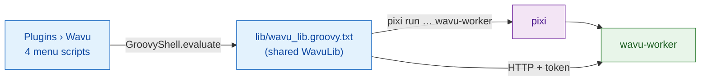

# wavu-fiji internals (advanced)

!!! abstract "For the curious and for maintainers"
    You do not need this page to use Wavu in Fiji. It explains how the Fiji
    waiter is built. The worker side is on [Architecture](../model/architecture.md).

## The idea in plain words

A waiter needs no kitchen of its own, just a notepad and good manners. The
Fiji waiter is exactly that: **a handful of plain-text Groovy scripts**, no
compiled Java, no jar. Fiji turns every `.groovy` file under
`scripts/Plugins/` into a menu item, so dropping the files in is the whole
installation.

## The files

Everything lives in `Fiji.app/scripts/Plugins/Wavu/`:

| File | Menu item |
|---|---|
| `Run_Python_Script.groovy` | **Run Python Script** |
| `Setup_Python_(pixi).groovy` | **Setup Python (pixi)** |
| `Connect_to_Running_Worker.groovy` | **Connect to Running Worker** |
| `Stop_Worker.groovy` | **Stop Worker** |
| `lib/wavu_lib.groovy.txt` | none: the shared library |

**Why no jar?** A jar needs a Java build to maintain, and extra Java
libraries in Fiji's single shared classpath can clash with other plugins.
Plain HTTP through `HttpURLConnection` needs nothing beyond the JDK (decisions
D1 and D6 in the
[decisions log](https://github.com/Oxford-Zeiss-Centre-of-Excellence/Wavu/blob/main/docs/decisions.md)).

**Why `.groovy.txt`?** No script language claims `.txt`, so Fiji does not
turn the library into a menu item. Each menu script loads it in four lines
with `new GroovyShell(this.class.classLoader).evaluate(file)` and gets one
`WavuLib` object. The environment variable `WAVU_LIB` points at another copy,
which the tests use. Running workers are kept in `System.getProperties()`
under `wavu.workers`, because that survives between menu commands. The code
avoids Java 9+ APIs, so it runs on Fiji's older Java 8 builds too.

## Finding and installing pixi

Wavu looks for pixi in this order, and uses the first one it finds:

1. the IJ preference `wavu.pixi`;
2. `<Fiji>/wavu/pixi` (`pixi.exe` on Windows);
3. `~/.wavu/bin/`;
4. every folder on `PATH`;
5. `~/.pixi/bin/` (where the pixi.sh installer puts it).

**Setup Python (pixi)**, or the first run without pixi, downloads it:

- the release tag comes from GitHub's `releases/latest` redirect, unless
  the preference `wavu.pixi.version` pins one;
- it downloads `sha256.sum` and the archive for your system from the same
  release, checks the SHA-256, and stops on any mismatch;
- it unpacks the binary into `<Fiji>/wavu/`, or `~/.wavu/bin/` if Fiji's
  folder is read-only, and saves the path in `wavu.pixi`.

## From folder to dialog

**Run Python Script** first lists what it already knows: *running:* workers
and *installed:* scripts, plus *&lt;choose a script folder...&gt;*. A new
folder must contain `pixi.toml`. If no worker is alive for it, Wavu starts
one with `pixi run --manifest-path … wavu-worker --script-dir …`; if the
folder has no `.pixi` yet, the Log warns that the first start downloads
packages. The status bar counts the seconds, and **Esc** gives up.

Then `GET /scripts`. If the folder has several scripts, a small dialog asks
which one. The script's `PARAMS` become a `GenericDialog`, with the first
line of the script's docstring on top:

| `PARAMS` type | Dialog field | Sent as |
|---|---|---|
| `float` | number field, 3 decimals | number |
| `int` | number field, 0 decimals | rounded whole number |
| `bool` | checkbox | true/false |
| `choice` | drop-down of `choices` | the chosen text |
| `image` | drop-down of open image titles (current one first) | the image, as an input |
| `str` | text field | text |

If Fiji started the worker itself, a last checkbox
**Debug in VS Code (restart worker with debugpy on port 5678)** is added.

## How images go out

Each `image` field becomes an input:

- **Shape and axes:** ImageJ's dimensions become NumPy order `T Z C Y X`
  (T, Z and C only when longer than 1); RGB images get a trailing `S` (3 samples).
- **Calibration:** if the unit is µm or micron, the pixel width becomes
  `meta.pixel_um` (nm is divided by 1000). The title goes along too.
- **Transport:** up to 4 MiB of pixels travel inline (8-, 16- or 32-bit, or
  RGB as interleaved bytes); larger images, and 8-bit colour images
  (converted to RGB first), are saved as a TIFF in a temp folder and sent
  as a path.

## How results come back

| Output kind | What Fiji does |
|---|---|
| `image` | opens a new image named `<input title>-<output name>`; a 3-D inline image whose `axes` start with `C` becomes a composite, `T` gives frames, otherwise slices. If the name contains `label` (and it is not RGB), the **glasbey on dark** LUT is applied. |
| `table` | opens the CSV as a **Results table** |
| `rois` | loads the zip into the **ROI Manager** and shows all on the input |
| `file`, `value` | one line in the Log |

Calibration: `pixel_um` in the output's `meta` sets microns; otherwise an
output with the same width and height as the input copies the input's
calibration. `channel_names` become slice labels.

While the job runs, `log` events go to the Log, `progress` to the progress
bar and status bar. **Esc** sends `POST /jobs/<id>/cancel`, which asks the
script to stop ([cooperatively](../write/logs-progress-cancel.md)). An error
opens a short message box; the full traceback is in the Log.

Fiji also compares its own version with the worker's (major.minor) and
writes a *Note* in the Log if they differ.

## Installed scripts and menu stubs

`wavu package` (see [Share with your lab](with-your-lab.md)) builds a tree
that unzips into `Fiji.app`:

- `wavu/scripts/<name>/` holds `script.py`, `pixi.toml`, `pixi.lock` and
  `README.md`;
- `scripts/Plugins/<Menu>/<Title>.groovy` is a tiny stub that loads the
  library and calls `runScriptFolder` on that folder, so there is no folder
  chooser.

For folders under `<Fiji>/wavu/scripts/` that have a `pixi.lock`, the
worker is started with `pixi run --frozen`, so users get exactly the
shipped versions.

## Attach and stop

**Connect to Running Worker** reads a handshake file (default
`~/.wavu/worker.json`), an optional **Host** (another machine) and, for
containers, a host folder and the same
folder inside the container; paths are translated in both directions.
**Stop Worker** sends `/shutdown` to every worker this Fiji started or
connected to, and closes the pipe of the ones it started.

## Same script in napari

The napari waiter does the same job with Python widgets and layers: see
[wavu-napari internals](../napari/internals.md).

## In one sentence

wavu-fiji is four Groovy menu scripts plus one shared library file that find
pixi, start a worker per folder, turn `PARAMS` into a `GenericDialog`, and
turn the outputs back into images, tables and ROIs.
