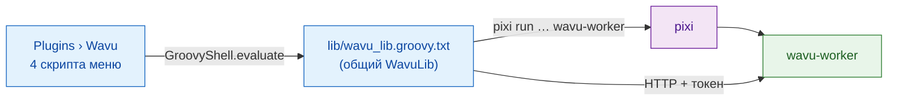

# Внутреннее устройство wavu-fiji (для продвинутых)

!!! abstract "Для любопытных и для сопровождающих"
    Эта страница не нужна, чтобы пользоваться Wavu в Fiji. Она объясняет,
    как устроен официант в Fiji. Сторона воркера описана на странице
    [Архитектура](../model/architecture.md).

## Идея простыми словами

Официанту не нужна своя кухня — только блокнот и хорошие манеры. Официант в
Fiji именно такой: **несколько текстовых Groovy-скриптов**, без
скомпилированной Java, без jar. Fiji превращает каждый файл `.groovy` в
`scripts/Plugins/` в пункт меню, так что положить туда файлы — это и есть
вся установка.

## Файлы

Всё лежит в `Fiji.app/scripts/Plugins/Wavu/`:

| Файл | Пункт меню |
|---|---|
| `Run_Python_Script.groovy` | **Run Python Script** |
| `Setup_Python_(pixi).groovy` | **Setup Python (pixi)** |
| `Connect_to_Running_Worker.groovy` | **Connect to Running Worker** |
| `Stop_Worker.groovy` | **Stop Worker** |
| `lib/wavu_lib.groovy.txt` | нет: общая библиотека |

**Почему без jar?** Jar требует сборки Java, которую надо поддерживать, а
лишние Java-библиотеки в единственном общем classpath Fiji могут
конфликтовать с другими плагинами. Простому HTTP через `HttpURLConnection`
не нужно ничего, кроме JDK (решения D1 и D6 в
[журнале решений](https://github.com/Oxford-Zeiss-Centre-of-Excellence/Wavu/blob/main/docs/decisions.md)).

**Почему `.groovy.txt`?** Ни один скриптовый язык не претендует на `.txt`,
поэтому Fiji не превращает библиотеку в пункт меню. Каждый скрипт меню
загружает её в четыре строки через
`new GroovyShell(this.class.classLoader).evaluate(file)` и получает один
объект `WavuLib`. Переменная окружения `WAVU_LIB` указывает на другую копию;
ею пользуются тесты. Работающие воркеры хранятся в `System.getProperties()`
под ключом `wavu.workers`, потому что это переживает переход между командами
меню. Код избегает API Java 9+, поэтому работает и на старых сборках Fiji с
Java 8.

## Поиск и установка pixi

Wavu ищет pixi в таком порядке и берёт первый найденный:

1. настройка IJ `wavu.pixi`;
2. `<Fiji>/wavu/pixi` (`pixi.exe` в Windows);
3. `~/.wavu/bin/`;
4. каждая папка из `PATH`;
5. `~/.pixi/bin/` (туда его кладёт установщик pixi.sh).

**Setup Python (pixi)** или первый запуск без pixi скачивает его:

- тег релиза берётся из перенаправления `releases/latest` на GitHub, если
  только настройка `wavu.pixi.version` не закрепляет конкретный;
- из того же релиза скачиваются `sha256.sum` и архив для вашей системы,
  проверяется SHA-256, и при любом несовпадении всё останавливается;
- бинарник распаковывается в `<Fiji>/wavu/` или, если папка Fiji доступна
  только для чтения, в `~/.wavu/bin/`, а путь сохраняется в `wavu.pixi`.

## От папки к диалогу

**Run Python Script** сначала перечисляет то, что уже знает: воркеры
*running:* и скрипты *installed:*, плюс *&lt;choose a script folder...&gt;*.
Новая папка должна содержать `pixi.toml`. Если для неё нет живого воркера,
Wavu запускает его командой
`pixi run --manifest-path … wavu-worker --script-dir …`; если в папке ещё нет
`.pixi`, Log предупреждает, что первый запуск скачивает пакеты. Строка
состояния отсчитывает секунды, а **Esc** прерывает ожидание.

Затем `GET /scripts`. Если в папке несколько скриптов, небольшой диалог
спрашивает, какой нужен. `PARAMS` скрипта превращаются в `GenericDialog`, а
сверху стоит первая строка docstring скрипта:

| Тип в `PARAMS` | Поле диалога | Что отправляется |
|---|---|---|
| `float` | числовое поле, 3 знака после запятой | число |
| `int` | числовое поле, 0 знаков после запятой | округлённое целое |
| `bool` | флажок | true/false |
| `choice` | выпадающий список из `choices` | выбранный текст |
| `image` | выпадающий список названий открытых изображений (текущее первым) | изображение, как вход |
| `str` | текстовое поле | текст |

Если воркер запустил сам Fiji, в конце добавляется флажок
**Debug in VS Code (restart worker with debugpy on port 5678)**.

## Как уходят изображения

Каждое поле `image` становится входом:

- **Форма и оси:** измерения ImageJ переводятся в порядок NumPy
  `T Z C Y X` (T, Z и C — только если их длина больше 1); RGB-изображения
  получают в конце ось `S` (3 компоненты).
- **Калибровка:** если единица — µm или micron, ширина пикселя становится
  `meta.pixel_um` (nm делится на 1000). Название тоже передаётся.
- **Передача:** до 4 МиБ пикселей идут inline (8, 16 или 32 бита, или RGB
  как чередующиеся байты); более крупные изображения и 8-битные цветные
  (сначала преобразуются в RGB) сохраняются как TIFF во временной папке и
  передаются путём.

## Как возвращаются результаты

| Вид выхода | Что делает Fiji |
|---|---|
| `image` | открывает новое изображение с именем `<input title>-<output name>`; 3-мерное inline-изображение, у которого `axes` начинаются с `C`, становится композитным, `T` даёт кадры, иначе — срезы. Если в имени есть `label` (и это не RGB), применяется LUT **glasbey on dark**. |
| `table` | открывает CSV как **Results table** |
| `rois` | загружает zip в **ROI Manager** и показывает всё на входном изображении |
| `file`, `value` | одна строка в Log |

Калибровка: `pixel_um` в `meta` выхода задаёт микроны; иначе выход с той же
шириной и высотой, что у входа, копирует калибровку входа. `channel_names`
становятся подписями срезов.

Пока задание работает, события `log` идут в Log, `progress` — в индикатор
прогресса и строку состояния. **Esc** отправляет `POST /jobs/<id>/cancel`,
что просит скрипт остановиться ([совместно](../write/logs-progress-cancel.md)).
Ошибка открывает короткое окно сообщения; полная трассировка — в Log.

Fiji также сравнивает свою версию с версией воркера (major.minor) и пишет в
Log *Note*, если они различаются.

## Установленные скрипты и заглушки меню

`wavu package` (смотрите [Поделиться с лабораторией](with-your-lab.md))
собирает дерево, которое распаковывается в `Fiji.app`:

- в `wavu/scripts/<name>/` лежат `script.py`, `pixi.toml`, `pixi.lock` и
  `README.md`;
- `scripts/Plugins/<Menu>/<Title>.groovy` — крошечная заглушка, которая
  загружает библиотеку и вызывает `runScriptFolder` для этой папки, поэтому
  выбирать папку не нужно.

Для папок в `<Fiji>/wavu/scripts/`, где есть `pixi.lock`, воркер
запускается через `pixi run --frozen`, так что пользователи получают ровно
те версии, которые были поставлены.

## Подключение и остановка

**Connect to Running Worker** читает файл рукопожатия (по умолчанию
`~/.wavu/worker.json`), необязательный **Host** (хост: другая машина) и,
для контейнеров, папку на хосте и ту же папку внутри контейнера; пути
переводятся в обе стороны.
**Stop Worker** отправляет `/shutdown` каждому воркеру, которого этот Fiji
запустил или к которому подключился, и закрывает канал тех, кого он
запустил.

## Тот же скрипт в napari

Официант в napari делает ту же работу с помощью Python-виджетов и слоёв:
смотрите [Внутреннее устройство wavu-napari](../napari/internals.md).

## Одним предложением

wavu-fiji — это четыре Groovy-скрипта меню плюс один общий файл библиотеки,
которые находят pixi, запускают по воркеру на папку, превращают `PARAMS` в
`GenericDialog`, а выходы — обратно в изображения, таблицы и ROI.
