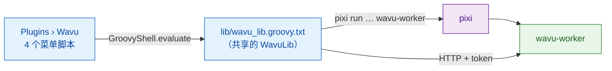

# wavu-fiji 内部实现（进阶）

!!! abstract "写给好奇者和维护者"
    在 Fiji 里使用 Wavu 不需要读这一页。它介绍 Fiji 这位服务员是怎么实现的。
    worker 那一端请看[架构](../model/architecture.md)。

## 用大白话说

服务员不需要自己的厨房，只要一个点菜本和良好的礼貌。Fiji 这位服务员正是
如此：**几个纯文本的 Groovy 脚本**，没有编译过的 Java，也没有 jar。Fiji 会把
`scripts/Plugins/` 下的每个 `.groovy` 文件变成一个菜单项，所以把文件放进去
就是全部的安装步骤。

## 这些文件

全部都放在 `Fiji.app/scripts/Plugins/Wavu/`：

| 文件 | 菜单项 |
|---|---|
| `Run_Python_Script.groovy` | **Run Python Script** |
| `Run_Script_(Macro).groovy` | **Run Script (Macro)**：可录制、不弹出对话框，用于宏和批处理工作流 |
| `Setup_Python_(pixi).groovy` | **Setup Python (pixi)** |
| `Connect_to_Running_Worker.groovy` | **Connect to Running Worker** |
| `Stop_Worker.groovy` | **Stop Worker** |
| `lib/wavu_lib.groovy.txt` | 无：共享库 |

**为什么不用 jar？**jar 需要维护一套 Java 构建流程，而且 Fiji 只有一个共享的
classpath，额外的 Java 库可能和其他插件冲突。通过 `HttpURLConnection`
使用纯 HTTP，除了 JDK 之外什么都不需要（见
[决策记录](https://github.com/Oxford-Zeiss-Centre-of-Excellence/Wavu/blob/main/docs/decisions.md)
中的 D1 和 D6，英文）。

**为什么是 `.groovy.txt`？**没有任何脚本语言认领 `.txt`，所以 Fiji 不会把
这个库变成菜单项。每个菜单脚本用四行代码加载它：
`new GroovyShell(this.class.classLoader).evaluate(file)`，然后得到一个
`WavuLib` 对象。环境变量 `WAVU_LIB` 可以指向另一份副本，测试就是这样用的。
运行中的 worker 保存在 `System.getProperties()` 的 `wavu.workers` 下，因为
它在不同的菜单命令之间会保留下来。代码避开了 Java 9 以上的 API，所以在
Fiji 较旧的 Java 8 版本上也能运行。

## 查找并安装 pixi

Wavu 按这个顺序查找 pixi，并使用找到的第一个：

1. IJ 首选项 `wavu.pixi`；
2. `<Fiji>/wavu/pixi`（Windows 上是 `pixi.exe`）；
3. `~/.wavu/bin/`；
4. `PATH` 上的每个文件夹；
5. `~/.pixi/bin/`（pixi.sh 安装程序放置的位置）。

**Setup Python (pixi)**，或者没有 pixi 时的第一次运行，会下载它：

- 发布版本的标签来自 GitHub 的 `releases/latest` 重定向，除非首选项
  `wavu.pixi.version` 指定了某个版本；
- 它从同一个发布版本下载 `sha256.sum` 和适合你系统的压缩包，校验 SHA-256，
  一旦不匹配就停止；
- 它把可执行文件解压到 `<Fiji>/wavu/`（如果 Fiji 的文件夹是只读的，则解压到
  `~/.wavu/bin/`），并把路径保存到 `wavu.pixi`。

## 从文件夹到对话框

**Run Python Script** 会先列出它已经知道的内容：*running:* 的 worker 和
*installed:* 的脚本，再加上 *&lt;choose a script folder...&gt;*。新的文件夹必须
包含 `pixi.toml`。如果这个文件夹还没有存活的 worker，Wavu 会用
`pixi run --manifest-path … wavu-worker --script-dir …` 启动一个；如果文件夹
还没有 `.pixi`，Log 会提醒第一次启动要下载包。状态栏会计秒，按
**Esc** 可以放弃。

接着是 `GET /scripts`。如果文件夹里有多个脚本，会弹出一个小对话框问你
要哪一个。脚本的 `PARAMS` 会变成一个 `GenericDialog`，顶部是脚本 docstring
的第一行：

| `PARAMS` 类型 | 对话框字段 | 发送形式 |
|---|---|---|
| `float` | 数字字段，3 位小数 | 数字 |
| `int` | 数字字段，0 位小数 | 四舍五入后的整数 |
| `bool` | 复选框 | true/false |
| `choice` | `choices` 的下拉列表 | 选中的文本 |
| `image` | 已打开图像标题的下拉列表（当前图像排第一） | 图像本身，作为输入 |
| `str` | 文本字段 | 文本 |

如果 worker 是 Fiji 自己启动的，最后还会加上一个复选框
**Debug in VS Code (restart worker with debugpy on port 5678)**。

## 图像怎么发出去

每个 `image` 字段都会变成一个输入：

- **形状和轴：**ImageJ 的维度会变成 NumPy 的 `T Z C Y X` 顺序（T、Z 和 C
  只有长度大于 1 时才出现）；RGB 图像会在末尾多一个 `S`（3 个采样）。
- **标定：**如果单位是 µm 或 micron，像素宽度就会成为 `meta.pixel_um`
  （nm 会除以 1000）。标题也会一起发送。
- **传输：**最多 4 MiB 的像素以内联方式传输（8、16 或 32 位，RGB 则为交错
  排列的字节）；更大的图像，以及 8 位彩色图像（先转换为 RGB），会保存为
  临时文件夹里的 TIFF，以路径发送。

## 结果怎么回来

| 输出 kind | Fiji 会做什么 |
|---|---|
| `image` | 打开一张名为 `<input title>-<output name>` 的新图像；`axes` 以 `C` 开头的三维内联图像会变成 composite，`T` 会变成时间帧，其他则为切片。如果名称包含 `label`（且不是 RGB），会应用 **glasbey on dark** 查找表（LUT）。 |
| `table` | 把 CSV 打开为一张 **Results 表** |
| `rois` | 把 zip 加载到 **ROI Manager**，并在输入图像上全部显示 |
| `file`、`value` | 在 Log 里写一行 |

标定：输出 `meta` 里的 `pixel_um` 会设置微米；否则，和输入图像宽高相同的
输出会沿用输入图像的标定。`channel_names` 会变成切片标签。

任务运行期间，`log` 事件进入 Log，`progress` 进入进度条和状态栏。**Esc**
会发送 `POST /jobs/<id>/cancel`，请求脚本停止
（[协作式](../write/logs-progress-cancel.md)）。出错时会弹出一个简短的消息
框；完整的 traceback 在 Log 里。

Fiji 还会比较自己和 worker 的版本（major.minor），不一致时会在 Log 里写一条
*Note*。

## 已安装的脚本和菜单桩

`wavu package`（见[分享给实验室](with-your-lab.md)）会生成一个可以直接
解压到 `Fiji.app` 的目录树：

- `wavu/scripts/<name>/` 存放 `script.py`、`pixi.toml`、`pixi.lock` 和
  `README.md`；
- `scripts/Plugins/<Menu>/<Title>.groovy` 是一个很小的桩脚本，它加载
  这个库，再对那个文件夹调用 `runScriptFolder`，所以不会弹出文件夹选择器。

对于 `<Fiji>/wavu/scripts/` 下附带 `pixi.lock` 的文件夹，worker 会用
`pixi run --frozen` 启动，让用户拿到的正好是发布时的版本。

## 附加和停止

**Connect to Running Worker** 会读取一个握手文件（默认为
`~/.wavu/worker.json`）、一个可选的 **Host**（主机，指另一台机器），如果是
容器，还会询问一个宿主机文件夹，以及它在容器里对应的文件夹；路径会双向转换。
**Stop Worker** 会向这个 Fiji 启动或连接的每个
worker 发送 `/shutdown`，并关闭它自己启动的那些 worker 的管道。

## 同一个脚本在 napari 中

napari 这位服务员用 Python 部件和图层完成同样的工作：参见
[wavu-napari 内部实现](../napari/internals.md)。

## 一句话总结

wavu-fiji 是四个 Groovy 菜单脚本加一个共享库文件：它们找到 pixi、为
每个文件夹启动一个 worker、把 `PARAMS` 变成 `GenericDialog`，再把输出变回
图像、表格和 ROI。
