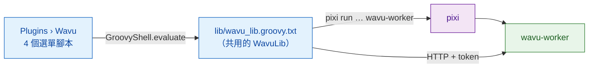

# wavu-fiji 內部構造（進階）

!!! abstract "給好奇的人和維護者"
    在 Fiji 裡使用 Wavu 不需要讀這一頁。它說明 Fiji 這位服務生是怎麼做出來的。
    worker 那一端請看[架構](../model/architecture.md)。

## 用白話說

服務生不需要自己的廚房，只要一本點菜單和良好的禮貌。Fiji 這位服務生正是
如此：**幾個純文字的 Groovy 腳本**，沒有編譯過的 Java，也沒有 jar。Fiji 會把
`scripts/Plugins/` 底下的每個 `.groovy` 檔案變成一個選單項目，所以把檔案放
進去就是全部的安裝步驟。

## 這些檔案

全部都放在 `Fiji.app/scripts/Plugins/Wavu/`：

| 檔案 | 選單項目 |
|---|---|
| `Run_Python_Script.groovy` | **Run Python Script** |
| `Setup_Python_(pixi).groovy` | **Setup Python (pixi)** |
| `Connect_to_Running_Worker.groovy` | **Connect to Running Worker** |
| `Stop_Worker.groovy` | **Stop Worker** |
| `lib/wavu_lib.groovy.txt` | 無：共用函式庫 |

**為什麼不用 jar？**jar 需要維護一套 Java 建置流程，而且 Fiji 只有一個共用的
classpath，多加的 Java 函式庫可能和其他外掛衝突。透過 `HttpURLConnection`
使用純 HTTP，除了 JDK 之外什麼都不需要（見
[決策紀錄](https://github.com/Oxford-Zeiss-Centre-of-Excellence/Wavu/blob/main/docs/decisions.md)
中的 D1 和 D6，英文）。

**為什麼是 `.groovy.txt`？**沒有任何腳本語言認領 `.txt`，所以 Fiji 不會把
函式庫變成選單項目。每個選單腳本用四行程式碼載入它：
`new GroovyShell(this.class.classLoader).evaluate(file)`，然後得到一個
`WavuLib` 物件。環境變數 `WAVU_LIB` 可以指向另一份副本，測試就是這樣用的。
執行中的 worker 存放在 `System.getProperties()` 的 `wavu.workers` 底下，因為
它在不同的選單指令之間會保留下來。程式碼避開了 Java 9 以上的 API，所以在
Fiji 較舊的 Java 8 版本上也能執行。

## 尋找並安裝 pixi

Wavu 依照這個順序尋找 pixi，並使用第一個找到的：

1. IJ 偏好設定 `wavu.pixi`；
2. `<Fiji>/wavu/pixi`（Windows 上是 `pixi.exe`）；
3. `~/.wavu/bin/`；
4. `PATH` 上的每個資料夾；
5. `~/.pixi/bin/`（pixi.sh 安裝程式放置的位置）。

**Setup Python (pixi)**，或沒有 pixi 時的第一次執行，會下載它：

- 發布版本的標籤來自 GitHub 的 `releases/latest` 重新導向，除非偏好設定
  `wavu.pixi.version` 指定了某個版本；
- 它從同一個發布版本下載 `sha256.sum` 和適合你系統的壓縮檔，核對 SHA-256，
  只要不符就停止；
- 它把執行檔解壓縮到 `<Fiji>/wavu/`（如果 Fiji 的資料夾是唯讀的，則放到
  `~/.wavu/bin/`），並把路徑存進 `wavu.pixi`。

## 從資料夾到對話框

**Run Python Script** 會先列出它已經知道的東西：*running:* 的 worker 和
*installed:* 的腳本，再加上 *&lt;choose a script folder...&gt;*。新的資料夾必須
含有 `pixi.toml`。如果這個資料夾沒有存活中的 worker，Wavu 會用
`pixi run --manifest-path … wavu-worker --script-dir …` 啟動一個；如果資料夾
還沒有 `.pixi`，Log 會警告第一次啟動要下載套件。狀態列會計算秒數，按
**Esc** 可以放棄。

接著是 `GET /scripts`。如果資料夾裡有好幾個腳本，會跳出一個小對話框問你
要哪一個。腳本的 `PARAMS` 會變成一個 `GenericDialog`，最上面是腳本 docstring
的第一行：

| `PARAMS` 型別 | 對話框欄位 | 送出的形式 |
|---|---|---|
| `float` | 數字欄位，3 位小數 | 數字 |
| `int` | 數字欄位，0 位小數 | 四捨五入後的整數 |
| `bool` | 勾選框 | true/false |
| `choice` | `choices` 的下拉選單 | 選中的文字 |
| `image` | 已開啟影像標題的下拉選單（目前的影像排第一） | 影像本身，作為輸入 |
| `str` | 文字欄位 | 文字 |

如果 worker 是 Fiji 自己啟動的，最後還會加上一個勾選框
**Debug in VS Code (restart worker with debugpy on port 5678)**。

## 影像怎麼送出去

每個 `image` 欄位都會變成一個輸入：

- **形狀與軸：**ImageJ 的維度會變成 NumPy 的 `T Z C Y X` 順序（T、Z 和 C
  只有長度大於 1 時才會出現）；RGB 影像會在最後多一個 `S`（3 個樣本）。
- **校正：**如果單位是 µm 或 micron，像素寬度就會成為 `meta.pixel_um`
  （nm 會除以 1000）。標題也會一起送出。
- **傳輸：**最多 4 MiB 的像素以內嵌方式傳送（8、16 或 32 位元，RGB 則為交錯
  排列的位元組）；更大的影像，以及 8 位元彩色影像（先轉成 RGB），會存成
  暫存資料夾裡的 TIFF，以路徑送出。

## 結果怎麼回來

| 輸出 kind | Fiji 會做什麼 |
|---|---|
| `image` | 開啟一張名為 `<input title>-<output name>` 的新影像；`axes` 以 `C` 開頭的 3 維內嵌影像會變成 composite，`T` 會變成時間幀，其他則是切片。如果名稱含有 `label`（而且不是 RGB），會套用 **glasbey on dark** 查找表（LUT）。 |
| `table` | 把 CSV 開成一張 **Results 表** |
| `rois` | 把 zip 載入 **ROI Manager**，並在輸入影像上顯示全部 |
| `file`、`value` | 在 Log 裡寫一行 |

校正：輸出 `meta` 裡的 `pixel_um` 會設定微米；否則，和輸入影像同寬同高的
輸出會沿用輸入影像的校正。`channel_names` 會變成切片標籤。

工作執行期間，`log` 事件送到 Log，`progress` 送到進度條和狀態列。**Esc**
會送出 `POST /jobs/<id>/cancel`，要求腳本停止
（[合作式](../write/logs-progress-cancel.md)）。發生錯誤時會開一個簡短的訊息
框；完整的 traceback 在 Log 裡。

Fiji 也會比對自己和 worker 的版本（major.minor），不同時會在 Log 裡寫一則
*Note*。

## 已安裝的腳本與選單殼層

`wavu package`（見[分享給實驗室](with-your-lab.md)）會建立一個可以直接
解壓縮到 `Fiji.app` 的目錄樹：

- `wavu/scripts/<name>/` 放著 `script.py`、`pixi.toml`、`pixi.lock` 和
  `README.md`；
- `scripts/Plugins/<Menu>/<Title>.groovy` 是一個很小的殼層腳本，它載入
  函式庫，再對那個資料夾呼叫 `runScriptFolder`，所以不會跳出資料夾選擇器。

對於 `<Fiji>/wavu/scripts/` 底下附有 `pixi.lock` 的資料夾，worker 會用
`pixi run --frozen` 啟動，讓使用者拿到的正好是發布時的版本。

## 附加與停止

**Connect to Running Worker** 會讀取一個交握檔案（預設為
`~/.wavu/worker.json`）、一個可選的 **Host**（主機，指另一台機器），如果是
容器，還會詢問一個主機資料夾，以及它在容器裡對應的資料夾；路徑會雙向轉換。**Stop Worker** 會對這個 Fiji 啟動或連上的每個
worker 送出 `/shutdown`，並關閉它自己啟動的那些 worker 的管道。

## 同一個腳本在 napari 中

napari 這位服務生用 Python 小工具和圖層做同樣的工作：請看
[wavu-napari 內部構造](../napari/internals.md)。

## 一句話總結

wavu-fiji 是四個 Groovy 選單腳本加上一個共用函式庫檔案：它們找到 pixi、為
每個資料夾啟動一個 worker、把 `PARAMS` 變成 `GenericDialog`，再把輸出變回
影像、表格和 ROI。
