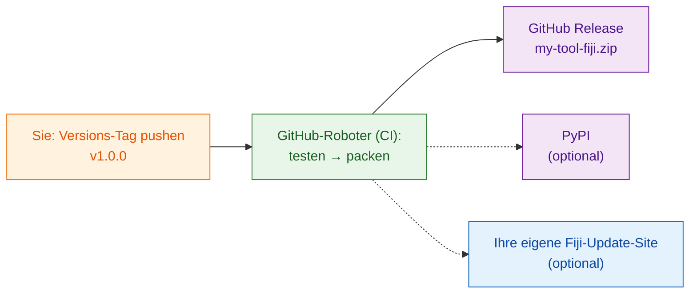

# Mit der ganzen Welt teilen (für Fortgeschrittene)

!!! abstract "Für Fortgeschrittene und optional"
    Alles auf dieser Seite ist **optional**. Um innerhalb Ihres Labors zu
    teilen, reicht die ZIP-Datei aus [`wavu package`](with-your-lab.md).
    Kommen Sie hierher zurück, wenn Fremde im Internet Ihr Werkzeug finden
    und installieren können sollen.

## Die Idee in einfachen Worten

Mit dem eigenen Labor zu teilen ist, als würden Sie der Nachbarin eine
Rezeptbox reichen. Mit der Welt zu teilen heißt, sie **ins Ladenregal** zu
stellen: Sie braucht eine feste Adresse, eine Versionsnummer auf der
Schachtel und am besten einen Roboter, der bei jeder Rezeptänderung eine
frische Schachtel packt, damit Sie nie von Hand packen und ein Teil
vergessen.

Dieser Roboter heißt **CI** („Continuous Integration“, fortlaufende
Integration): ein kostenloser GitHub-Dienst, der auf GitHubs Rechnern
Schritte für Sie ausführt. Die Vorlage enthält bereits die Anweisungen
dafür, in `.github/workflows/release.yml`.

## Die drei Regale

### 1. Ein GitHub Release (fangen Sie hier an)

Legen Sie Ihren Skriptordner als eigenes Repository auf GitHub. Am
einfachsten geht das mit
**[Diese Vorlage auf GitHub verwenden](https://github.com/Oxford-Zeiss-Centre-of-Excellence/Wavu-Script-Template/generate)**,
das die Online-Kopie für Sie anlegt. Danach macht der Roboter jedes Mal,
wenn Sie einen **Tag** wie `v1.0.0` pushen (ein Versionsetikett an Ihrem
Code), Folgendes:

1. er führt Ihre Tests aus;
2. er führt `wavu package` aus;
3. er veröffentlicht eine Seite **GitHub Release** mit `my-tool-fiji.zip`
   im Anhang.

Jeder kann die ZIP-Datei von dieser Seite herunterladen und genau so
installieren wie Ihr Labor. Den Namen des Werkzeugs und seinen Menüeintrag
legen `SCRIPT_NAME` und `MENU` oben in `release.yml` fest.

### 2. PyPI (nur wenn Ihr Algorithmus auch außerhalb von Fiji nützlich ist)

Auf PyPI findet `pip install` seine Pakete. Wenn Sie dort veröffentlichen,
können andere Ihren Algorithmus auch in Notebooks und anderen
Python-Werkzeugen nutzen. Dafür braucht es eine kleine Änderung daran, wie
der Code organisiert ist, und ein PyPI-Konto, aber keine auf GitHub
gespeicherten Passwörter.

### 3. Ihre eigene Fiji-Update-Site (Installation per Häkchen)

Mit einer ImageJ-Update-Site können Fiji-Nutzer Ihr Werkzeug installieren,
indem sie unter **Help › Update… › Manage update sites** ein Häkchen setzen,
und sie bekommen Updates automatisch. Dafür braucht es ein Konto im
ImageJ-Wiki und ein Upload-Passwort, das in GitHub gespeichert ist.

!!! warning "Noch nicht überprüft"
    Das Hochladen von Wavu-Skripten auf eine Update-Site ist noch nicht
    vollständig getestet. Prüfen Sie den ersten Upload in einem frischen
    Fiji, bevor Sie ihn ankündigen.

## Wo die Schritt-für-Schritt-Anleitungen stehen

Die vollständige Entwickleranleitung (auf Englisch) geht jeden Klick und
jede Einstellung durch:

- [8a. GitHub: der Quellcode und die Release-ZIP](https://github.com/Oxford-Zeiss-Centre-of-Excellence/Wavu/blob/main/docs/tutorial-cellpose-plugin.md#8a-github-the-source-and-the-release-zip)
- [8b. PyPI: den Algorithmus selbst teilen](https://github.com/Oxford-Zeiss-Centre-of-Excellence/Wavu/blob/main/docs/tutorial-cellpose-plugin.md#8b-pypi-share-the-algorithm-itself-optional)
- [8c. ImageJ-Update-Site: Installation per Häkchen für alle Fiji-Nutzer](https://github.com/Oxford-Zeiss-Centre-of-Excellence/Wavu/blob/main/docs/tutorial-cellpose-plugin.md#8c-imagej-update-site-one-tick-install-for-every-fiji-user)

Wählen Sie vor einer öffentlichen Veröffentlichung außerdem eine **Lizenz**,
fügen Sie eine Zitationsdatei hinzu und verweisen Sie Nutzer bei Fragen auf
das [image.sc-Forum](https://forum.image.sc) (siehe Abschnitt 9 der
[vollständigen Anleitung](https://github.com/Oxford-Zeiss-Centre-of-Excellence/Wavu/blob/main/docs/tutorial-cellpose-plugin.md#9-keeping-it-alive-with-minimal-effort)).

## In einem Satz

Die Veröffentlichung auf GitHub, PyPI oder einer Fiji-Update-Site ist
optional und wird größtenteils vom Release-Roboter der Vorlage erledigt; für
Ihr eigenes Labor reicht die ZIP-Datei.
