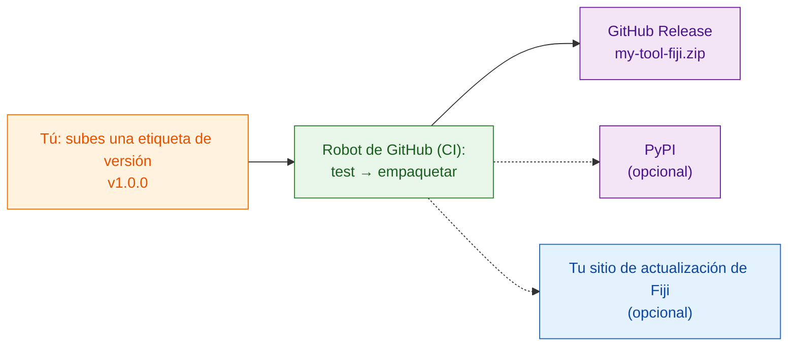

# Compartir con el mundo (avanzado)

!!! abstract "Avanzado y opcional"
    Todo lo que hay en esta página es **opcional**. Para compartir dentro de
    tu laboratorio, el zip de [`wavu package`](with-your-lab.md) es todo lo
    que necesitas. Vuelve aquí cuando quieras que desconocidos en internet
    puedan encontrar e instalar tu herramienta.

## La idea en palabras sencillas

Compartir con tu laboratorio es darle un kit de comida a un vecino. Compartir
con el mundo es ponerlo **en la estantería de una tienda**: necesita una
dirección permanente, un número de versión en la caja y, a ser posible, un
robot que empaquete una caja nueva cada vez que cambias la receta, para que
nunca la empaquetes a mano y olvides un ingrediente.

Ese robot es la **CI** ("integración continua"): un servicio gratuito de
GitHub que ejecuta pasos por ti en los ordenadores de GitHub. La plantilla ya
contiene las instrucciones para él, en `.github/workflows/release.yml`.

## Las tres estanterías

### 1. Una GitHub Release (empieza por aquí)

Pon tu carpeta de script en GitHub como un repositorio propio. La forma más
fácil de empezar es
**[Usar esta plantilla en GitHub](https://github.com/Oxford-Zeiss-Centre-of-Excellence/Wavu-Script-Template/generate)**,
que crea la copia en línea por ti. Después, cada vez que subes (push) una
**etiqueta** (tag) como `v1.0.0` (una marca de versión en tu código), el
robot:

1. ejecuta tus tests;
2. ejecuta `wavu package`;
3. publica una página de **GitHub Release** con `my-tool-fiji.zip` adjunto.

Cualquiera puede descargar el zip desde esa página e instalarlo exactamente
como lo hace tu laboratorio. El nombre de la herramienta y su entrada de menú
se definen con `SCRIPT_NAME` y `MENU` al principio de `release.yml`.

### 2. PyPI (solo si tu algoritmo es útil fuera de Fiji)

PyPI es donde `pip install` encuentra los paquetes. Publicar allí permite que
la gente use tu algoritmo también en notebooks y otras herramientas de
Python. Hace falta un pequeño cambio en la organización del código y una
cuenta de PyPI, pero ninguna contraseña guardada en GitHub.

### 3. Tu propio sitio de actualización de Fiji (instalación con una casilla)

Un sitio de actualización (update site) de ImageJ permite a los usuarios de
Fiji instalar tu herramienta marcando una casilla en
**Help › Update… › Manage update sites**, y reciben las actualizaciones
automáticamente. Hace falta una cuenta en la wiki de ImageJ y una contraseña
de subida guardada en GitHub.

!!! warning "Aún no verificado"
    Subir scripts de Wavu a un sitio de actualización todavía no se ha
    probado del todo. Comprueba la primera subida en un Fiji limpio antes de
    anunciarla.

## Dónde están las instrucciones paso a paso

La guía completa para desarrolladores (en inglés) recorre cada clic y cada
ajuste:

- [8a. GitHub: the source and the release zip](https://github.com/Oxford-Zeiss-Centre-of-Excellence/Wavu/blob/main/docs/tutorial-cellpose-plugin.md#8a-github-the-source-and-the-release-zip) (el código fuente y el zip de la versión)
- [8b. PyPI: share the algorithm itself](https://github.com/Oxford-Zeiss-Centre-of-Excellence/Wavu/blob/main/docs/tutorial-cellpose-plugin.md#8b-pypi-share-the-algorithm-itself-optional) (compartir el propio algoritmo)
- [8c. ImageJ update site: one-tick install for every Fiji user](https://github.com/Oxford-Zeiss-Centre-of-Excellence/Wavu/blob/main/docs/tutorial-cellpose-plugin.md#8c-imagej-update-site-one-tick-install-for-every-fiji-user) (instalación con una casilla para cualquier usuario de Fiji)

Antes de una publicación abierta, elige también una **licencia**, añade un
archivo de citación e indica a los usuarios el
[foro image.sc](https://forum.image.sc) para preguntas (mira la sección 9 de
la [guía completa](https://github.com/Oxford-Zeiss-Centre-of-Excellence/Wavu/blob/main/docs/tutorial-cellpose-plugin.md#9-keeping-it-alive-with-minimal-effort)).

## En una frase

Publicar en GitHub, PyPI o un sitio de actualización de Fiji es opcional y
está casi todo automatizado por el robot de publicación de la plantilla; para
tu propio laboratorio, el zip es suficiente.
