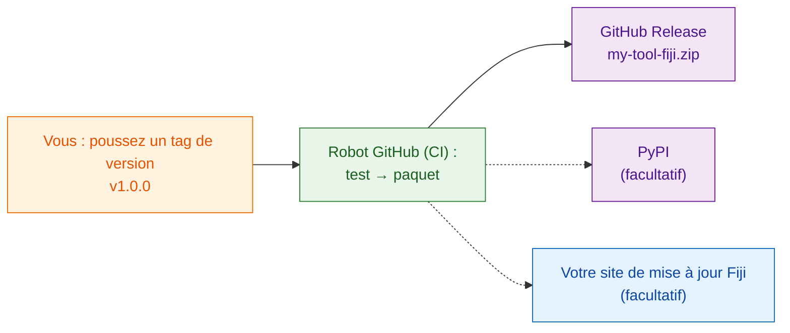

# Partager avec le monde (avancé)

!!! abstract "Avancé et facultatif"
    Tout ce qui est sur cette page est **facultatif**. Pour partager au sein
    de votre labo, le zip de [`wavu package`](with-your-lab.md) suffit.
    Revenez ici quand des inconnus sur Internet devront pouvoir trouver et
    installer votre outil.

## L'idée en mots simples

Partager avec votre labo, c'est donner un coffret de recette à un voisin.
Partager avec le monde, c'est le mettre **en rayon dans un magasin** : il
lui faut une adresse permanente, un numéro de version sur la boîte, et
idéalement un robot qui emballe une boîte neuve à chaque fois que vous
changez la recette, pour que vous n'en emballiez jamais une à la main en
oubliant une pièce.

Ce robot, c'est la **CI** (« intégration continue ») : un service gratuit de
GitHub qui exécute des étapes pour vous sur les ordinateurs de GitHub. Le
modèle contient déjà les instructions pour lui, dans
`.github/workflows/release.yml`.

## Les trois rayons

### 1. Une GitHub Release (commencez ici)

Mettez votre dossier de script sur GitHub, dans son propre dépôt. Le plus
simple pour démarrer est
**[Utiliser ce modèle sur GitHub](https://github.com/Oxford-Zeiss-Centre-of-Excellence/Wavu-Script-Template/generate)**,
qui crée la copie en ligne pour vous. Ensuite, à chaque fois que vous
poussez un **tag** comme `v1.0.0` (une étiquette de version sur votre code),
le robot :

1. lance vos tests ;
2. lance `wavu package` ;
3. publie une page **GitHub Release** avec `my-tool-fiji.zip` en pièce
   jointe.

N'importe qui peut télécharger le zip depuis cette page et l'installer
exactement comme le fait votre labo. Le nom de l'outil et son entrée de menu
sont définis par `SCRIPT_NAME` et `MENU` en haut de `release.yml`.

### 2. PyPI (seulement si votre algorithme est utile hors de Fiji)

PyPI est l'endroit où `pip install` trouve les paquets. Y publier permet
d'utiliser votre algorithme aussi dans des notebooks et d'autres outils
Python. Il faut un petit changement dans l'organisation du code et un compte
PyPI, mais aucun mot de passe stocké sur GitHub.

### 3. Votre propre site de mise à jour Fiji (installation en une case)

Un site de mise à jour ImageJ (update site) permet aux utilisateurs de Fiji
d'installer votre outil en cochant une case dans
**Help › Update… › Manage update sites**, et ils reçoivent les mises à jour
automatiquement. Il faut un compte sur le wiki ImageJ et un mot de passe
d'envoi stocké dans GitHub.

!!! warning "Pas encore vérifié"
    L'envoi de scripts Wavu vers un site de mise à jour n'a pas encore été
    complètement testé. Vérifiez le premier envoi dans un Fiji vierge avant
    de l'annoncer.

## Où trouver les instructions pas à pas

Le guide complet pour développeurs (en anglais) détaille chaque clic et
chaque réglage :

- [8a. GitHub : le code source et le zip de la release](https://github.com/Oxford-Zeiss-Centre-of-Excellence/Wavu/blob/main/docs/tutorial-cellpose-plugin.md#8a-github-the-source-and-the-release-zip)
- [8b. PyPI : partager l'algorithme lui-même](https://github.com/Oxford-Zeiss-Centre-of-Excellence/Wavu/blob/main/docs/tutorial-cellpose-plugin.md#8b-pypi-share-the-algorithm-itself-optional)
- [8c. Site de mise à jour ImageJ : installation en une case pour tous les utilisateurs de Fiji](https://github.com/Oxford-Zeiss-Centre-of-Excellence/Wavu/blob/main/docs/tutorial-cellpose-plugin.md#8c-imagej-update-site-one-tick-install-for-every-fiji-user)

Avant une publication publique, choisissez aussi une **licence**, ajoutez un
fichier de citation, et orientez les utilisateurs vers le
[forum image.sc](https://forum.image.sc) pour leurs questions (voir la
section 9 du [guide complet](https://github.com/Oxford-Zeiss-Centre-of-Excellence/Wavu/blob/main/docs/tutorial-cellpose-plugin.md#9-keeping-it-alive-with-minimal-effort)).

## En une phrase

Publier sur GitHub, sur PyPI ou sur un site de mise à jour Fiji est
facultatif et en grande partie automatisé par le robot de publication du
modèle ; pour votre propre labo, le zip suffit.
