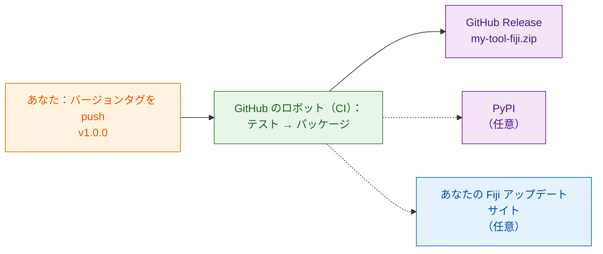

# 世界と共有する（上級）

!!! abstract "上級者向け、任意です"
    このページの内容はすべて **任意** です。研究室で共有するだけなら、
    [`wavu package`](with-your-lab.md) で作った zip があれば十分です。
    インターネット上の知らない人にもツールを見つけてインストールして
    もらいたくなったら、ここに戻ってきてください。

## やさしく言うと

研究室での共有は、レシピボックスをお隣さんに手渡すことです。世界との共有は、
それを **お店の棚に並べる** ことです。そのためには、決まった住所と、箱に
書かれたバージョン番号が必要です。できれば、レシピを変えるたびに新しい箱を
詰めてくれるロボットがいると理想的です。そうすれば手で詰めて何かを入れ
忘れることもありません。

そのロボットが **CI**（「継続的インテグレーション」）です。GitHub の
コンピューター上で作業を代わりに実行してくれる、無料の GitHub の
サービスです。テンプレートには、そのための指示が
`.github/workflows/release.yml` にすでに入っています。

## 3 つの棚

### 1. GitHub Release（ここから始めましょう）

スクリプトフォルダーを、独立したリポジトリとして GitHub に置きます。一番
簡単な始め方は
**[GitHub でこのテンプレートを使う](https://github.com/Oxford-Zeiss-Centre-of-Excellence/Wavu-Script-Template/generate)**
で、オンラインのコピーを作ってくれます。その後、`v1.0.0` のような **タグ**
（コードに付けるバージョンのラベル）を push するたびに、ロボットが次のことを
します。

1. テストを実行する。
2. `wavu package` を実行する。
3. `my-tool-fiji.zip` を添付した **GitHub Release** のページを公開する。

誰でもそのページから zip をダウンロードし、あなたの研究室とまったく同じ
方法でインストールできます。ツールの名前とメニューの項目は、`release.yml`
の先頭にある `SCRIPT_NAME` と `MENU` で決まります。

### 2. PyPI（アルゴリズムが Fiji の外でも役立つ場合だけ）

PyPI は `pip install` がパッケージを探す場所です。そこで公開すると、
ノートブックやほかの Python ツールでもあなたのアルゴリズムを使ってもらえます。
コードの構成を少し変えることと PyPI のアカウントが必要ですが、GitHub に
パスワードを保存する必要はありません。

### 3. 自分の Fiji アップデートサイト（チェック 1 つでインストール）

ImageJ のアップデートサイトを使うと、Fiji のユーザーは
**Help › Update… › Manage update sites** でチェックを 1 つ入れるだけで
ツールをインストールでき、更新も自動で届きます。ImageJ wiki のアカウントと、
GitHub に保存するアップロード用パスワードが必要です。

!!! warning "まだ検証されていません"
    Wavu スクリプトをアップデートサイトにアップロードする手順は、まだ十分に
    テストされていません。公開を告知する前に、まっさらな Fiji で最初の
    アップロードを確認してください。

## 詳しい手順はどこに？

完全な開発者ガイド（英語）が、すべてのクリックと設定を順に説明しています。

- [8a. GitHub：ソースとリリース zip](https://github.com/Oxford-Zeiss-Centre-of-Excellence/Wavu/blob/main/docs/tutorial-cellpose-plugin.md#8a-github-the-source-and-the-release-zip)
- [8b. PyPI：アルゴリズムそのものを共有する](https://github.com/Oxford-Zeiss-Centre-of-Excellence/Wavu/blob/main/docs/tutorial-cellpose-plugin.md#8b-pypi-share-the-algorithm-itself-optional)
- [8c. ImageJ アップデートサイト：すべての Fiji ユーザーにチェック 1 つでインストール](https://github.com/Oxford-Zeiss-Centre-of-Excellence/Wavu/blob/main/docs/tutorial-cellpose-plugin.md#8c-imagej-update-site-one-tick-install-for-every-fiji-user)

一般公開の前には、**ライセンス** を選び、引用ファイルを追加し、質問は
[image.sc フォーラム](https://forum.image.sc) へとユーザーに案内してください
（[完全ガイド](https://github.com/Oxford-Zeiss-Centre-of-Excellence/Wavu/blob/main/docs/tutorial-cellpose-plugin.md#9-keeping-it-alive-with-minimal-effort)
の 9 章を参照）。

## ひとことで言うと

GitHub、PyPI、Fiji アップデートサイトでの公開は任意で、ほとんどはテンプレートの
リリース用ロボットが自動でやってくれます。自分の研究室なら、zip で十分です。
