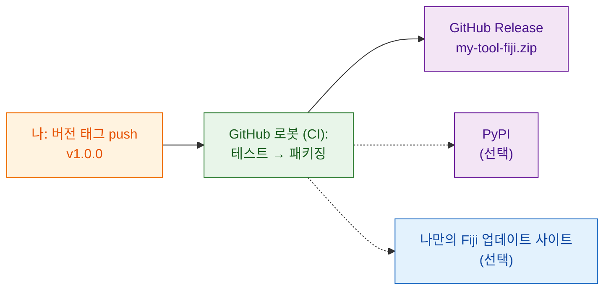

# 전 세계와 공유하기(고급)

!!! abstract "고급이고 선택 사항이에요"
    이 페이지의 모든 내용은 **선택 사항**이에요. 연구실 안에서 공유하려면
    [`wavu package`](with-your-lab.md)로 만든 zip이면 충분해요. 인터넷의
    모르는 사람들도 도구를 찾고 설치할 수 있게 하고 싶을 때 다시 오세요.

## 쉬운 말로 설명하면

연구실과 공유하는 건 이웃에게 레시피 박스를 건네는 거예요. 전 세계와 공유하는 건
그걸 **가게 진열대에** 올리는 거예요. 변하지 않는 주소, 상자에 적힌 버전
번호가 필요하고, 레시피를 바꿀 때마다 새 상자를 싸 주는 로봇이 있으면 더
좋아요. 그러면 손으로 싸다가 뭔가를 빠뜨릴 일이 없어요.

그 로봇이 **CI**("지속적 통합", continuous integration)예요. GitHub의
컴퓨터에서 여러분 대신 작업을 돌려 주는 무료 GitHub 서비스예요. 템플릿에는
이미 그 지시서가 `.github/workflows/release.yml`에 들어 있어요.

## 세 가지 진열대

### 1. GitHub Release(여기서 시작하세요)

스크립트 폴더를 별도의 저장소로 GitHub에 올리세요. 가장 쉬운 시작은
**[GitHub에서 이 템플릿 사용하기](https://github.com/Oxford-Zeiss-Centre-of-Excellence/Wavu-Script-Template/generate)**예요.
온라인 사본을 대신 만들어 줘요. 그다음 `v1.0.0` 같은 **태그**(코드에 붙이는
버전 라벨)를 push할 때마다 로봇이

1. 테스트를 돌리고,
2. `wavu package`를 실행하고,
3. `my-tool-fiji.zip`이 첨부된 **GitHub Release** 페이지를 공개해요.

누구나 그 페이지에서 zip을 내려받아 연구실과 똑같이 설치할 수 있어요.
도구의 이름과 메뉴 항목은 `release.yml` 맨 위의 `SCRIPT_NAME`과 `MENU`로
정해요.

### 2. PyPI(알고리즘이 Fiji 밖에서도 쓸모 있을 때만)

PyPI는 `pip install`이 패키지를 찾는 곳이에요. 여기에 공개하면 노트북이나
다른 Python 도구에서도 여러분의 알고리즘을 쓸 수 있어요. 코드 구성을 조금
바꿔야 하고 PyPI 계정이 필요하지만, GitHub에 비밀번호를 저장할 필요는 없어요.

### 3. 나만의 Fiji 업데이트 사이트(체크 하나로 설치)

ImageJ 업데이트 사이트가 있으면 Fiji 사용자가
**Help › Update… › Manage update sites**에서 체크 하나로 도구를 설치하고,
업데이트도 자동으로 받아요. ImageJ 위키 계정과, GitHub에 저장한 업로드
비밀번호가 필요해요.

!!! warning "아직 검증되지 않았어요"
    Wavu 스크립트를 업데이트 사이트에 올리는 과정은 아직 충분히 테스트되지
    않았어요. 공개하기 전에 깨끗한 Fiji에서 첫 업로드를 확인하세요.

## 단계별 안내는 어디에 있나요?

전체 개발자 가이드(영어)가 모든 클릭과 설정을 하나하나 안내해요.

- [8a. GitHub: 소스와 릴리스 zip](https://github.com/Oxford-Zeiss-Centre-of-Excellence/Wavu/blob/main/docs/tutorial-cellpose-plugin.md#8a-github-the-source-and-the-release-zip)
- [8b. PyPI: 알고리즘 자체를 공유하기](https://github.com/Oxford-Zeiss-Centre-of-Excellence/Wavu/blob/main/docs/tutorial-cellpose-plugin.md#8b-pypi-share-the-algorithm-itself-optional)
- [8c. ImageJ 업데이트 사이트: 모든 Fiji 사용자를 위한 체크 하나 설치](https://github.com/Oxford-Zeiss-Centre-of-Excellence/Wavu/blob/main/docs/tutorial-cellpose-plugin.md#8c-imagej-update-site-one-tick-install-for-every-fiji-user)

공개 릴리스 전에는 **라이선스**도 고르고, 인용(citation) 파일을 추가하고,
질문은 [image.sc 포럼](https://forum.image.sc)으로 안내하세요
([전체 가이드](https://github.com/Oxford-Zeiss-Centre-of-Excellence/Wavu/blob/main/docs/tutorial-cellpose-plugin.md#9-keeping-it-alive-with-minimal-effort) 9절 참고).

## 한 문장으로

GitHub, PyPI, Fiji 업데이트 사이트에 공개하는 건 선택이고 대부분 템플릿의
릴리스 로봇이 자동으로 해 줘요. 내 연구실이라면 zip으로 충분해요.
