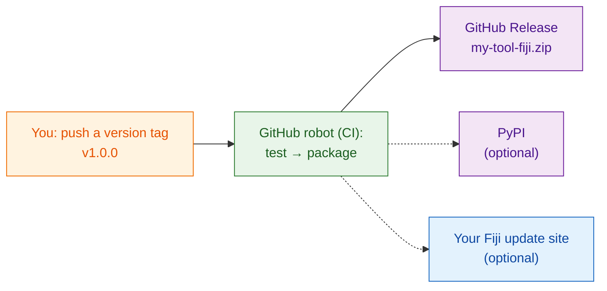

# Share with the world (advanced)

!!! abstract "Advanced and optional"
    Everything on this page is **optional**. To share within your lab, the
    zip from [`wavu package`](with-your-lab.md) is all you need. Come back
    here when strangers on the internet should be able to find and install
    your tool.

## The idea in plain words

Sharing with your lab is handing a meal kit to a neighbour. Sharing with the
world is putting it **on a shop shelf**: it needs a permanent address, a
version number on the box, and ideally a robot that packs a fresh box every
time you change the recipe, so you never pack one by hand and forget an
ingredient.

That robot is **CI** ("continuous integration"): a free GitHub service that
runs steps for you on GitHub's computers. The template already contains the
instructions for it, in `.github/workflows/release.yml`.

## The three shelves

### 1. A GitHub Release (start here)

Put your script folder on GitHub as its own repository. The easiest start is
**[Use this template on GitHub](https://github.com/Oxford-Zeiss-Centre-of-Excellence/Wavu-Script-Template/generate)**,
which makes the online copy for you. Then, each time you push a **tag**
such as `v1.0.0` (a version label on your code), the robot:

1. runs your tests;
2. runs `wavu package`;
3. publishes a **GitHub Release** page with `my-tool-fiji.zip` attached.

Anyone can download the zip from that page and install it exactly as your lab
does. The tool's name and menu entry are set by `SCRIPT_NAME` and `MENU` at
the top of `release.yml`.

### 2. PyPI (only if your algorithm is useful outside Fiji)

PyPI is where `pip install` finds packages. Publishing there lets people use
your algorithm in notebooks and other Python tools too. It needs a small change in how
the code is organised and a PyPI account, but no passwords stored on GitHub.

### 3. Your own Fiji update site (one-tick install)

An ImageJ update site lets Fiji users install your tool by ticking a box in
**Help › Update… › Manage update sites**, and they get updates
automatically. It needs an ImageJ wiki account and an upload password stored
in GitHub.

!!! warning "Not yet verified"
    Uploading Wavu scripts to an update site has not been fully tested yet.
    Check the first upload in a clean Fiji before you announce it.

## Where the step-by-step instructions are

The full developer guide walks through every click and setting:

- [8a. GitHub: the source and the release zip](https://github.com/Oxford-Zeiss-Centre-of-Excellence/Wavu/blob/main/docs/tutorial-cellpose-plugin.md#8a-github-the-source-and-the-release-zip)
- [8b. PyPI: share the algorithm itself](https://github.com/Oxford-Zeiss-Centre-of-Excellence/Wavu/blob/main/docs/tutorial-cellpose-plugin.md#8b-pypi-share-the-algorithm-itself-optional)
- [8c. ImageJ update site: one-tick install for every Fiji user](https://github.com/Oxford-Zeiss-Centre-of-Excellence/Wavu/blob/main/docs/tutorial-cellpose-plugin.md#8c-imagej-update-site-one-tick-install-for-every-fiji-user)

Before a public release, also pick a **licence**, add a citation file, and
point users to the [image.sc forum](https://forum.image.sc) for questions
(see section 9 of the [full guide](https://github.com/Oxford-Zeiss-Centre-of-Excellence/Wavu/blob/main/docs/tutorial-cellpose-plugin.md#9-keeping-it-alive-with-minimal-effort)).

## In one sentence

Publishing to GitHub, PyPI or a Fiji update site is optional and mostly
automated by the template's release robot; for your own lab, the zip is
enough.
