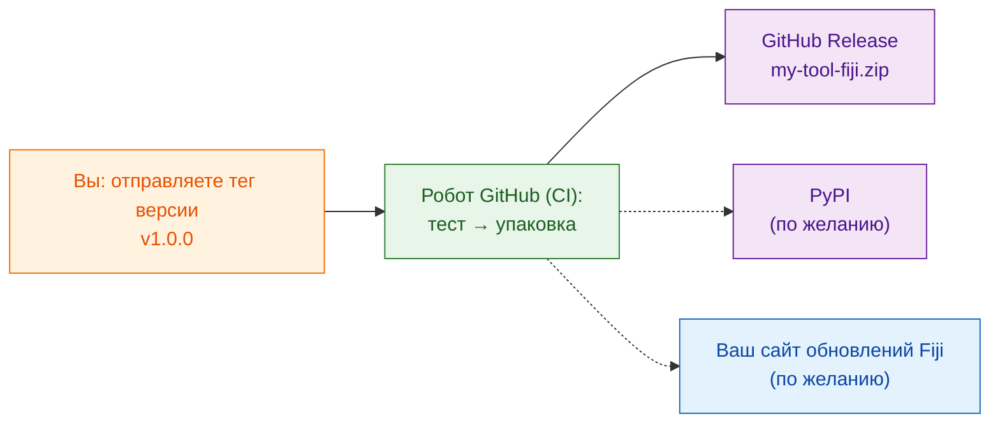

# Поделиться со всем миром (для продвинутых)

!!! abstract "Для продвинутых и по желанию"
    Всё на этой странице **необязательно**. Чтобы поделиться внутри
    лаборатории, достаточно zip из [`wavu package`](with-your-lab.md).
    Возвращайтесь сюда, когда ваш инструмент должны находить и
    устанавливать незнакомые люди в интернете.

## Идея простыми словами

Поделиться с лабораторией — это отдать набор для ужина соседу. Поделиться со
всем миром — это поставить его **на полку магазина**: нужен постоянный адрес,
номер версии на коробке и, в идеале, робот, который упаковывает свежую
коробку каждый раз, когда вы меняете рецепт, чтобы вы никогда не собирали её
вручную и не забыли ингредиент.

Этот робот — **CI** («непрерывная интеграция»): бесплатный сервис GitHub,
который выполняет шаги за вас на компьютерах GitHub. Шаблон уже содержит
инструкции для него в `.github/workflows/release.yml`.

## Три полки

### 1. GitHub Release (начните отсюда)

Разместите папку скрипта на GitHub как отдельный репозиторий. Проще всего
начать с **[Использовать шаблон на GitHub](https://github.com/Oxford-Zeiss-Centre-of-Excellence/Wavu-Script-Template/generate)** —
так онлайн-копия создаётся за вас. Затем каждый раз, когда вы отправляете
(push) **тег** вроде `v1.0.0` (метку версии на вашем коде), робот:

1. запускает ваши тесты;
2. выполняет `wavu package`;
3. публикует страницу **GitHub Release** с приложенным `my-tool-fiji.zip`.

Любой может скачать zip с этой страницы и установить его так же, как ваша
лаборатория. Имя инструмента и пункт меню задаются переменными `SCRIPT_NAME`
и `MENU` в начале `release.yml`.

### 2. PyPI (только если алгоритм полезен и вне Fiji)

PyPI — это место, где `pip install` находит пакеты. Публикация там позволяет
использовать ваш алгоритм и в ноутбуках, и в других Python-инструментах. Для
этого нужно немного изменить организацию кода и завести учётную запись PyPI,
но хранить пароли на GitHub не нужно.

### 3. Свой сайт обновлений Fiji (установка одной галочкой)

Сайт обновлений (update site) ImageJ позволяет пользователям Fiji
установить ваш инструмент, отметив галочку в
**Help › Update… › Manage update sites**, и получать обновления
автоматически. Для этого нужна учётная запись в вики ImageJ и пароль для
загрузки, сохранённый в GitHub.

!!! warning "Ещё не проверено"
    Загрузка скриптов Wavu на сайт обновлений пока не протестирована
    полностью. Проверьте первую загрузку в чистом Fiji, прежде чем
    объявлять о ней.

## Где пошаговые инструкции

Полное руководство разработчика проводит через каждый щелчок и настройку:

- [8a. GitHub: the source and the release zip](https://github.com/Oxford-Zeiss-Centre-of-Excellence/Wavu/blob/main/docs/tutorial-cellpose-plugin.md#8a-github-the-source-and-the-release-zip) (исходный код и zip релиза)
- [8b. PyPI: share the algorithm itself](https://github.com/Oxford-Zeiss-Centre-of-Excellence/Wavu/blob/main/docs/tutorial-cellpose-plugin.md#8b-pypi-share-the-algorithm-itself-optional) (поделиться самим алгоритмом)
- [8c. ImageJ update site: one-tick install for every Fiji user](https://github.com/Oxford-Zeiss-Centre-of-Excellence/Wavu/blob/main/docs/tutorial-cellpose-plugin.md#8c-imagej-update-site-one-tick-install-for-every-fiji-user) (установка одной галочкой для любого пользователя Fiji)

Перед публичным релизом также выберите **лицензию**, добавьте файл для
цитирования и направьте пользователей с вопросами на
[форум image.sc](https://forum.image.sc) (см. раздел 9
[полного руководства](https://github.com/Oxford-Zeiss-Centre-of-Excellence/Wavu/blob/main/docs/tutorial-cellpose-plugin.md#9-keeping-it-alive-with-minimal-effort)).

## Одним предложением

Публикация на GitHub, PyPI или сайте обновлений Fiji необязательна и почти
полностью автоматизирована роботом релизов из шаблона; для вашей лаборатории
достаточно zip.
