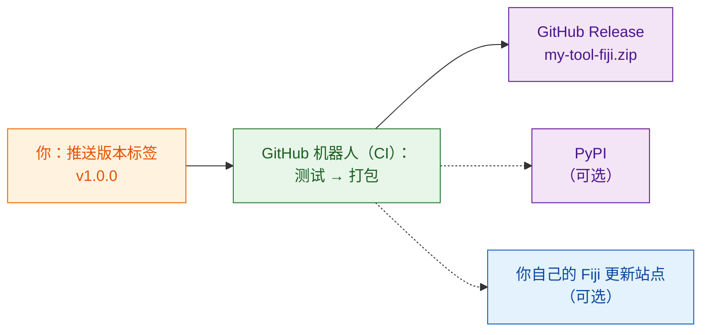

# 分享给全世界（进阶）

!!! abstract "进阶，可跳过"
    这一页的内容全都是**可选的**。只在实验室里分享的话，[`wavu package`](with-your-lab.md) 生成的 zip 就够了。等你希望互联网上的陌生人也能找到并安装你的工具时，再回来看这一页。

## 用大白话说

分享给实验室，就像把料理包递给邻居。分享给全世界，则是把它摆上**商店货架**：它需要一个固定的地址、盒子上的版本号，最好还有一个机器人，每次你改了食谱就自动装好一盒新的，这样你永远不用手工打包，也不会漏掉哪样食材。

这个机器人就是 **CI**（“持续集成”，continuous integration）：GitHub 的一项免费服务，会在 GitHub 的电脑上替你执行一系列步骤。模板里已经写好了给它的指令，放在 `.github/workflows/release.yml`。

## 三种货架

### 1. GitHub Release（从这里开始）

把你的脚本文件夹放到 GitHub 上，成为一个独立的仓库。最简单的起步方式是 **[Use this template on GitHub](https://github.com/Oxford-Zeiss-Centre-of-Excellence/Wavu-Script-Template/generate)**（在 GitHub 上使用此模板），它会帮你创建在线副本。之后，每当你推送一个**标签**（tag，例如 `v1.0.0`，也就是贴在代码上的版本标记），机器人就会：

1. 运行你的测试；
2. 运行 `wavu package`；
3. 发布一个 **GitHub Release** 页面，附上 `my-tool-fiji.zip`。

任何人都可以从那个页面下载 zip，安装方法和你的实验室完全一样。工具的名称和菜单项由 `release.yml` 开头的 `SCRIPT_NAME` 和 `MENU` 设置。

### 2. PyPI（仅当你的算法在 Fiji 之外也有用时）

PyPI 是 `pip install` 查找软件包的地方。发布到那里，别人就能在 notebook 和其他 Python 工具里使用你的算法。这需要稍微调整代码的组织方式，并准备一个 PyPI 账号，但不用把任何密码存在 GitHub 上。

### 3. 你自己的 Fiji 更新站点（勾一下就能安装）

ImageJ 更新站点（update site）让 Fiji 用户只要在 **Help › Update… › Manage update sites** 里勾选一个复选框，就能安装你的工具，并且自动获得更新。这需要一个 ImageJ wiki 账号，以及一个保存在 GitHub 上的上传密码。

!!! warning "尚未验证"
    把 Wavu 脚本上传到更新站点还没有经过完整测试。正式宣布之前，请先在一个干净的 Fiji 里检查第一次上传的结果。

## 详细步骤在哪里

完整的开发者指南会带你走完每一次点击和每一项设置（英文）：

- [8a. GitHub: the source and the release zip](https://github.com/Oxford-Zeiss-Centre-of-Excellence/Wavu/blob/main/docs/tutorial-cellpose-plugin.md#8a-github-the-source-and-the-release-zip)（GitHub：源代码与发布用 zip）
- [8b. PyPI: share the algorithm itself](https://github.com/Oxford-Zeiss-Centre-of-Excellence/Wavu/blob/main/docs/tutorial-cellpose-plugin.md#8b-pypi-share-the-algorithm-itself-optional)（PyPI：分享算法本身）
- [8c. ImageJ update site: one-tick install for every Fiji user](https://github.com/Oxford-Zeiss-Centre-of-Excellence/Wavu/blob/main/docs/tutorial-cellpose-plugin.md#8c-imagej-update-site-one-tick-install-for-every-fiji-user)（ImageJ 更新站点：让每个 Fiji 用户勾一下就能安装）

公开发布之前，还请选好一份**许可证**、加上引用文件（citation file），并引导用户到 [image.sc 论坛](https://forum.image.sc)提问（见[完整指南](https://github.com/Oxford-Zeiss-Centre-of-Excellence/Wavu/blob/main/docs/tutorial-cellpose-plugin.md#9-keeping-it-alive-with-minimal-effort)第 9 节）。

## 一句话总结

发布到 GitHub、PyPI 或 Fiji 更新站点都是可选的，而且大部分由模板里的发布机器人自动完成；在你自己的实验室里，一个 zip 就够了。
