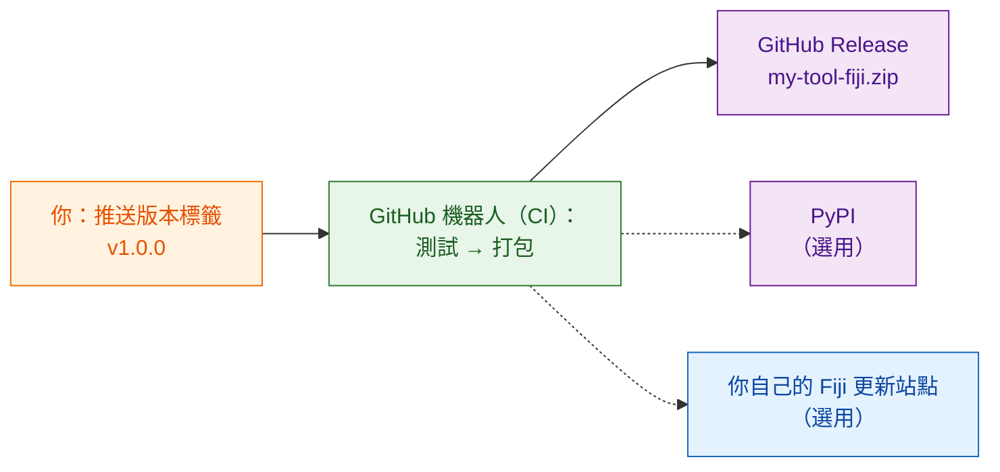

# 分享給全世界（進階）

!!! abstract "進階，可略過"
    這一頁的內容全部都是**選用的**。只在實驗室裡分享的話，[`wavu package`](with-your-lab.md) 產生的 zip 就夠了。等你希望網路上的陌生人也能找到並安裝你的工具時，再回來看這一頁。

## 用白話說

分享給實驗室，就像把食譜盒交給鄰居。分享給全世界，則是把它擺上**商店貨架**：它需要一個固定的地址、盒子上的版本號，最好還有一個機器人，每次你改了食譜就自動包好一盒新的，這樣你永遠不必手工打包，也不會漏掉某個零件。

這個機器人就是 **CI**（「持續整合」，continuous integration）：GitHub 的一項免費服務，會在 GitHub 的電腦上替你執行一連串步驟。範本裡已經寫好給它的指示，放在 `.github/workflows/release.yml`。

## 三種貨架

### 1. GitHub Release（從這裡開始）

把你的腳本資料夾放到 GitHub，成為一個獨立的儲存庫。最簡單的開始方式是 **[Use this template on GitHub](https://github.com/Oxford-Zeiss-Centre-of-Excellence/Wavu-Script-Template/generate)**（在 GitHub 上使用這個範本），它會幫你建立線上副本。之後，每當你推送一個**標籤**（tag，例如 `v1.0.0`，也就是貼在程式碼上的版本標記），機器人就會：

1. 執行你的測試；
2. 執行 `wavu package`；
3. 發布一個 **GitHub Release** 頁面，附上 `my-tool-fiji.zip`。

任何人都可以從那個頁面下載 zip，安裝方式和你的實驗室完全一樣。工具的名稱和選單項目由 `release.yml` 開頭的 `SCRIPT_NAME` 和 `MENU` 設定。

### 2. PyPI（只有當你的演算法在 Fiji 以外也有用時）

PyPI 是 `pip install` 尋找套件的地方。發布到那裡，別人就能在 notebook 和其他 Python 工具裡使用你的演算法。這需要稍微調整程式碼的組織方式，並準備一個 PyPI 帳號，但不必把任何密碼存在 GitHub 上。

### 3. 你自己的 Fiji 更新站點（勾一下就安裝）

ImageJ 更新站點（update site）讓 Fiji 使用者只要在 **Help › Update… › Manage update sites** 裡勾選一個方框，就能安裝你的工具，並且自動收到更新。這需要一個 ImageJ wiki 帳號，以及一組存放在 GitHub 上的上傳密碼。

!!! warning "尚未驗證"
    把 Wavu 腳本上傳到更新站點這件事還沒有經過完整測試。正式公告之前，請先在一個乾淨的 Fiji 裡檢查第一次上傳的結果。

## 詳細步驟在哪裡

完整的開發者指南會帶你走過每一次點擊和每一項設定（英文）：

- [8a. GitHub: the source and the release zip](https://github.com/Oxford-Zeiss-Centre-of-Excellence/Wavu/blob/main/docs/tutorial-cellpose-plugin.md#8a-github-the-source-and-the-release-zip)（GitHub：原始碼與發布用 zip）
- [8b. PyPI: share the algorithm itself](https://github.com/Oxford-Zeiss-Centre-of-Excellence/Wavu/blob/main/docs/tutorial-cellpose-plugin.md#8b-pypi-share-the-algorithm-itself-optional)（PyPI：分享演算法本身）
- [8c. ImageJ update site: one-tick install for every Fiji user](https://github.com/Oxford-Zeiss-Centre-of-Excellence/Wavu/blob/main/docs/tutorial-cellpose-plugin.md#8c-imagej-update-site-one-tick-install-for-every-fiji-user)（ImageJ 更新站點：讓每位 Fiji 使用者勾一下就安裝）

公開發布之前，也請選好一份**授權條款**、加上引用檔案（citation file），並引導使用者到 [image.sc 論壇](https://forum.image.sc)提問（請看[完整指南](https://github.com/Oxford-Zeiss-Centre-of-Excellence/Wavu/blob/main/docs/tutorial-cellpose-plugin.md#9-keeping-it-alive-with-minimal-effort)第 9 節）。

## 一句話總結

發布到 GitHub、PyPI 或 Fiji 更新站點都是選用的，而且大多由範本裡的發布機器人自動完成；在你自己的實驗室裡，一個 zip 就夠了。
