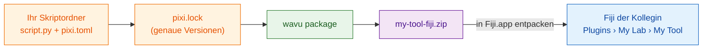

# Mit dem eigenen Labor teilen

## Die Idee in einfachen Worten

Ihr Rezept funktioniert. Jetzt sollen Ihre Kolleginnen und Kollegen es
benutzen, **ohne** Ordner auszuwählen oder irgendetwas über Python zu
wissen. Wavu kann Ihren Skriptordner in **eine einzige ZIP-Datei** packen,
wie eine Kochbox: das Rezept, die genaue Einkaufsliste und einen
Menüeintrag. Ihre Kollegin entpackt sie in Fiji, startet neu und findet Ihr
Werkzeug im Menü **Plugins**, unter einem Namen, den Sie wählen.

**Für ein Labor reicht diese ZIP-Datei.** Kein GitHub, keine Website, keine
Konten. Per E-Mail verschicken, auf ein gemeinsames Laufwerk legen, fertig.



## Was ist `pixi.lock`? { #what-is-pixilock }

`pixi.toml` ist die Einkaufsliste („etwas scikit-image“). `pixi.lock` ist
der **Kassenbon**: die genaue Version jedes Pakets, das tatsächlich gekauft
wurde. Wenn Sie den Kassenbon mitliefern, bekommen Ihre Kollegen *genau*
dieselben Pakete wie Sie, und das Werkzeug verhält sich auf ihren Computern
gleich. pixi schreibt ihn für Sie, wenn es die Umgebung baut; nach Ihrem
ersten Durchlauf aus Fiji liegt er also schon in Ihrem Ordner.

## Schritt 1: die ZIP-Datei erstellen { #step-1-make-the-zip }

Das ist ein Schritt im Terminal (siehe
[wie Sie pixi ins Terminal bekommen](../write/test-without-fiji.md#run-the-tests)).
Öffnen Sie in VS Code **Terminal › New Terminal** in Ihrem Skriptordner und
führen Sie aus:

```sh
pixi install
pixi run wavu package . --name my-tool --menu "My Lab>My Tool"
```

- `--name` ist ein kurzer interner Name: nur Buchstaben, Ziffern, `_` und
  `-`.
- `--menu` legt fest, wo das Werkzeug unter **Plugins** erscheint. `>`
  trennt Untermenüs, also ergibt `"My Lab>My Tool"`
  **Plugins › My Lab › My Tool**.

Sie sollten etwa Folgendes sehen:

```text
Wrote dist/fiji and …/dist/my-tool-fiji.zip
Users unzip it into Fiji.app (needs Wavu); menu: Plugins > My Lab > My Tool
```

Ihre ZIP-Datei ist `dist/my-tool-fiji.zip` im Skriptordner. Tests, `.pixi`,
`.vscode` und `.github` werden automatisch weggelassen.

??? warning "Es heißt *depends on wavu through a local path*"
    Dann zeigt Ihre `pixi.toml` auf einen Wavu-Ordner auf *Ihrer* Festplatte,
    den Ihre Kollegen nicht haben. Die Meldung gibt die Zeile aus, die Sie
    stattdessen verwenden sollen. Fügen Sie sie in `pixi.toml` ein und führen
    Sie dann `pixi install` erneut aus. Ordner aus der
    [Vorlage](../write/get-the-template.md) haben dieses Problem nicht.

## Schritt 2: Ihre Kollegin installiert es { #step-2-your-colleague-installs-it }

Ihre Kollegin braucht ein installiertes Wavu
([zwei Minuten](install.md)). Dann:

1. `my-tool-fiji.zip` **in `Fiji.app`** entpacken, genau wie die Wavu-ZIP
   ([so geht es, je nach System](install.md#step-2-unzip-it-into-your-fiji-folder)).
2. Fiji neu starten.
3. Ein Bild öffnen und **Plugins › My Lab › My Tool** wählen.

Der erste Start lädt die Pakete aus Ihrer `pixi.lock` herunter (einmalig;
das Log sagt Bescheid), dann erscheint der Dialog. Es gibt keinen Ordner
auszuwählen.

Das Werkzeug erscheint außerdem in **Plugins › Wavu › Run Python Script**
als *installed: my-tool*.

## Das Werkzeug aktualisieren { #updating-the-tool }

Ändern Sie Ihr Skript, testen Sie es, führen Sie die beiden Befehle erneut
aus und verschicken Sie die neue ZIP-Datei. Ihre Kollegen entpacken sie über
die alte und starten Fiji neu.

## In einem Satz

`wavu package` macht aus Ihrem Skriptordner eine ZIP-Datei; wer Wavu hat,
entpackt sie in `Fiji.app` und findet Ihr Werkzeug im Plugins-Menü, ganz
ohne GitHub.

[Weiter: mit der ganzen Welt teilen (für Fortgeschrittene) :material-arrow-right:](with-the-world.md){ .md-button }
