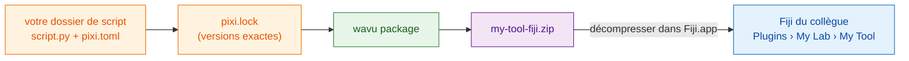

# Partager avec votre labo

## L'idée en mots simples

Votre recette fonctionne. Maintenant, vous voulez que vos collègues
l'utilisent **sans** choisir de dossier ni rien connaître à Python. Wavu peut
emballer votre dossier de script dans **un seul fichier zip**, comme un
coffret de recette : la recette, la liste exacte de la batterie de cuisine
et une entrée de menu.
Un collègue le décompresse dans Fiji, redémarre, et trouve votre outil dans
le menu **Plugins**, sous le nom que vous avez choisi.

**Pour un labo, ce zip suffit.** Pas de GitHub, pas de site web, pas de
comptes. Envoyez-le par e-mail, déposez-le sur un disque partagé, c'est
fait.



## Qu'est-ce que `pixi.lock` ? { #what-is-pixilock }

`pixi.toml` est la liste de la batterie de cuisine (« du scikit-image »). `pixi.lock` est le
**ticket de caisse** : la version exacte de chaque paquet réellement acheté.
Fournir le ticket veut dire que vos collègues obtiennent *exactement* les
mêmes paquets que vous, donc l'outil se comporte pareil sur leurs
ordinateurs. pixi l'écrit pour vous quand il construit l'environnement :
après votre première exécution depuis Fiji, il est déjà dans votre dossier.

## Étape 1 : créer le zip { #step-1-make-the-zip }

C'est une étape dans le terminal (voir
[comment avoir pixi dans un terminal](../write/test-without-fiji.md#run-the-tests)).
Dans VS Code, ouvrez **Terminal › New Terminal** dans votre dossier de
script et lancez :

```sh
pixi install
pixi run wavu package . --name my-tool --menu "My Lab>My Tool"
```

- `--name` est un court nom interne : lettres, chiffres, `_` et `-`
  uniquement.
- `--menu` indique où l'outil apparaît sous **Plugins**. `>` sépare les
  sous-menus : `"My Lab>My Tool"` donne **Plugins › My Lab › My Tool**.

Vous devriez voir quelque chose comme :

```text
Wrote dist/fiji and …/dist/my-tool-fiji.zip
Users unzip it into Fiji.app (needs Wavu); menu: Plugins > My Lab > My Tool
```

Votre zip est `dist/my-tool-fiji.zip` dans le dossier de script. Les tests,
`.pixi`, `.vscode` et `.github` sont laissés de côté automatiquement.

??? warning "Le message dit *depends on wavu through a local path*"
    Votre `pixi.toml` pointe alors vers un dossier Wavu sur *votre* disque,
    que vos collègues n'ont pas. Le message affiche la ligne à utiliser à la
    place. Collez-la dans `pixi.toml`, puis relancez `pixi install`. Les
    dossiers issus du [modèle](../write/get-the-template.md) n'ont pas ce
    problème.

## Étape 2 : votre collègue l'installe { #step-2-your-colleague-installs-it }

Votre collègue doit avoir installé Wavu ([deux minutes](install.md)).
Ensuite :

1. Décompresser `my-tool-fiji.zip` **dans `Fiji.app`**, exactement comme le
   zip de Wavu
   ([comment faire, selon le système](install.md#step-2-unzip-it-into-your-fiji-folder)).
2. Redémarrer Fiji.
3. Ouvrir une image et choisir **Plugins › My Lab › My Tool**.

Le premier démarrage télécharge les paquets indiqués dans votre `pixi.lock`
(une seule fois ; le Log le signale), puis la boîte de dialogue apparaît. Il
n'y a aucun dossier à choisir.

L'outil apparaît aussi dans **Plugins › Wavu › Run Python Script** sous le
nom *installed: my-tool*.

## Mettre l'outil à jour { #updating-the-tool }

Modifiez votre script, testez-le, relancez les deux commandes et envoyez le
nouveau zip. Vos collègues le décompressent par-dessus l'ancien et
redémarrent Fiji.

## En une phrase

`wavu package` transforme votre dossier de script en un seul zip ; toute
personne qui a Wavu le décompresse dans `Fiji.app` et retrouve votre outil
dans le menu Plugins, sans avoir besoin de GitHub.

[Suite : partager avec le monde (avancé) :material-arrow-right:](with-the-world.md){ .md-button }
