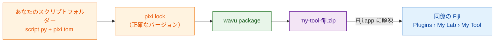

# 研究室で共有する

## やさしく言うと

レシピが完成しました。今度は同僚に、フォルダーを選んだり Python について
何か知ったりすること **なしに** 使ってもらいたいですね。Wavu はスクリプト
フォルダーを **zip ファイル 1 つ** にまとめられます。ミールキットのような
もので、レシピ、正確な買い物リスト、メニューの項目が入っています。同僚は
それを Fiji に解凍して再起動するだけで、**Plugins** メニューの中に、あなたが
決めた名前でツールを見つけられます。

**研究室で使うなら、この zip だけで十分です。** GitHub もウェブサイトも
アカウントもいりません。メールで送るか、共有ドライブに置けば終わりです。



## `pixi.lock` とは？

`pixi.toml` は買い物リストです（「scikit-image を少し」）。`pixi.lock` は
**レシート** で、実際に買ったすべてのパッケージの正確なバージョンが書いて
あります。レシートも一緒に渡せば、同僚はあなたと *まったく同じ* パッケージを
手に入れるので、ツールは同僚のコンピューターでも同じように動きます。pixi は
環境を作るときにこれを書いてくれるので、Fiji から一度実行した後なら、もう
フォルダーに入っています。

## ステップ 1：zip を作る

これはターミナルでの作業です（[ターミナルで pixi を使う方法](../write/test-without-fiji.md#run-the-tests)
を見てください）。VS Code でスクリプトフォルダーを開いた状態で
**Terminal › New Terminal** を開き、次を実行します。

```sh
pixi install
pixi run wavu package . --name my-tool --menu "My Lab>My Tool"
```

- `--name` は短い内部用の名前です。文字、数字、`_`、`-` だけが使えます。
- `--menu` は **Plugins** の下でツールが表示される場所です。`>` でサブメニューを
  区切るので、`"My Lab>My Tool"` は **Plugins › My Lab › My Tool** になります。

次のような表示が出るはずです。

```text
Wrote dist/fiji and …/dist/my-tool-fiji.zip
Users unzip it into Fiji.app (needs Wavu); menu: Plugins > My Lab > My Tool
```

zip はスクリプトフォルダーの中の `dist/my-tool-fiji.zip` です。テスト、
`.pixi`、`.vscode`、`.github` は自動的に除かれます。

??? warning "*depends on wavu through a local path* と表示されたら"
    `pixi.toml` が *あなたの* ディスク上の Wavu フォルダーを指しています。
    同僚はそのフォルダーを持っていません。メッセージには代わりに使う行が
    表示されるので、それを `pixi.toml` に貼り付けて、もう一度
    `pixi install` を実行してください。[テンプレート](../write/get-the-template.md)
    から作ったフォルダーでは、この問題は起きません。

## ステップ 2：同僚がインストールする

同僚には Wavu のインストールが必要です（[2 分です](install.md)）。
その後で：

1. `my-tool-fiji.zip` を **`Fiji.app` の中に** 解凍します。Wavu の zip と
   まったく同じです（[OS ごとのやり方](install.md#step-2-unzip-it-into-your-fiji-folder)）。
2. Fiji を再起動します。
3. 画像を開き、**Plugins › My Lab › My Tool** を選びます。

最初の起動では `pixi.lock` に書かれたパッケージをダウンロードし（一度だけ。
Log にそう表示されます）、その後ダイアログが出ます。フォルダーを選ぶ必要は
ありません。

このツールは **Plugins › Wavu › Run Python Script** にも
*installed: my-tool* として表示されます。

## ツールを更新する

スクリプトを変えてテストし、2 つのコマンドをもう一度実行して、新しい zip を
送ります。同僚は古いものの上に解凍し、Fiji を再起動します。

## ひとことで言うと

`wavu package` はスクリプトフォルダーを zip 1 つにします。Wavu を持っている人
なら誰でも、それを `Fiji.app` に解凍するだけで Plugins メニューにツールが
現れます。GitHub は必要ありません。

[次へ：世界と共有する（上級） :material-arrow-right:](with-the-world.md){ .md-button }
