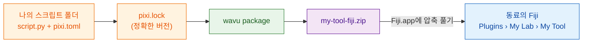

# 연구실과 공유하기

## 쉬운 말로 설명하면

레시피가 잘 작동해요. 이제 동료들이 폴더를 고르거나 Python을 몰라도 쓸 수
있게 하고 싶어요. Wavu는 스크립트 폴더를 밀키트처럼 **zip 파일 하나**로
싸 줄 수 있어요. 레시피, 정확한 장보기 목록, 메뉴 항목이 다 들어 있어요.
동료가 Fiji에 압축을 풀고 다시 시작하면, 여러분이 정한 이름으로
**Plugins** 메뉴에서 도구를 찾을 수 있어요.

**연구실이라면 이 zip 하나면 충분해요.** GitHub도, 웹사이트도, 계정도
필요 없어요. 이메일로 보내거나 공유 드라이브에 올리면 끝이에요.



## `pixi.lock`이 뭔가요?

`pixi.toml`은 장보기 목록이에요("scikit-image 조금"). `pixi.lock`은
**영수증**이에요. 실제로 산 모든 패키지의 정확한 버전이 적혀 있어요.
영수증을 함께 보내면 동료들이 여러분과 *똑같은* 패키지를 받으니, 도구가
동료 컴퓨터에서도 똑같이 동작해요. pixi가 환경을 만들 때 이 파일을 써
주니까, Fiji에서 처음 실행한 뒤라면 이미 폴더에 있어요.

## 1단계: zip 만들기

이건 터미널 단계예요([터미널에서 pixi 쓰는 법](../write/test-without-fiji.md#run-the-tests)
참고). VS Code에서 스크립트 폴더에 **Terminal › New Terminal**을 열고
실행하세요.

```sh
pixi install
pixi run wavu package . --name my-tool --menu "My Lab>My Tool"
```

- `--name`은 짧은 내부 이름이에요. 글자, 숫자, `_`, `-`만 쓸 수 있어요.
- `--menu`는 **Plugins** 아래에서 도구가 나올 위치예요. `>`가 하위 메뉴를
  나눠요. 그래서 `"My Lab>My Tool"`은 **Plugins › My Lab › My Tool**이 돼요.

이런 내용이 보일 거예요.

```text
Wrote dist/fiji and …/dist/my-tool-fiji.zip
Users unzip it into Fiji.app (needs Wavu); menu: Plugins > My Lab > My Tool
```

zip은 스크립트 폴더 안의 `dist/my-tool-fiji.zip`이에요. 테스트, `.pixi`,
`.vscode`, `.github`는 자동으로 빠져요.

??? warning "*depends on wavu through a local path*라고 나와요"
    `pixi.toml`이 *여러분* 디스크의 Wavu 폴더를 가리키고 있다는 뜻이에요.
    동료에게는 그 폴더가 없어요. 메시지에 대신 쓸 줄이 출력되니, 그걸
    `pixi.toml`에 붙여 넣고 `pixi install`을 다시 실행하세요.
    [템플릿](../write/get-the-template.md)에서 만든 폴더에는 이 문제가 없어요.

## 2단계: 동료가 설치하기

동료에게는 Wavu가 설치되어 있어야 해요([2분이면 돼요](install.md)).
그다음은 이래요.

1. `my-tool-fiji.zip`을 Wavu zip과 똑같이 **`Fiji.app` 안에** 압축 풀어요
   ([시스템별 방법](install.md#step-2-unzip-it-into-your-fiji-folder)).
2. Fiji를 다시 시작해요.
3. 이미지를 열고 **Plugins › My Lab › My Tool**을 골라요.

첫 시작 때 `pixi.lock`에 적힌 패키지를 내려받고(한 번만, Log에 나와요),
그다음 대화상자가 나타나요. 고를 폴더는 없어요.

도구는 **Plugins › Wavu › Run Python Script**에도 *installed: my-tool*로 나와요.

## 도구 업데이트하기

스크립트를 고치고, 테스트하고, 두 명령을 다시 실행해서 새 zip을 보내세요.
동료는 예전 것 위에 압축을 풀고 Fiji를 다시 시작하면 돼요.

## 한 문장으로

`wavu package`는 스크립트 폴더를 zip 하나로 만들고, Wavu가 있는 사람은
누구나 그걸 `Fiji.app`에 압축 풀어 Plugins 메뉴에서 도구를 쓸 수 있어요.
GitHub는 필요 없어요.

[다음: 전 세계와 공유하기(고급) :material-arrow-right:](with-the-world.md){ .md-button }
