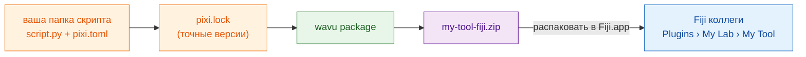

# Поделиться с лабораторией

## Идея простыми словами

Ваш рецепт работает. Теперь вы хотите, чтобы коллеги пользовались им,
**не** выбирая папки и ничего не зная о Python. Wavu может упаковать папку
скрипта в **один zip-файл**, как коробку с рецептом: рецепт, точный
список кухонной утвари и пункт меню. Коллега распаковывает его в Fiji,
перезапускает — и находит ваш инструмент в меню **Plugins** под выбранным
вами названием.

**Для лаборатории этого zip достаточно.** Ни GitHub, ни сайта, ни учётных
записей. Отправьте по почте или положите на общий диск — готово.



## Что такое `pixi.lock`?

`pixi.toml` — это список кухонной утвари («немного scikit-image»). `pixi.lock` — это
**чек**: точная версия каждого пакета, который действительно купили. Если
отправить чек, коллеги получат *ровно* те же пакеты, что и вы, и инструмент
будет вести себя у них так же. pixi пишет его сам, когда собирает окружение,
так что после первого запуска из Fiji он уже лежит в вашей папке.

## Шаг 1: создайте zip

Это шаг в терминале (см. [как получить pixi в терминале](../write/test-without-fiji.md#run-the-tests)).
В VS Code откройте **Terminal › New Terminal** в папке скрипта и выполните:

```sh
pixi install
pixi run wavu package . --name my-tool --menu "My Lab>My Tool"
```

- `--name` — короткое внутреннее имя: только буквы, цифры, `_` и `-`.
- `--menu` — где инструмент появится в **Plugins**. `>` разделяет подменю,
  так что `"My Lab>My Tool"` даёт **Plugins › My Lab › My Tool**.

Вы увидите примерно такое:

```text
Wrote dist/fiji and …/dist/my-tool-fiji.zip
Users unzip it into Fiji.app (needs Wavu); menu: Plugins > My Lab > My Tool
```

Ваш zip — это `dist/my-tool-fiji.zip` внутри папки скрипта. Тесты, `.pixi`,
`.vscode` и `.github` исключаются автоматически.

??? warning "Пишет *depends on wavu through a local path*"
    Значит, ваш `pixi.toml` указывает на папку Wavu на *вашем* диске, которой
    у коллег нет. Сообщение выводит строку, которую нужно использовать
    вместо этого. Вставьте её в `pixi.toml` и снова выполните
    `pixi install`. У папок из [шаблона](../write/get-the-template.md) такой
    проблемы нет.

## Шаг 2: коллега устанавливает инструмент

У коллеги должен быть установлен Wavu ([две минуты](install.md)).
Дальше:

1. Распакуйте `my-tool-fiji.zip` **в `Fiji.app`**, точно так же, как zip Wavu
   ([как это сделать в каждой системе](install.md#step-2-unzip-it-into-your-fiji-folder)).
2. Перезапустите Fiji.
3. Откройте изображение и выберите **Plugins › My Lab › My Tool**.

Первый старт скачивает пакеты по вашему `pixi.lock` (один раз; Log об этом
сообщает), затем появляется диалог. Папку выбирать не нужно.

Инструмент также виден в **Plugins › Wavu › Run Python Script** как
*installed: my-tool*.

## Обновление инструмента

Измените скрипт, проверьте его, снова выполните обе команды и отправьте
новый zip. Коллеги распаковывают его поверх старого и перезапускают Fiji.

## Одним предложением

`wavu package` превращает папку скрипта в один zip; любой, у кого есть Wavu,
распаковывает его в `Fiji.app` и получает ваш инструмент в меню Plugins —
без всякого GitHub.

[Далее: поделиться со всем миром (для продвинутых) :material-arrow-right:](with-the-world.md){ .md-button }
