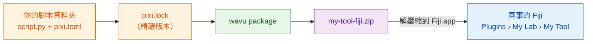

# 分享給實驗室

## 用白話說

你的食譜能用了。現在你希望同事也能用它，**不必**自己挑資料夾，也不用懂 Python。Wavu 可以把你的腳本資料夾打包成**一個 zip 檔**，就像一個食譜盒：裡面有食譜、精確的廚具清單，還有一個選單項目。同事把它解壓縮到 Fiji 裡、重新啟動，就能在 **Plugins** 選單裡用你取的名字找到你的工具。

**對實驗室來說，這個 zip 就夠了。** 不需要 GitHub、不需要網站、不需要帳號。用 email 寄出去，或放到共用磁碟上，就完成了。



## `pixi.lock` 是什麼？

`pixi.toml` 是廚具清單（「要一些 scikit-image」）。`pixi.lock` 是**收據**：記下實際買到的每個套件的精確版本。把收據一起附上，同事拿到的套件就和你的*完全*一樣，工具在他們的電腦上也會有同樣的表現。pixi 在建立環境時會自動寫好它，所以只要你從 Fiji 執行過一次，它就已經在你的資料夾裡了。

## 步驟 1：做出 zip 檔

這一步要用終端機（請看[如何在終端機裡使用 pixi](../write/test-without-fiji.md#run-the-tests)）。在 VS Code 裡，於你的腳本資料夾開啟 **Terminal › New Terminal**，然後執行：

```sh
pixi install
pixi run wavu package . --name my-tool --menu "My Lab>My Tool"
```

- `--name` 是簡短的內部名稱：只能用英文字母、數字、`_` 和 `-`。
- `--menu` 決定工具出現在 **Plugins** 底下的位置。`>` 用來分隔子選單，所以 `"My Lab>My Tool"` 會變成 **Plugins › My Lab › My Tool**。

你應該會看到類似這樣的輸出：

```text
Wrote dist/fiji and …/dist/my-tool-fiji.zip
Users unzip it into Fiji.app (needs Wavu); menu: Plugins > My Lab > My Tool
```

你的 zip 檔就是腳本資料夾裡的 `dist/my-tool-fiji.zip`。測試檔、`.pixi`、`.vscode` 和 `.github` 會自動排除。

??? warning "出現 *depends on wavu through a local path*（透過本機路徑依賴 wavu）"
    這表示你的 `pixi.toml` 指向*你自己*磁碟上的一個 Wavu 資料夾，而同事的電腦上沒有。訊息裡會印出應該改用的那一行。把它貼進 `pixi.toml`，再執行一次 `pixi install`。從[範本](../write/get-the-template.md)建立的資料夾沒有這個問題。

## 步驟 2：同事安裝它

同事需要先裝好 Wavu（[只要兩分鐘](install.md)）。接著：

1. 把 `my-tool-fiji.zip` 解壓縮**到 `Fiji.app` 裡**，做法和 Wavu 的 zip 完全一樣（[各系統的做法](install.md#step-2-unzip-it-into-your-fiji-folder)）。
2. 重新啟動 Fiji。
3. 開啟一張影像，選擇 **Plugins › My Lab › My Tool**。

第一次啟動時會依照你的 `pixi.lock` 下載套件（只有一次，Log 視窗會說明），然後對話框就會出現。不需要挑選任何資料夾。

這個工具也會出現在 **Plugins › Wavu › Run Python Script** 裡，顯示為 *installed: my-tool*。

## 更新工具

修改腳本、測試它，再執行一次上面兩個指令，把新的 zip 寄出去。同事把它解壓縮覆蓋舊的，然後重新啟動 Fiji。

## 一句話總結

`wavu package` 把你的腳本資料夾變成一個 zip 檔；任何裝了 Wavu 的人把它解壓縮到 `Fiji.app`，就能在 Plugins 選單裡找到你的工具，完全不需要 GitHub。

[下一步：分享給全世界（進階） :material-arrow-right:](with-the-world.md){ .md-button }
