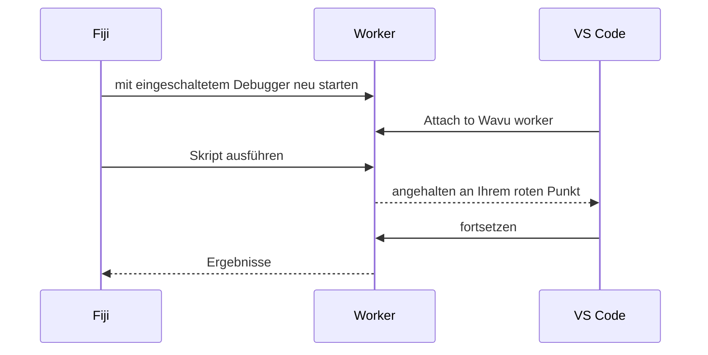
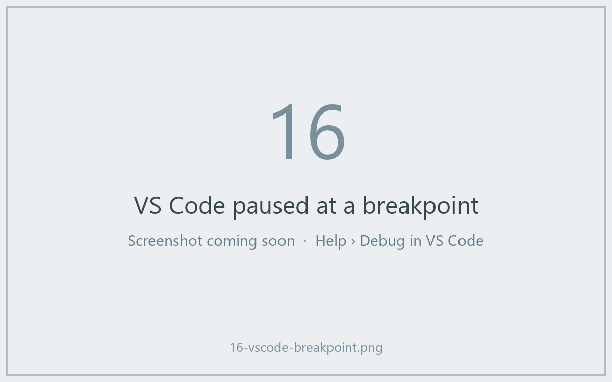

# In VS Code debuggen (für Fortgeschrittene)

!!! abstract "Optional"
    `ctx.log`-Meldungen lösen die meisten Probleme. Nehmen Sie den Debugger,
    wenn Sie *in* ein laufendes Skript hineinschauen möchten.

## Die Idee in einfachen Worten

Normalerweise ist die Küchentür zu: Sie sehen nur den Teller, der
herauskommt. Ein **Debugger** ist ein Fenster in dieser Tür. Sie markieren
eine Zeile in Ihrem Skript mit einem roten Punkt (einem **Haltepunkt**,
englisch Breakpoint); wenn der Koch diese Zeile erreicht, hält alles an, und
VS Code zeigt Ihnen jede Variable in diesem Moment: das Bild, seine Form,
die Labels. Dann gehen Sie Zeile für Zeile weiter.



Die Vorlage enthält bereits die VS-Code-Einstellungen dafür
(`.vscode/launch.json`). Sie brauchen die VS-Code-Erweiterungen **Python**
und **Python Debugger**; VS Code bietet sie an, wenn Sie den Ordner öffnen.

## Der einfache Weg: aus dem Fiji-Dialog { #the-easy-way-from-the-fiji-dialog }

1. Öffnen Sie Ihren Skriptordner in VS Code und klicken Sie in `script.py`
   links neben eine Zeilennummer, um einen **roten Punkt** zu setzen, zum
   Beispiel auf die erste Zeile von `run`.
2. Führen Sie das Skript in Fiji wie gewohnt aus. Setzen Sie im Dialog das
   Häkchen bei
   **Debug in VS Code (restart worker with debugpy on port 5678)** und
   klicken Sie auf **OK**.
3. Im Log steht *Restarting the worker with debugpy. In VS Code: Run and
   Debug > 'Attach to Wavu worker'.*, und die Statusleiste wartet:
   *Wavu: waiting for VS Code to attach on port 5678 (Esc to give up)*.
4. Öffnen Sie in VS Code **Run and Debug** (das Play-Symbol mit einem Käfer,
   links), wählen Sie **Attach to Wavu worker** und klicken Sie auf den
   grünen ▶-Button.
5. Das Skript läuft und hält an Ihrem roten Punkt an.



Während der Pause fahren Sie mit der Maus über eine Variable, um ihren Wert
zu sehen, oder schauen in das Feld **Variables**. Mit der Werkzeugleiste
gehen Sie einen Schritt weiter (++f10++) oder setzen fort (++f5++). Wenn
das Skript fertig ist, öffnen sich die Ergebnisse wie gewohnt in Fiji.

## Der Weg übers Terminal { #the-terminal-way }

Praktisch, wenn Sie oft hintereinander debuggen, weil der Worker dabei
weiterläuft:

1. Im Terminal von VS Code, in Ihrem Skriptordner:

    ```sh
    pixi run debug
    ```

2. Wählen Sie in Fiji **Plugins › Wavu › Connect to Running Worker** und
   klicken Sie auf **OK** (die vorgeschlagene Handshake-Datei ist richtig).
   Fiji bestätigt mit *Connected to the worker serving …*.
3. In VS Code: **Attach to Wavu worker**.
4. In Fiji: **Plugins › Wavu › Run Python Script**, dann den Eintrag
   *running: …* wählen.

Wenn Sie fertig sind, wählen Sie **Plugins › Wavu › Stop Worker**.

!!! tip "Nach Änderungen neu starten"
    Genau wie bei normalen Durchläufen behält der Worker die Version von
    `script.py`, die er geladen hat. Stoppen und starten Sie ihn nach dem
    Bearbeiten neu.

## In einem Satz

Setzen Sie im Dialog das Häkchen bei **Debug in VS Code**, wählen Sie in
VS Code **Attach to Wavu worker**, und Ihr Skript hält an Ihren Haltepunkten
an, damit Sie hineinschauen können.
