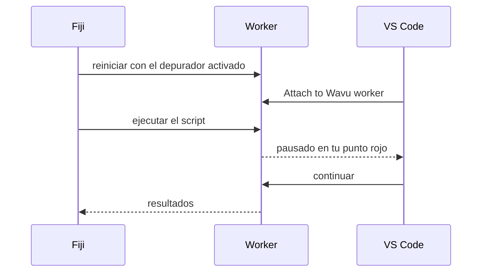
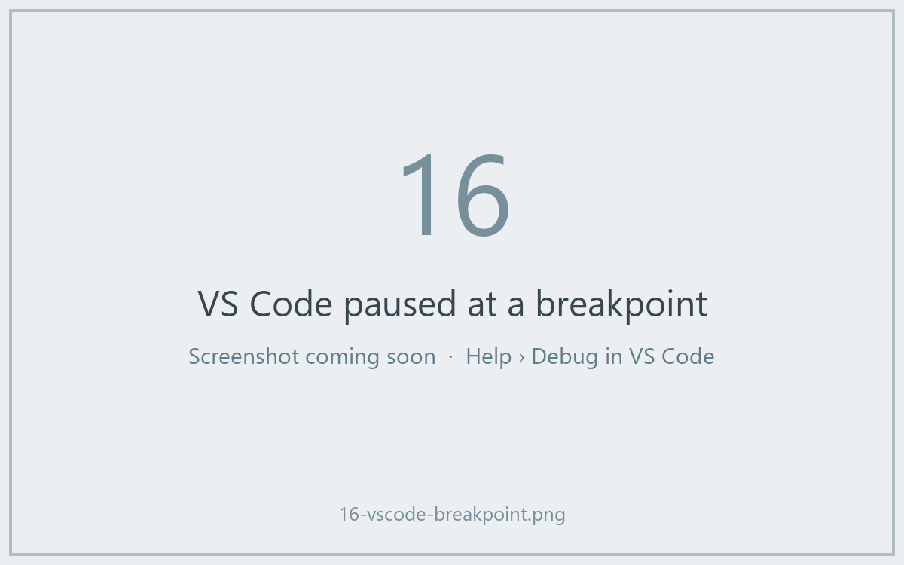

# Depurar en VS Code (avanzado)

!!! abstract "Opcional"
    Los mensajes de `ctx.log` resuelven la mayoría de los problemas. Usa el
    depurador cuando quieras mirar *dentro* de un script en marcha.

## La idea en palabras sencillas

Normalmente la puerta de la cocina está cerrada: solo ves el plato que sale.
Un **depurador** es una ventanita en esa puerta. Marcas una línea de tu
script con un punto rojo (un **punto de interrupción**, o breakpoint); cuando
el cocinero llega a esa línea, todo se pausa y VS Code te muestra cada
variable en ese momento: la imagen, su forma, las etiquetas. Luego avanzas
línea a línea.



La plantilla ya contiene la configuración de VS Code para esto
(`.vscode/launch.json`). Necesitas las extensiones **Python** y **Python
Debugger** de VS Code; VS Code te las ofrece al abrir la carpeta.

## La forma fácil: desde el diálogo de Fiji

1. Abre tu carpeta de script en VS Code y haz clic a la izquierda de un
   número de línea en `script.py` para poner un **punto rojo**, por ejemplo
   en la primera línea de `run`.
2. En Fiji, ejecuta el script como siempre. En su diálogo, marca
   **Debug in VS Code (restart worker with debugpy on port 5678)** y pulsa
   **OK**.
3. El Log dice *Restarting the worker with debugpy. In VS Code: Run and
   Debug > 'Attach to Wavu worker'.*, y la barra de estado espera:
   *Wavu: waiting for VS Code to attach on port 5678 (Esc to give up)*.
4. En VS Code, abre **Run and Debug** (el icono de reproducir con un bicho, a
   la izquierda), elige **Attach to Wavu worker** y pulsa el botón verde ▶.
5. El script se ejecuta y se detiene en tu punto rojo.



Mientras está en pausa, pasa el ratón por encima de una variable para ver su
valor, o mira el panel **Variables**. Usa la barra de herramientas para
avanzar paso a paso (++f10++) o continuar (++f5++). Cuando termina, los
resultados se abren en Fiji como siempre.

## La forma con terminal

Útil cuando depuras muchas veces seguidas, porque el worker sigue en marcha:

1. En la terminal de VS Code, en tu carpeta de script:

    ```sh
    pixi run debug
    ```

2. En Fiji, elige **Plugins › Wavu › Connect to Running Worker** y pulsa
   **OK** (el archivo de conexión que viene por defecto es el correcto).
   Fiji confirma *Connected to the worker serving …*.
3. En VS Code, **Attach to Wavu worker**.
4. En Fiji, **Plugins › Wavu › Run Python Script** y elige la entrada
   *running: …*.

Cuando termines, elige **Plugins › Wavu › Stop Worker**.

!!! tip "Acuérdate de reiniciar después de editar"
    Igual que en las ejecuciones normales, el worker conserva la versión de
    `script.py` que cargó. Después de editar, detenlo y vuelve a arrancarlo.

## En una frase

Marca **Debug in VS Code** en el diálogo, elige **Attach to Wavu worker** en
VS Code, y tu script se pausa en tus puntos de interrupción para que puedas
mirar dentro.
