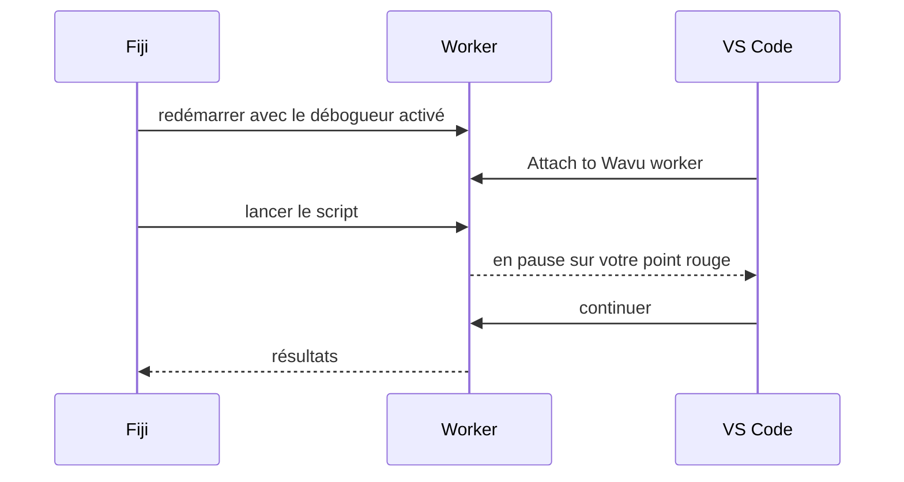

# Déboguer dans VS Code (avancé)

!!! abstract "Facultatif"
    Les messages `ctx.log` règlent la plupart des problèmes. Utilisez le
    débogueur quand vous voulez regarder *à l'intérieur* d'un script en
    cours d'exécution.

## L'idée en mots simples

D'habitude, la porte de la cuisine est fermée : vous ne voyez que l'assiette
qui en sort. Un **débogueur** est une fenêtre dans cette porte. Vous marquez
une ligne de votre script avec un point rouge (un **point d'arrêt**, ou
breakpoint) ; quand le cuisinier arrive à cette ligne, tout se met en pause
et VS Code vous montre chaque variable à cet instant : l'image, sa forme,
les labels. Ensuite, vous avancez une ligne à la fois.



Le modèle contient déjà les réglages VS Code pour cela
(`.vscode/launch.json`). Il vous faut les extensions **Python** et
**Python Debugger** de VS Code ; VS Code les propose quand vous ouvrez le
dossier.

## La méthode simple : depuis la boîte de dialogue de Fiji { #the-easy-way-from-the-fiji-dialog }

1. Ouvrez votre dossier de script dans VS Code et cliquez à gauche d'un
   numéro de ligne dans `script.py` pour poser un **point rouge**, par
   exemple sur la première ligne de `run`.
2. Dans Fiji, lancez le script comme d'habitude. Dans sa boîte de dialogue,
   cochez **Debug in VS Code (restart worker with debugpy on port 5678)** et
   cliquez sur **OK**.
3. Le Log affiche *Restarting the worker with debugpy. In VS Code: Run and
   Debug > 'Attach to Wavu worker'.*, et la barre d'état attend :
   *Wavu: waiting for VS Code to attach on port 5678 (Esc to give up)*.
4. Dans VS Code, ouvrez **Run and Debug** (l'icône lecture avec un insecte,
   à gauche), choisissez **Attach to Wavu worker** et cliquez sur le bouton
   vert ▶.
5. Le script s'exécute et s'arrête sur votre point rouge.

Pendant la pause, survolez une variable pour voir sa valeur, ou regardez le
panneau **Variables**. Utilisez la barre d'outils pour passer à la ligne
suivante (++f10++) ou continuer (++f5++). Quand c'est fini, les résultats
s'ouvrent dans Fiji comme d'habitude.

## La méthode terminal { #the-terminal-way }

Pratique quand vous déboguez plusieurs fois de suite, car le worker reste
lancé :

1. Dans le terminal de VS Code, dans votre dossier de script :

    ```sh
    pixi run debug
    ```

2. Dans Fiji, choisissez **Plugins › Wavu › Connect to Running Worker** et
   cliquez sur **OK** (le fichier de liaison proposé par défaut est le bon).
   Fiji confirme *Connected to the worker serving …*.
3. Dans VS Code, **Attach to Wavu worker**.
4. Dans Fiji, **Plugins › Wavu › Run Python Script**, puis choisissez
   l'entrée *running: …*.

Quand vous avez fini, choisissez **Plugins › Wavu › Stop Worker**.

!!! tip "Pensez à redémarrer après vos modifications"
    Comme pour les exécutions normales, le worker garde la version de
    `script.py` qu'il a chargée. Après une modification, arrêtez-le et
    relancez-le.

## En une phrase

Cochez **Debug in VS Code** dans la boîte de dialogue, choisissez
**Attach to Wavu worker** dans VS Code, et votre script se met en pause à
vos points d'arrêt pour que vous puissiez regarder à l'intérieur.
