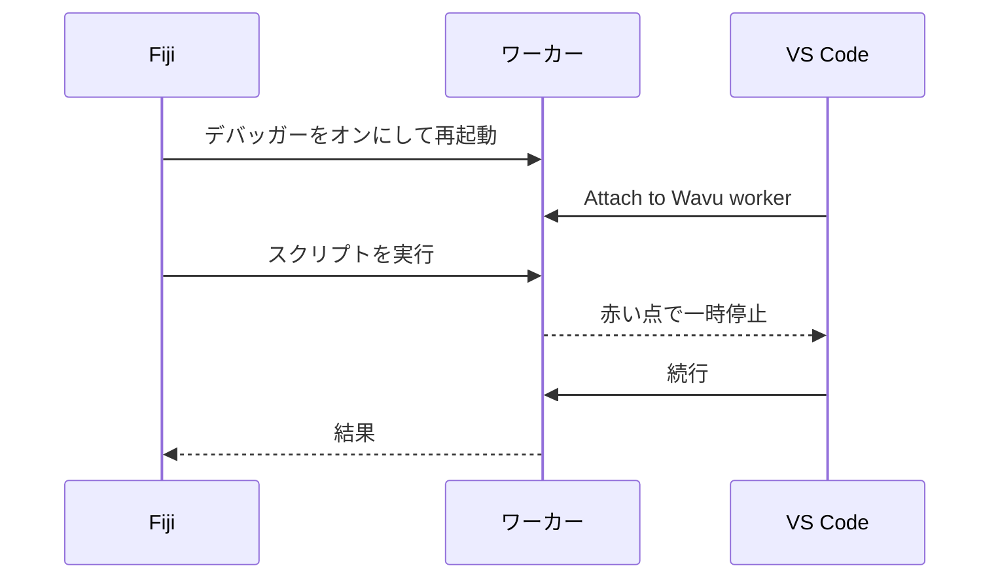
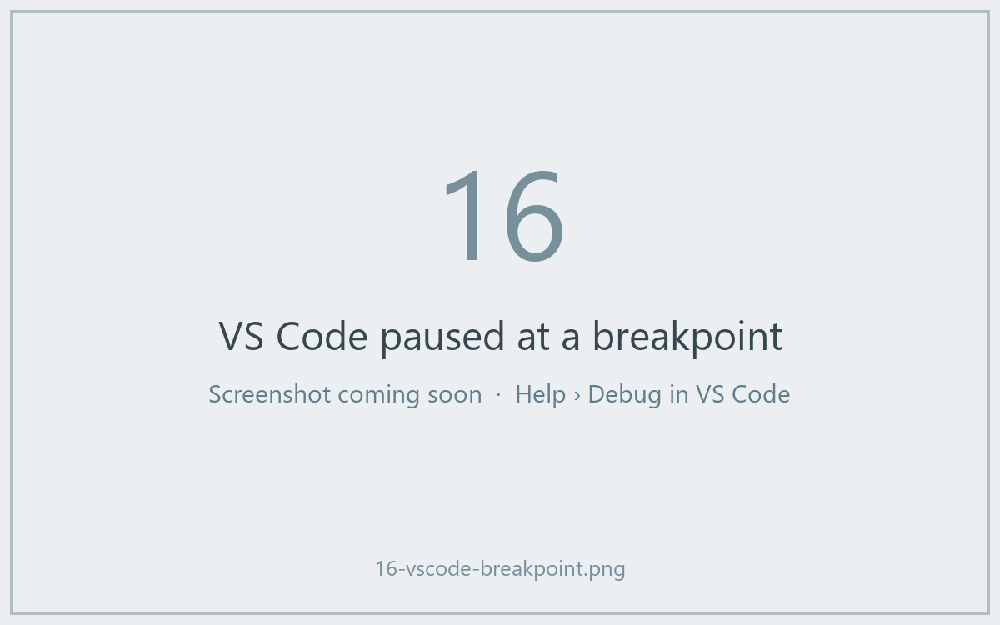

# VS Code でデバッグする（上級）

!!! abstract "任意"
    ほとんどの問題は `ctx.log` のメッセージで解決します。動いている
    スクリプトの *中* をのぞきたいときに、デバッガーを使ってください。

## やさしく言うと

ふだん厨房のドアは閉まっていて、見えるのは出てくる料理だけです。
**デバッガー** は、そのドアに付けた窓です。スクリプトの 1 行に赤い点
（**ブレークポイント**）で印を付けておくと、料理人がその行に来たところで
すべてが一時停止し、VS Code がその瞬間のすべての変数を見せてくれます。
画像、その形、ラベル。そこから 1 行ずつ進めます。



テンプレートには、このための VS Code の設定（`.vscode/launch.json`）が
すでに入っています。VS Code の **Python** 拡張機能と **Python Debugger**
拡張機能が必要です。フォルダーを開くと VS Code が勧めてきます。

## 簡単な方法：Fiji のダイアログから

1. VS Code でスクリプトフォルダーを開き、`script.py` の行番号の左を
   クリックして **赤い点** を置きます。たとえば `run` の最初の行です。
2. Fiji でいつもどおりスクリプトを実行します。ダイアログで
   **Debug in VS Code (restart worker with debugpy on port 5678)** に
   チェックを入れ、**OK** を押します。
3. Log に *Restarting the worker with debugpy. In VS Code: Run and
   Debug > 'Attach to Wavu worker'.* と表示され、ステータスバーが
   *Wavu: waiting for VS Code to attach on port 5678 (Esc to give up)*
   と待ち状態になります。
4. VS Code で **Run and Debug**（左側の、虫の付いた再生アイコン）を開き、
   **Attach to Wavu worker** を選んで緑の ▶ ボタンを押します。
5. スクリプトが動き、赤い点で止まります。



一時停止中は、変数にマウスを乗せると値が見えます。**Variables** パネルでも
見られます。ツールバーを使って、ステップオーバー（++f10++）や続行（++f5++）
ができます。終わると、結果はいつもどおり Fiji で開きます。

## ターミナルを使う方法

ワーカーが動き続けるので、何度も続けてデバッグするときに便利です。

1. VS Code のターミナルで、スクリプトフォルダーにいる状態で：

    ```sh
    pixi run debug
    ```

2. Fiji で **Plugins › Wavu › Connect to Running Worker** を選び、**OK** を
   押します（既定のハンドシェイクファイルで正しいです）。Fiji が
   *Connected to the worker serving …* と確認してくれます。
3. VS Code で **Attach to Wavu worker** を選びます。
4. Fiji で **Plugins › Wavu › Run Python Script** を選び、
   *running: …* の項目を選びます。

終わったら **Plugins › Wavu › Stop Worker** を選びます。

!!! tip "編集したら再起動を忘れずに"
    ふだんの実行と同じく、ワーカーは読み込んだときの `script.py` を
    使い続けます。編集したら、一度止めてからもう一度起動してください。

## ひとことで言うと

ダイアログで **Debug in VS Code** にチェックを入れ、VS Code で
**Attach to Wavu worker** を選べば、スクリプトはブレークポイントで止まり、
中をのぞけます。
