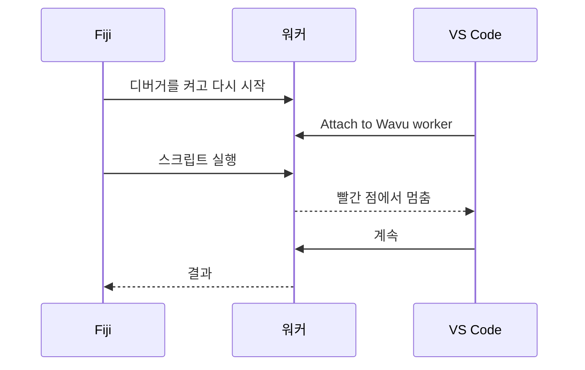

# VS Code에서 디버그하기(고급)

!!! abstract "선택 사항"
    대부분의 문제는 `ctx.log` 메시지로 해결돼요. 실행 중인 스크립트 *안을*
    들여다보고 싶을 때 디버거를 쓰세요.

## 쉬운 말로 설명하면

평소에는 주방 문이 닫혀 있어서 나오는 접시만 보여요. **디버거**는 그 문에
난 창문이에요. 스크립트의 한 줄에 빨간 점(**중단점**, breakpoint)을 찍어
두면, 요리사가 그 줄에 닿았을 때 모든 것이 멈추고 VS Code가 그 순간의 모든
변수를 보여 줘요. 이미지, 그 모양, 라벨까지요. 그다음 한 줄씩 나아가면 돼요.



템플릿에는 이미 이를 위한 VS Code 설정(`.vscode/launch.json`)이 들어 있어요.
VS Code의 **Python**과 **Python Debugger** 확장이 필요한데, 폴더를 열면
VS Code가 추천해 줘요.

## 쉬운 방법: Fiji 대화상자에서

1. VS Code에서 스크립트 폴더를 열고, `script.py`의 줄 번호 왼쪽을 클릭해
   **빨간 점**을 찍으세요. 예를 들면 `run`의 첫 줄에요.
2. Fiji에서 평소처럼 스크립트를 실행하세요. 대화상자에서
   **Debug in VS Code (restart worker with debugpy on port 5678)**를 체크하고
   **OK**를 누르세요.
3. Log에 *Restarting the worker with debugpy. In VS Code: Run and
   Debug > 'Attach to Wavu worker'.*라고 나오고, 상태 표시줄은
   *Wavu: waiting for VS Code to attach on port 5678 (Esc to give up)*에서
   기다려요.
4. VS Code에서 **Run and Debug**(왼쪽의 벌레가 달린 재생 아이콘)를 열고,
   **Attach to Wavu worker**를 고른 뒤 초록색 ▶ 버튼을 누르세요.
5. 스크립트가 돌다가 빨간 점에서 멈춰요.

멈춘 동안 변수 위에 마우스를 올리면 값이 보이고, **Variables** 패널에서도 볼
수 있어요. 도구 모음으로 한 줄씩 넘어가거나(++f10++) 계속할 수 있어요(++f5++).
끝나면 평소처럼 결과가 Fiji에서 열려요.

## 터미널 방법

워커가 계속 켜져 있어서, 여러 번 연달아 디버그할 때 편해요.

1. VS Code의 터미널에서, 스크립트 폴더에서:

    ```sh
    pixi run debug
    ```

2. Fiji에서 **Plugins › Wavu › Connect to Running Worker**를 고르고
   **OK**를 누르세요(기본 핸드셰이크 파일이 맞아요). Fiji가
   *Connected to the worker serving …*라고 확인해 줘요.
3. VS Code에서 **Attach to Wavu worker**.
4. Fiji에서 **Plugins › Wavu › Run Python Script**를 고르고
   *running: …* 항목을 선택하세요.

다 끝나면 **Plugins › Wavu › Stop Worker**를 고르세요.

!!! tip "고친 뒤에는 다시 시작하세요"
    평소 실행과 마찬가지로, 워커는 불러온 버전의 `script.py`를 계속 써요.
    고친 뒤에는 멈췄다가 다시 시작하세요.

## 한 문장으로

대화상자에서 **Debug in VS Code**를 체크하고 VS Code에서
**Attach to Wavu worker**를 고르면, 스크립트가 중단점에서 멈춰서 안을
들여다볼 수 있어요.
